# Cluster Mesh を使うクラスタ入れ替え・同一 VIP 引継ぎ設計

作成日：2026-09-24。試験順序・アプリ設計更新：2026-09-25。状態：**k04 基盤と 3 クラスタ Mesh は導入済み。VIP／Egress の限定往復試験を実施。恒久切替・Stateful／DR は未実施**。

[試験アプリケーションの詳細設計](clustermesh-upgrade-test-applications.md)に、既存ひな形の実装状況、
echo／比較用アプリ、別・同一 Egress IP、Stateful の逆同期、外部 mock と測定方法をまとめた。
[初回リハーサル結果](../results/multisite/2026-09-25/upgrade-rehearsal.md)と
[手動の実施・復元手順](../tests/upgrade-rehearsal-runbook.md)を追加した。機能の往復成功と時間目標の未達を分けて扱う。

重点確認：[BGP 方式比較](#bgp-choice)、[集約と exact route](#prefix-choice)、
[ASN 比較](#asn-choice)、[常設 AZ 冗長との比較](#asn-az-comparison)、[事前検証・切替・復帰](#ingress-switch)、
[ステップ別構成図](#migration-step-diagrams)、[Egress の両パターン](#egress-choice)、
[Ingress／Egress 統合手順](#egress-upgrade-steps)、[アプリ例](#egress-app-examples)、
[k02／k04 の交互再利用](#slot-reuse)、[アップグレード前の試験順序](#upgrade-prerequisites)、[現時点の開始条件](#upgrade-current-gates)。

機器別の追加設定候補：[k04 向け Nexus Config](../../../nxos_multisite/configs/changes/cilium-k04-upgrade/README.md)。
Leaf／BGR の標準差分と、任意の BGW 制限案を分離して作成済みである。
標準案では既存 DCI 伝播を維持し、BGW は変更しない。
Leaf／BGR の接続基盤は [k04 追加](../results/multisite/2026-09-25/k04-addition.md)と
[Cilium／Mesh 導入](../results/multisite/2026-09-25/k04-clustermesh.md)で適用・保存済み。
アプリ引継ぎ・Egress 移管用の差分は、基盤の適用実績と分けて扱う。

## 1. 決定事項と推奨案

ADC に `adc-k04` を新規追加し、旧 Production の `adc-k02`、DR の `bdc-k03` と接続する。
k01 の既存 MetalLB 環境を今回の設計で撤去・変更する前提にはしない。
利用者向け application VIP は k02 から k04 へ引き継ぎ、アプリ単位で切替・復帰する。
成功後は k04 が Production となる。次回は k02 を新バージョンで新規構築し、k04 から k02 へ移行する。
k02／k04 は固定の収容枠として Name・Cluster ID・CIDR・固定 IP を再利用する。世代間の再利用条件は 11 節に定める。
アプリ移行の優先度に `planned-shut` は使用せず、意味を明示した独自 community を使用する。

初回試験の推奨は次の組合せである。

| 対象 | 推奨 | 理由 |
|---|---|---|
| Cluster Mesh | 移行中は 3 クラスタの full mesh | 旧クラスタを経由せず新 Production と DR を検証する |
| Ingress VIP | 引継ぎ対象だけ `/32`／`/128` にする | 同じ集約内の別アプリを動かさず切り替える |
| Cilium の BGP 制御 | Service 単位の独自 community → BGR の Local Preference | 保守用の意味と分け、候補・現用・切替先を明示する |
| BGP ASN | k02／k04 とも `65012` を推奨案、別 ASN 案も比較 | 固定枠の反復運用を共通化し、優先度は ASN と分離する |
| 切替順序 | E-A は現用 `200`／候補 `100` → 新 `300`。E-B は旧入口停止・E 移管後に新 `300` | E-B は旧の外向き通信が失われるため、旧 P を自動復帰先に残さない |
| 事前検証 | k04 の NodePort を試験端末から利用 | 別 VIP・PBR・常設プロキシを必須にしない |
| Egress：送信元変更を許容 | 旧・新で別 IP を使い、外部許可リストを先行更新 | NAT の戻り先を明確に分離できる |
| Egress：同じ送信元が必須 | 同じ E を旧 Gateway から新 Gateway へ単独移管 | 旧の送信・所有権を解除してから新を有効化し、IP を維持する |

Egress Gateway と Cluster Mesh の同時有効化は Cilium の公式非互換条件に該当する。
クラスタ内 Egress Gateway を使う案は、既存の共存試験を先に実施し、観測結果から実験としての継続可否を判断する。
合格しても公式サポート構成へ昇格させず、通常 profile への統合とは分ける。順序は 10.1 節に定める。
Ingress VIP の引継ぎだけでは Egress IP は引き継がれない。
**別 IP の E-A と同一 IP の E-B を両方用意し、アプリごとに選択する。**
両方式とも 7 節と同じ更新サイクルで検証し、Egress の受入前に Ingress を本切替しない。
同一 IP の E-B は IP 自体を移管する方式に限定し、クラスタ外の共通 NAT は使用しない。
具体的な対応は [8.6 節の統合手順](#egress-upgrade-steps)に定める。

この文書は topology／kind／Cilium／NX-OS config の実装・適用を行うものではない。
例示 YAML、状態変更コマンド、候補アドレスはレビュー用であり、実行済みではない。
実施前に対象・操作を確定し、保存 config と稼働状態の差分を確認する。

## 2. 確認した現状と適用範囲

根拠は [status](../status.md)、[09-13 の保存時点](../results/multisite/2026-09-13/checkpoint.md)、
[k03 導入結果](../results/multisite/2026-09-13/k03-clustermesh-install.md) と保存設定である。
本書作成時はローカルファイルと公式資料を確認し、lab へは接続していない。
稼働状況の最終根拠は 2026-09-13 であり、現在の稼働値とは断定しない。

| 項目 | 保存構成／記録 |
|---|---|
| 実行環境 | clab02、ADC／BDC、CDC 除外。k01 は MetalLB 比較用 |
| Kubernetes／Cilium | `1.35.5`／`1.20.1` |
| k02／k03 | 各 control-plane 1 台、worker 2 台。Mesh API 各 2 replica |
| datapath | dual-stack、Cilium VXLAN、kube-proxy replacement |
| MTU | Node Fabric `9150`、Cilium 基準 `9050`、Pod 経路 `9000` |
| Mesh | 共通 CA、固定 API VIP、`cacheTTL: 10m` |
| BGP | k02 AS `65012` → ADC BGR AS `65010`、k03 AS `65022` → BDC Leaf の local-as `65020` |
| 通常 LB 広告 | Service を IPv4 `/26`、IPv6 `/112` に集約 |
| Mesh API 広告 | 通常 LB 集約に加え、専用 community 付き exact route を DCI へ公開 |
| Egress | multisite の通常 values は `egressGateway.enabled: false` |
| 残試験 | 障害・退避・fallback、サイト間 MTU／性能、全体 connectivity、初期化再現性 |
| 資源 | 保存時点の MemAvailable は約 `11 GiB`。k04 追加可能とは未判定 |

[k02 BGP resource](../../../nxos_multisite/k8s_kind/k02/cilium/resources/20-bgp.yaml) と
[planned-shut resource](../../../nxos_multisite/k8s_kind/k02/cilium/resources/21-bgp-planned-shut.yaml) が現行設定である。
既存の `bgp-maintenance` は Node 単位の保守用で、Mesh API を含む広告に影響する。
アプリ 1 個の移行にはこの Node label を使わず、本書の Service 単位 selector を追加する。

ADC BGR 両系の保存 config には `graceful-shutdown aware` があり、Fabric 向けに `send-community` もある。
この機能は既存の Node／機器保守用として保持し、アプリ移行の優先度には使用しない。
現行の k02 inbound policy は prefix 許可が中心で、独自の移行優先度 community の変換規則はない。
したがって本書の切替には、BGR 両系の受信 policy を先に追加する必要がある。

## 3. 通常時・移行時・移行後の構成

図の Mesh 接続は情報同期・Pod 通信の関係を表す。利用者 VIP の経路選択とは別である。
DR は standby アプリ／データを用意する設計上の役割であり、既存 demo の成功だけで DR 完成とはしない。

### 3.1 通常時

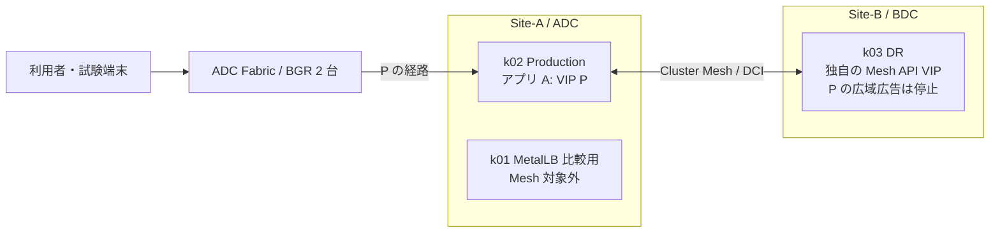

### 3.2 アップグレード時

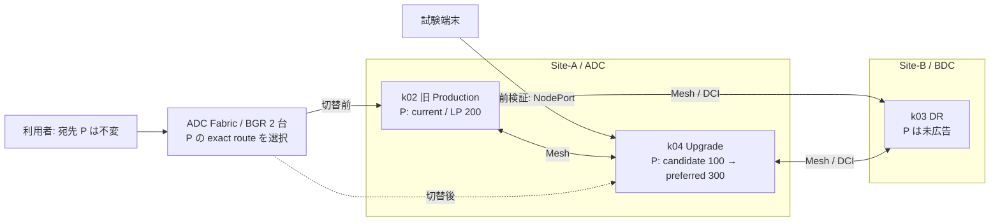

k04 の Mesh API VIP は事前に広告して full mesh を成立させる。
一方、引継ぎ対象の application VIP P は準備完了まで k04 から広告しない。
通信を受けてもよい段階で candidate の低優先広告を開始し、切替時に preferred へ昇格する。
「k04 の BGP を全部止める」という操作にはしない。

### 3.3 移行完了後

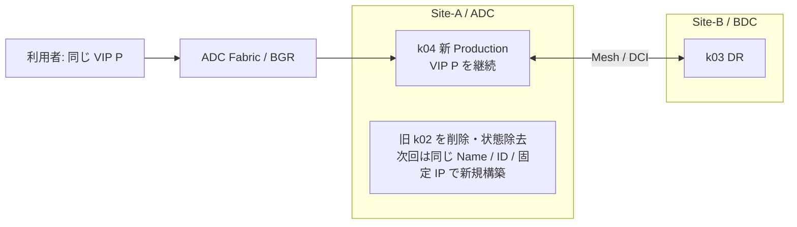

同じ clab02 内での Site-A／Site-B 分離は論理的な障害ドメインであり、ホスト停止への DR ではない。
kind はホスト kernel も共有する。kernel 自体の入れ替えは今回のクラスタ更新と分ける。

## 4. 識別子・アドレス・バージョン

### 4.1 割当案

| 項目 | k02 既存 | k03 既存 | k04 提案・未予約 |
|---|---|---|---|
| Cluster Name／ID | `adc-k02`／`2` | `bdc-k03`／`3` | `adc-k04`／`4` |
| PodCIDR IPv4 | `10.202.0.0/16` | `10.203.0.0/16` | `10.204.0.0/16` |
| PodCIDR IPv6 | `fd00:10:202::/56` | `fd00:10:203::/56` | `fd00:10:204::/56` |
| ServiceCIDR IPv4 | `10.102.0.0/16` | `10.103.0.0/16` | `10.104.0.0/16` |
| ServiceCIDR IPv6 | `fd00:10:102::/112` | `fd00:10:103::/112` | `fd00:10:104::/112` |
| BGP ASN | `65012` | `65022` | `65012` 推奨案、`65014` は比較案 |
| Mesh API IPv4 | `172.16.14.10` | `172.16.15.10` | `172.16.34.10` 候補 |
| Mesh API IPv6 | `fd21:0:0:14:0:0:1:10` | `fd21:0:0:15:0:0:1:10` | `fd21:0:0:34:0:0:1:10` 候補 |

Node IP、VLAN／VNI、Leaf port／port-channel は
[追加 Config の仮割当](../../../nxos_multisite/configs/changes/cilium-k04-upgrade/README.md#2-今回の仮割当)で具体化した。
Node は `172.16.6.0/24`／`fd21:0:0:6::/64`、VLAN は Leaf pair 別の `16`／`106`、L2 VNI は `10106` を候補とする。
control-plane／worker は Leaf `0103／0104` の `Ethernet1/9–10`、worker2 は Leaf `0101／0102` の `Ethernet1/9` に収容する。
保存構成上の競合は確認済みだが、稼働値と資源は未確認である。k01 の IP／port を流用しない。
k04 の BGP neighbor、API SAN、NodePort 対象アドレス、Node IP 初期化、MTU を用意し、既存 DCI での到達性を確認する。
同時に接続する k02 と k04 で PodCIDR や Cluster ID を共有せず、k04 を Production に昇格しても名前を k02 に変更しない。
次世代 k02 は旧世代 k02 を完全に除去した後に限って、k02 枠の Name／ID／CIDR を再利用する。

引継ぎ例のアプリ A は `P4=172.16.14.20`、`P6=fd21:0:0:14:0:0:1:100` とする。
これらは既存 app pool 内の例であり、当該 Service への実割当は未確認である。
P はクラスタ固有の Mesh API VIP と区別する。

同一 P の新旧割当は移行用の管理された例外とする。Cilium LB IPAM はクラスタ間で割当を調停しない。
k04 に k02 の pool 全体をコピーせず、P だけを固定割当する pool／selector と Service annotation を設計する。
k02 内で専用 pool に切り出す場合は既存 pool と重複させず、再割当の影響を事前に確認する。
初回は k02 の既存割当を保持し、再構成範囲を抑える。
同一 VIP を L2 announcement でも二重所有させない。本書は routed VIP の引継ぎである。

### 4.2 version skew

k02／k03 は `Kubernetes 1.35.5 / Cilium 1.20.1` を維持し、k04 は初回から
`Kubernetes 1.36.4 / Cilium 1.20.1` で新規作成する。同一版で作ってから再構築する段階は設けない。
Kubernetes minor 差を含む構築・移行を先に受け入れ、Cilium patch／minor 差は後続で別々に試験する。
k04 の image は topology の `adc-k04` に digest 固定で個別指定し、共通 image は変更しない。
Cilium `1.20.1` は Kubernetes `1.36` を互換表に含む。内蔵 Kind の作成互換性と Leaf 再作成の条件は
[k04 構築手順](../../../nxos_multisite/k8s_kind/k04/cilium/README.md#2-containerlab-追加版の扱い)に記載する。
Mesh 内の Cilium は最大 1 minor 差、datapath と `maxConnectedClusters: 255` は共通とする。
各クラスタの Kubernetes は採用 Cilium の互換範囲に収め、kubectl の skew も別に確認する。
DR が古い Cilium のまま次々回の更新へ進まないよう、DR の更新をサイクルに含める。
独立クラスタの移行は Kubernetes の in-place downgrade を行う手順ではない。

参照：[Mesh 要件](https://docs.cilium.io/en/stable/network/clustermesh/setup/)、
[Kubernetes 互換表](https://docs.cilium.io/en/stable/network/kubernetes/compatibility/)、
[Cilium 更新手順](https://docs.cilium.io/en/stable/operations/upgrade/)、
[Kubernetes skew](https://kubernetes.io/releases/version-skew-policy/)。

<a id="bgp-choice"></a>

## 5. Cilium で操作できる BGP 属性と方式比較

調査対象は導入済み `1.20.1` の公開 CRD と、確認時点で `1.20.2` の stable 公式文書である。
`CiliumBGPAdvertisement.attributes` には `communities` と `localPreference` がある。
MED、AS-path prepend の直接指定フィールドは対象 CRD にない。未公開の GoBGP 内部設定を操作する案は採用しない。
`aggregationLengthIPv4: 32`／`aggregationLengthIPv6: 128` も指定しない。対象 CRD の上限は `31`／`127` であり、
exact route は aggregation フィールドを省略して生成する。

参照：[Cilium 1.20.1 CRD](https://raw.githubusercontent.com/cilium/cilium/v1.20.1/pkg/k8s/apis/cilium.io/client/crds/v2/ciliumbgpadvertisements.yaml)。

| 方法 | Cilium からの操作 | この lab での評価 |
|---|---|---|
| MED | 公開 Advertisement CRD に直接指定なし | 同一 ASN にすると通常の MED 比較条件を揃えやすいが、Cilium の設定欄が増えるわけではない |
| AS-path prepend | 同 CRD に直接指定なし | 受信側・中継ルータでの操作は別案。今回の優先度制御には採用しない |
| `attributes.localPreference` | 指定可能だが eBGP へは広告されない | k02／k04 の ASN を揃えても BGR とは eBGP のため使えない |
| `planned-shut` community | `attributes.communities.wellKnown` から付与可能 | Node／機器保守に限定。アプリの候補クラスタ・昇格の表現には使わない |
| 独自 community → BGR の Local Preference | Cilium が community を変更、BGR が変換 | **今回の推奨**。ASN と切り離して Service 単位に優先度を操作できる |
| 広告停止・開始のみ | Service selector で操作可能 | 別の比較案。停止許容時は単純だが、経路空白があり得る |

公式文書の community 付与機能を使い、移行状態の意味と値は本 lab 独自に定義する。
Cilium が BGR の Local Preference を直接変更するわけではなく、BGR の受信 policy が community を解釈する。
参照：[Cilium BGP attributes](https://docs.cilium.io/en/stable/network/bgp-control-plane/bgp-control-plane-configuration/#bgp-attributes)。

### 5.1 独自 community と移行状態

| Service の `handover-state` | community | BGR の Local Preference | 意味 |
|---|---|---:|---|
| `off` | 広告なし | 対象外 | 準備中・不適格・撤去。P の Service 自体は残せる |
| `candidate` | `65010:100` | 100 | 候補。現用より低優先だが、現用経路消失時には選択され得る |
| `current` | `65010:200` | 200 | この移行サイクルの現用 |
| `preferred` | `65010:300` | 300 | 今回選択した移行先。観察・rollback 期間中の優先経路 |

これらの community は未適用の設計値で、標準予約値ではない。左側の `65010` は管理上の命名であり、
Cilium の local ASN が `65012` でも送信できる。k02／k04 共通で使用する。
メンテナンスと意味が混ざらないよう、移行用の広告例には `planned-shut` を付けない。

| 状態 | 現用側 | 候補側 | 期待する経路 |
|---|---:|---:|---|
| 準備 | current / 200 | off | 現用 |
| 事前広告 | current / 200 | candidate / 100 | 現用 |
| 切替 | current / 200 | preferred / 300 | 候補側 |
| ロールバック | current / 200 | candidate / 100 または off | 旧現用側 |
| 旧を撤去後 | off | preferred / 300 → current / 200 | 新現用側 |

初回の現用は k02、候補は k04。次回は現用が k04、候補が新世代 k02 となり、数値・状態の意味は変えない。
旧側の `200` が全選択点から消えたことを確認するまで、新側 `300` を `200` に戻さない。
同じ IP を受け持つ新旧が同優先度にならない順序とする。
同じクラスタ内の worker 間 ECMP は許容するが、新旧クラスタを跨ぐ ECMP はこの試験では意図しない。

candidate は利用禁止ではない。アプリ・データが未準備なら off を維持する。
旧側を current のまま残す期間も、経路障害時に旧へ自動 fallback し得る。
Stateful の単一 writer など、自動 fallback が許されない場合は旧の広告停止とアプリ側 fencing を組み合わせる。
初回 DR は手動昇格とし、P の常時広域広告を行わない。

### 5.2 BGR の変換 policy と伝播範囲

BGR 両系の k02／k04 neighbor、両 AF に同じ優先度変換を事前設定する。
許可した exact VIP と neighbor を限定し、同じ ASN だからといって他クラスタの infra／Egress prefix まで許可しない。
既存の broad な LB permit より前に移行 VIP 用の規則を配置する。

| 受信条件 | 動作 |
|---|---|
| 許可 P ＋優先度 community がちょうど 1 個 | `100`／`200`／`300` に変換して許可 |
| 許可 P ＋優先度 community が複数・不明・欠落 | 移行用経路として拒否し、状態不整合を報告 |
| 移行対象外の prefix | 既存の infra／LB／Egress 別の許可規則を適用 |
| 許可していない prefix | 拒否 |

同一 Service に複数の Advertisement が一致すると community は合成され得るため、selector を排他的にする。
BGR 側も複数 rank を黙ってどれかへ変換しない。既存の prefix 制限を失う catch-all permit を作らない。
追加 Config 案では `match community ... exact-match` を採用し、移行 P の standard community を優先度用 1 個に限定する。
別用途の standard community を追加した場合も拒否するため、Cilium 側の広告をこの条件に揃える。
unknown rank の拒否が後続の既存 permit で覆らないよう、route-map の照合順序を実装時に検証する。
Node 保守とアプリ移行は同時に操作せず、将来併用する場合は既存 graceful-shutdown aware との優先関係を別途試験する。

Local Preference は通常の eBGP 越しに伝播する属性ではない。
ADC BGR は両方のクラスタを直接受信して比較するため、両系で同じ選択に収束させる。
途中の各 AS で候補を比較する拡張設計では、community の保持と再変換が必要になる。
ADC BGR の RIB だけで合格にせず、Fabric の EVPN Type-5、各入口の FIB、実通信まで照合する。
参照：[NX-OS BGP best path](https://www.cisco.com/c/en/us/td/docs/dcn/nx-os/nexus9000/106x/configuration/unicast-routing-configuration/cisco-nexus-9000-series-nx-os-unicast-routing-configuration-guide/configuring-bgp.html)。

<a id="asn-choice"></a>

### 5.3 k02／k04 を同一 ASN にする案と別 ASN 案

**今回の構成では k02／k04 をともに AS `65012` とする案を推奨する。**
これは未適用の選定案である。k04 の topology／BGP resource は 2026-09-25 に [構築準備ファイル](../../../nxos_multisite/k8s_kind/k04/cilium/README.md)として作成した。
BGR は `65010` のままで、k02–BGR と k04–BGR は引き続き eBGP である。
k02–k04 間に iBGP session を張る必要はなく、Cluster ID は `2`／`4` と別々に維持する。

| 観点 | 同一 ASN：k02／k04 とも 65012 | 別 ASN：65012／65014 |
|---|---|---|
| 基本成立 | 両クラスタが別 peer IP で BGR へ広告できる | 同じく成立する |
| 設定の反復 | 両枠で local ASN／peer の remote-as を共通化 | 枠ごとに固定すれば反復可能。更新世代ごとに変更する必要はない |
| 新旧の優先度 | ASN だけでは区別できない。独自 community を使用 | ASN が違うだけでは優先度にならない。同じ community 設計を使用 |
| 経路の識別 | neighbor IP、next-hop、枠別 prefix／用途 community で区別 | AS_PATH からもクラスタ枠を識別しやすい |
| ECMP | 他属性も等しいと新旧が等コスト候補になりやすい | 設定次第で候補になる。別 ASN を誤分散防止策とはしない |
| MED | 通常の比較対象を揃えやすい。ただし Cilium に直接指定欄なし | 通常は異なる隣接 AS 間の MED 比較に追加設定が必要 |
| 受信側 policy | peer IP／prefix と rank で制限 | ASN も判定材料にできるが prefix 制限は引き続き必要 |
| 将来 BGP で他クラスタ経路を受信する場合 | 自 AS を含む経路の loop 検出を再設計する必要がある | その観点では分離しやすい |

同一 ASN は「独自 community の代わり」ではない。ASN は BGP の隣接・AS_PATH の設計、community は運用上の優先度であり、
独立した選択である。別 ASN を採用しても本書の切替手順は変わらない。
ASN による経路識別やクラスタごとの経路制御境界を優先する場合は、比較案の `65014` を選べる。

現行の Cilium BGP Control Plane は広告用で、受信した BGP 経路を Node の転送表へ投入する機能ではない。
Mesh の Node 到達性は Fabric と Node の既存経路で確保する。
この前提では、同一 ASN を理由に直ちに `as-override`／`allowas-in` を追加する必要はない。
将来 Node 上の別 BGP daemon で他クラスタ経路を受信・転送する場合は、自 AS を含む経路の拒否、
AS override、受信 filter をその実装に合わせて再評価する。loop 防止を一括で無効化しない。
参照：[Cilium BGP の責務](https://docs.cilium.io/en/stable/network/bgp-control-plane/bgp-control-plane/)、
[NX-OS AS override](https://www.cisco.com/c/en/us/td/docs/dcn/nx-os/nexus9000/106x/configuration/unicast-routing-configuration/cisco-nexus-9000-series-nx-os-unicast-routing-configuration-guide/configuring-bgp.html)。

同一 ASN でも Node IP と Router ID は別々にする。BGR の neighbor を枠別に管理し、k04 に必要な prefix のみ許可する。
Mesh API の用途識別は既存 k02 の `65012:510` を維持し、k04 は例えば `65012:514` を候補にできる。
これは別途未予約の lab 値であり、rank の `65010:100/200/300` と用途を分ける。
任意に DCI の prefix／community filter を導入する場合は、ASN とは別に k04 の許可条件を追加する。
既存の prefix 制限を追加しない標準案では、そのための BGW 変更は行わない。

<a id="asn-az-comparison"></a>

### 5.4 一時アップグレードと常設 AZ 冗長の ASN／BGP 比較

2026-09-25 の追加レビュー。以下は保存設計・試験結果と公式文書による比較であり、追加の実機試験結果ではない。
**確認した公式 Cluster Mesh 要件に「クラスタごとに別 ASN が必須／推奨」という指定はない。**
固有の Cluster Name／ID、PodCIDR 非重複、共通 datapath mode、Node InternalIP 相互到達性等と、BGP の ASN は別の設定である。
ASN の選定は Fabric の経路設計と運用単位に基づく、本 lab の推奨として扱う。
参照：[Cluster Mesh 要件](https://docs.cilium.io/en/stable/network/clustermesh/setup/#prerequisites)。

現在の k02／k03 は VXLAN tunnel mode であり、Node の到達性は既存 Fabric／Node 経路で確保する。
Cilium BGP Control Plane は広告を担当し、学習した BGP 経路を Node の転送表へ投入する機能ではない。
同じ ASN のクラスタを並べても、それだけで Mesh の相互通信が拒否されるわけではない。
Cluster Mesh の full mesh と BGP の iBGP full mesh は異なる仕組みであり、k02–k04 間に BGP session を追加しない。
参照：[Cluster Mesh の構成](https://docs.cilium.io/en/stable/network/clustermesh/intro/)、
[Cilium BGP の責務](https://docs.cilium.io/en/stable/network/bgp-control-plane/bgp-control-plane/)。

| 比較項目 | 一時アップグレード：同一 ASN | 一時アップグレード：別 ASN | 常設 AZ 冗長：同一 ASN | 常設 AZ 冗長：別 ASN |
|---|---|---|---|---|
| 割当例 | k02／k04 とも `65012` | k02 `65012`、k04 `65014` | k02／k04 とも `65012` | k02 `65012`、k04 `65014` |
| 現時点の推奨 | **今回の初回比較の基準** | 常設化を見込む場合の候補 | 単一の経路運用単位なら可能 | **常設クラスタごとの運用を重視する場合の候補** |
| 同時利用期間 | 移行・rollback の間 | 同左 | 常時 | 常時 |
| 識別・受信制限 | neighbor IP／prefix／community | 左記に加えて AS_PATH | neighbor 台帳をクラスタ別に維持 | 受信点でクラスタの識別が容易 |
| 同一 VIP の主従 | community → Local Preference | 同左 | 同左。常設用の運用状態を定義 | 同左。ASN の大小で主従は決まらない |
| 同一 VIP の同時利用 | 初回は行わない | 初回は行わない | ECMP 条件とアプリ要件の追加受入が必要 | 左記に加え異なる AS_PATH の multipath 条件を確認 |
| 自 AS を含む経路の再受信 | 将来、別 BGP daemon で受信経路を転送へ使うなら再設計 | この種の制約を避けやすい | 複数拠点で受信経路を使う拡張時に注意 | クラスタ間の経路境界を表しやすい |
| 次回更新 | 空いた k02／k04 枠を再構築 | 枠の ASN を固定して同じ反復が可能 | 冗長数を保った更新には追加枠が必要 | 同左 |

別 ASN は可用性・セキュリティの境界そのものではなく、経路識別と policy 管理の補助手段である。
同一 ASN でも neighbor ごとの prefix filter は必須。別 ASN でも同じ VRF／RT で広く経路を共有すれば、経路は相互に伝わる。
AS_PATH は集約・再広告・AS override により変わり得るため、クラスタの識別を全経路区間で AS_PATH だけに依存させない。

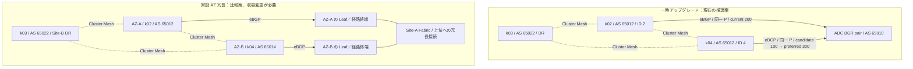

下図部分の AZ は「独立した障害・保守単位」という設計上の意味である。
現行の k04 追加 Config は k02 と同じ Leaf pair 群・BGR pair を使い、worker も複数 Leaf pair に跨る。
そのままではクラスタごとに Leaf 障害を分離できない。独立 AZ 案は Node／control-plane、Leaf、経路終端、
storage、電源・物理 host 等の共有箇所を棚卸し、必要な障害範囲に合わせて再配置する。
単一 containerlab host では論理的な障害注入はできるが、host／電源障害に対する物理冗長の実証にはならない。

#### 5.4.1 BGP とアプリの冗長方式

| 方式 | BGP／VIP | 適する条件・追加の確認 |
|---|---|---|
| 一時移行の active／standby | 同じ exact VIP、旧 LP `200`／新 `100`、切替時に新 `300` | 初回の推奨。candidate は旧経路消失時に選択され得るので、未準備なら `off` を維持する |
| 常設 AZ の active／standby | 同じ exact VIP、現用・待機の順位を明示 | 同一 VIP 方針のまま拡張しやすい。現用復帰時に自動切戻しするか、運用で制御するかを決める |
| 常設 AZ の active／active | 同じ exact VIP、同順位、実転送で ECMP を確認 | 両クラスタが同時処理できるアプリ向け。複数 flow の分散であり、試験端末の選別や厳密な重み付けではない |
| 常設 AZ の個別入口 | クラスタ別 VIP、上位 LB／DNS 等で選択 | 比較案。ヘルス判定や段階移行を上位へ集約できるが、追加要素が必要。今回の同一 VIP 案の置換は行わない |

NX-OS は ECMP に AS_PATH 等の条件を持つ。異なる AS_PATH の load sharing には
`bestpath as-path multipath-relax` 等の適用範囲と他の等コスト条件を確認する。
保存された ADC BGR 設定には `maximum-paths 16` があるが、それだけで異なる ASN 間の ECMP や実 FIB の複数経路を証明しない。
`TI-002` が残るため、両 AF の実パケット、複数 flow、片経路撤去を受入条件にする。
参照：[NX-OS 10.6(x) BGP／multipath](https://www.cisco.com/c/en/us/td/docs/dcn/nx-os/nexus9000/106x/configuration/unicast-routing-configuration/cisco-nexus-9000-series-nx-os-unicast-routing-configuration-guide/configuring-bgp.html)。

経路優先度は引き続き独自 community を経路選択点の受信 policy で Local Preference に変換する。
Cilium と Fabric が eBGP の場合、Cilium の `localPreference` をそのまま相手へ渡す方式にはしない。
AZ ごとに経路終端を分ける案では、双方の経路が比較される場所、EVPN への取り込み、上位までの属性保持を再確認する。
既存の「共通 BGR pair で比較する」Config をそのまま複製して成立したとは扱わない。
同じ長さの `/32`／`/128` を維持し、途中の集約に切替単位を吸収させない。
参照：[Cilium BGP attributes](https://docs.cilium.io/en/stable/network/bgp-control-plane/bgp-control-plane-configuration/#bgp-attributes)。

**BGP session の正常性だけではアプリの正常性を判定できない。**
現在の `externalTrafficPolicy: Cluster` は endpoint の有無だけで Service 広告を自動撤回する構成ではない。
`Local` の endpoint 連動と、DB／外部 API を含む業務 readiness は別々に試験する。
Mesh の Global Service に remote backend があると、入口は k04 でも処理先が k02 となる可能性があるため、
入口 cluster・実行 Pod・外部観測 Egress IP を別々に記録する。
参照：[Service の広告条件](https://docs.cilium.io/en/stable/network/bgp-control-plane/bgp-control-plane-configuration/#externaltrafficpolicy-internaltrafficpolicy)。

BGP／ECMP による切替でクラスタ間の conntrack・SNAT state・アプリ session が同期されるわけではない。
長時間接続、再試行、書込みの重複排除、Stateful の単一 writer／fencing と RPO／RTO を別に設計する。
同一 Egress IP の単独移管は計画移行・主従向けで、独立した二つの NAT が同じ E を同時使用する active／active 案にはしない。
常設で両クラスタが同時送信する場合は別 Egress IP を基本比較案とする。外部 NAT 共通化は今回の要件に含めない。
対向クラスタの Cilium Egress Gateway を借りる方式も、今回の実測から採用しない。

#### 5.4.2 DR と次回アップグレードの資源

一時アップグレードは平常時 Site-A 1 クラスタ＋Site-B DR、移行中だけ Site-A 2 クラスタとなる。
常設 AZ 冗長は平常時から Site-A 2 クラスタ＋Site-B DR となる。
Site-A の冗長数を維持しながら同じ新旧並行方式で更新するなら、さらに Site-A の第 3 枠が必要で、
DR を含め最大 4 クラスタになる。追加枠を用意しない場合は、片側を退避・再構築する間の冗長性低下と容量を受け入れる設計になる。
通常／片 AZ 停止／DR 昇格／アップグレード重複時の CPU・RAM・storage を別々に見積もる。

DR は ASN を分けただけでは昇格しない。全常設クラスタと DR の直接 Mesh 接続、データ同期、writer の切替、
Ingress／Egress の許可・広告、旧側への戻し方を確認する。3 クラスタでは full mesh を比較の基準とする。
通常の k04 追加では既存 DCI 伝播を使い、BGW 変更を必須にしない。常設 AZ 案で VRF／RT／filter を変える場合は差分を再評価する。

#### 5.4.3 比較試験の進め方

1. k04 は Kubernetes `1.36.4`、Cilium は既存と同じ `1.20.1`、同一 ASN `65012`、アプリ VIP 広告 `off` を基準とする。Kubernetes の版差は初回から含め、ASN 比較時には各クラスタの版を固定する。
2. `UG-02`／`UG-03` で exact VIP と独自 community の受信・実転送・撤回・rollback を両 AF で確認する。
3. 比較が必要なら k04 を試験トラフィックから退避し、Cilium の local ASN と両 BGR の対応 remote ASN を `65014` へ揃える。
   ASN 変更で session が再確立することを前提に、VIP／rank／アプリ版は固定して同じ試験を行う。
   新たな neighbor の作り替えや AS_PATH 条件は適用前に差分化する。稼働中に片側だけ変更しない。
4. 常設 AZ 案は収容分離・片 AZ の処理容量を整え、まず active／standby を評価する。
   active／active は別 ASN 間 ECMP、endpoint 消失、Mesh 断、AZ 経路断、長時間接続を追加受入する。
5. Kubernetes の版差は初回の k04 構築時から導入し、基盤受入を先に行う。後続の Cilium 更新、ASN 比較、AZ 障害を同じ試行に混ぜない。

<a id="prefix-choice"></a>

## 6. 集約広告とアプリ単位の引継ぎ

**Cilium は集約広告でき、現行 lab は実際に集約を指定している。**
LB IPAM pool の大きさから自動で集約するのではなく、Advertisement の設定によって決まる。

| 条件 | Cilium が生成する Service 経路 |
|---|---|
| aggregation 指定なし | IPv4 `/32`、IPv6 `/128` |
| 現行の `aggregationLengthIPv4: 26`／IPv6 `112` | 対象 VIP を含む `/26`／`/112` |
| `LoadBalancerIP` で `externalTrafficPolicy: Local` | aggregation 指定は無視され、local endpoint に応じた exact route |
| 上流が集約・個別経路抑止を行う | Cilium の送信経路と、利用者側の見える経路が異なる可能性がある |

exact route を生成するために `externalTrafficPolicy` を変更する必要はない。
初回は既存の `Cluster` を維持し、引継ぎ対象の広告だけ aggregation を省略する。
送信元 IP 維持などの理由で `Local` を使う比較は、endpoint 配置・経路撤回の試験を別途行う。
参照：[Cilium Prefix Aggregation](https://docs.cilium.io/en/stable/network/bgp-control-plane/bgp-control-plane-configuration/#prefix-aggregation)。

| k02 の広告 | k04 の広告 | 結果 |
|---|---|---|
| P を含む `/26` のみ | P `/32`、candidate / 100 | `/32` が優先。低優先 community でも k04 が選ばれる |
| P `/32`、current / 200 | P `/32`、candidate / 100 | 同じ prefix 同士として優先度を比較できる |
| 同じ `/26`、current / 200 | 同じ `/26`、candidate / 100 | 集約内の他アプリも同じ単位で切り替わる |

IPv6 の `/112` と `/128` も同じ関係である。
アプリ単位移行では P の exact route を全選択点で残し、`summary-only` や export filter で落とさない。
上流で経路数を減らす場合でも、移行中の P だけは個別経路を例外通過させる。

準備は「k02 に P の exact route を追加 → 受信許可・FIB・疎通を確認 → P を通常集約用 selector から除外」の順とする。
残るアプリや Mesh API が同じ集約を生成することはあり、その集約は消えない。
P の両 exact route を消すと、その短い prefix へ fallback し得るので、広告 off を通信禁止と同一視しない。
k04 から k02 の集約全体を広告しない。既存の aggregate blackhole route は他の範囲の loop 防止用として維持する。

### 6.1 Service 単位の Advertisement 例

以下は新規追加する設計例であり、既存 resource の置換 YAML ではない。
k02 の通常 PeerConfig に選択される `advertise: k02` を使用する。
k04 用は cluster 固有 label を `advertise: k04` にし、両 AF の PeerConfig に選択させる。
通常集約側には `vip-mode NotIn [handover]` を追加し、移行対象に通常広告・保守用広告と移行用 community が重複適用されないようにする。
同一 ASN 案でも枠別 label は維持する。以下の属性は 5.2 節の BGR 変換 policy と組み合わせて初めて優先度になる。

```yaml
apiVersion: cilium.io/v2
kind: CiliumBGPAdvertisement
metadata:
  name: k02-app-handover
  labels:
    advertise: k02
spec:
  advertisements:
    - advertisementType: Service
      service:
        addresses: [LoadBalancerIP]
      selector:
        matchLabels:
          vip-mode: handover
          handover-state: candidate
      attributes:
        communities:
          standard: ["65010:100"]
    - advertisementType: Service
      service:
        addresses: [LoadBalancerIP]
      selector:
        matchLabels:
          vip-mode: handover
          handover-state: current
      attributes:
        communities:
          standard: ["65010:200"]
    - advertisementType: Service
      service:
        addresses: [LoadBalancerIP]
      selector:
        matchLabels:
          vip-mode: handover
          handover-state: preferred
      attributes:
        communities:
          standard: ["65010:300"]
```

対象 Service は `vip-mode: handover` と `handover-state: candidate|current|preferred|off` を持つ。
`off` に一致する広告は定義しない。Service や NodePort 自体は残る。
Service が持つ LoadBalancer VIP はまとめて扱われるため、アプリごとに独立した Service／VIP が必要である。
同じ VIP の異なる port／Host 名だけを BGP で別々のクラスタへ切り替えることはできない。

通常集約用 selector に追加する fragment は以下である。通常／Node 保守用双方に整合させる。

```yaml
selector:
  matchLabels:
    bgp-advertise: "true"
  matchExpressions:
    - key: vip-mode
      operator: NotIn
      values: [handover]
```

集約経路への異なる属性の重複付与は避ける。Mesh API の `dci-export: clustermesh` は移行 Service に付けない。
Node 保守 profile へ切り替えても必要な P が失われない設計は別途必要であり、初回のアプリ移行と Node 保守は重ねない。

<a id="ingress-switch"></a>

## 7. 事前検証と本切替・ロールバック手順

### 7.1 シンプルな事前検証の比較

| 方法 | 追加 VIP | 通常と同じ宛先 IP | 評価 |
|---|---|---|---|
| Mesh 経由の k04 Pod IP、または k04 内の ClusterIP | 不要 | いいえ | 内部依存・Policy の確認用。外部 ingress の検証を代替しない |
| k04 の NodePort に試験端末から接続 | 不要 | いいえ | **初回推奨**。Fabric 経路も確認できる。P の exact route 切替は後続で検証 |
| k04 専用の一時 VIP T | 必要 | いいえ | 通常の LoadBalancer 経路に近い比較用。必要時だけ追加 |
| 試験端末の専用 VRF／経路、または入口 PBR | 不要でも可 | はい | 同じ P へ送る必要がある場合。next-hop・戻り経路・IPv6 の追加設計が必要 |
| 外部プロキシ | 別途設計 | 共通入口では同じ | 送信元・割合制御に有効だが今回の最小案には含めない |

NodePort は LoadBalancer Service の NodePort 割当・Cilium の対象 Node address・到達 ACL を確認して使う。
Mesh 接続だけで remote ClusterIP がそのまま routable になるとは考えない。
HTTPS の事前検証では Host／SNI を保った接続先変更を使う。例：

```bash
# 設計例。NODE_IP と NODE_PORT は実際の k04 の値に置換する。
curl --connect-to app-a.lab.example:443:NODE_IP:NODE_PORT https://app-a.lab.example/
```

試験端末だけに NodePort を許可するなら送信元制限を設け、NAT 後に見える送信元も確認する。
`hosts` や DNS だけでは、同じ宛先 IP P の到達クラスタは変わらない。
PBR は任意の remote Node を next-hop に書くだけで成立すると考えず、入口と中継経路を設計する。
BGP の community／MED／AS-path は試験端末ごとの振分け手段ではない。

### 7.2 開始条件

1. k02／k03 の基本・障害受入と k04 の初期化を確認し、資源不足がない。
2. 全クラスタで Node IP、Mesh 接続、CA／SAN、DNS、dual-stack／MTU、Policy を確認する。
3. P の固定割当、両 AF の exact route 許可、k04 の経路未広告を確認する。
4. 両 BGR の community → Local Preference 変換を先に検証する。欠落・複数 rank の拒否も確認する。
5. P の全候補経路と集約を列挙し、DR を含め別の通常候補がないことを確認する。
6. アプリ A の E-A／E-B を選び、8.5 節の移行票を作る。k04 NodePort から外部 API までの試験と Egress／データの開始条件を満たす。
   E-B は同じ E を使う最終確認を所有権移管後の Step 3b に置き、事前検証の未確認範囲と停止・復帰手順を確定する。
7. 新旧の backend を local cluster に限定する。入口判定用 Service を Global Service として新旧混在させない。
8. 旧へ戻せるデータ・容量・Secret・外部許可リスト・ジョブ所有権を保持する。

### 7.3 切替

以下のコマンドは Service 名を `upgrade-demo/app-a` とした設計例である。
6.1 節の Advertisement／集約除外／IPAM／Fabric 側準備を適用・検証してから使用する。
現行 manifest にこの Service／label を付けるだけでは手順は成立しない。
E-B は新側の Egress を移管前に利用できないため、以下の候補広告 2～3 を省略し、8.3／8.6 節の停止・IP 移管を経て 4 へ進む。

1. k02 は `current`／200、k04 は `off` で P の通信を記録する。新規接続と既存接続を別々に観測する。
2. k04 が障害時の受信先になってもよい状態に到達したら、アプリ A だけを `candidate` にする。

   ```bash
   kubectl --context kind-adc-k04 -n upgrade-demo label service app-a handover-state=candidate --overwrite
   ```

3. 両 worker→両 BGR の IPv4／IPv6 広告で k02 の `65010:200`、k04 の `65010:100` を確認する。
   BGR 受信後の Local Preference、best path、Fabric の FIB、一般端末の応答が k02 を選ぶことを照合する。
   k04 は NodePort で事前検証する。candidate の低優先経路で試験端末だけを選別することはできない。
4. 8.6 節の Step 3a／3b で、外部 API から見える送信元、往復通信、ジョブ所有権、データを確認してから、
   Step 3c として k04 の P を `preferred` に変更する。E-A で旧が復帰可能なら k02 は `current` を維持する。
   E-B の所有権移管中や単一 writer の切替中は、入口を抑止し、旧の広告も停止する。

   ```bash
   kubectl --context kind-adc-k04 -n upgrade-demo label service app-a handover-state=preferred --overwrite
   ```

5. 両 BGR の Local Preference が k02：200、k04：300 となり、best path と Fabric の FIB が k04 に収束することを確認する。
   P の新規通信は k04 の応答を返す。外部 API 呼出しを含む業務処理まで成功し、送信元が採用した E と一致することを確認する。
   k02 の別アプリ B と各 Mesh API の経路・通信は維持されることを確認する。
6. 新側の継続試験、DR 通信・昇格試験、旧へ戻す演習を行う。成功しても直ちに k02 を削除しない。
7. rollback 期間終了後、対象アプリの k02 広告を `off` にして全選択点で撤回を確認する。
   **その後に限り** k04 の `preferred`／300 を `current`／200 に戻す。全アプリ完了後に 11 節の撤去を行う。

Stateful で旧への自動 fallback を許容できない場合は、切替時に旧 writer を fence し、旧広告も停止する。
この場合の復帰は 7.4 節のデータ復帰と旧広告再開を含む手動操作になる。
candidate を受信可能にできないアプリは `off` のまま事前検証し、データ切替の条件を満たしてから `preferred` にする。

変更は両クラスタ・両 BGR・全 agent に原子的に適用されない。上記は収束後の期待状態である。
瞬間的な経路不整合、packet loss、TCP reset、再接続を測定し、無停止とは保証しない。
BGP の優先度変更は connection drain ではない。長時間接続を維持する要求がある場合は
アプリの quiesce／再接続制御、または接続状態を持つ入口設計が別途必要である。

### 7.4 ロールバック

1. 8.6 節の Step R に従い、データ・Egress・ジョブの旧側復帰条件を先に満たす。
   旧から外部 API への往復と送信元確認が失敗する間は Ingress を戻さない。Stateful は新側書込みを停止して逆同期・fencing を行う。
2. k02 の `current`／200 の広告と受信準備を確認する。広告停止済みなら、データ復帰後に `current` で再開する。
3. k04 を `candidate`／100 に戻す。不具合により受信先にできない場合は `off` にする。

   ```bash
   # fallback 先として健全な場合のみ candidate。受信不可なら off に置換する。
   kubectl --context kind-adc-k04 -n upgrade-demo label service app-a handover-state=candidate --overwrite
   ```

4. 両 AF・両 BGR・Fabric で k02 の 200 が選択され、実通信・Egress・データが旧へ戻ることを確認する。
   k04 は調査用に残せるが、不健全な経路を candidate のまま残さない。

k02 の優先度を追加で上げる操作は不要である。復帰先の 200 と移行先の 100／off を明示する。
広告 off でも別の集約により P へ到達し得るため、通信禁止が必要なら別途 ACL／アプリ停止などで制御する。
k04 の API 操作不能時は、両 BGR の k04 neighbor 受信 policy で **P だけ**を拒否して route refresh を行う復旧案を
事前に用意する。全 neighbor の停止は他アプリ・Mesh API も失うため初手にしない。具体的な NX-OS 差分は実装時に確定する。

### 7.5 次回 k04 → 再構築 k02 の操作対応

| 操作 | 初回 | 次回 |
|---|---|---|
| 現用 current / 200 | k02 | k04 |
| 新規構築・off で事前検証 | k04 | 同じ Name／ID／固定 IP の新世代 k02 |
| candidate / 100 → preferred / 300 | k04 の Service label を変更 | k02 の Service label を変更 |
| 復帰 | k04 を 100／off にして k02 へ戻す | k02 を 100／off にして k04 へ戻す |
| 成功後 | k02 の撤回確認後、k04 を current / 200 | k04 の撤回確認後、k02 を current / 200 |

切替コマンドの context は初回の `kind-adc-k04` から次回の `kind-adc-k02` に置き換える。
クラスタ枠の ASN・ID を交換する操作ではなく、アプリの現用・候補の役割が交替する。
次回も DR の k03 との Cilium version skew を満たす必要があり、Site-A だけを無制限に更新し続けない。
Egress も役割を交替する。E-A は次世代 k02 の E2 の経路・許可を再準備し、E-B は同じ E を新世代 k02 側へ逆方向に移管する。クラスタ ID／Node IP の再利用だけでは Egress は復旧しない。

<a id="migration-step-diagrams"></a>

### 7.6 ステップ別の構成・community 広告・通信先

以下は 7.2～7.5 節の操作を図にしたもので、設定適用後に収束した状態を示す。
対象はアプリ A の同一 VIP P（IPv4 `/32`、IPv6 `/128`）。別アプリ B の VIP を Q とする。
P と Q を別々の Service とし、各入口の backend は local cluster に限定する。
ここでの低優先候補・旧 current 維持の図は E-A など自動 fallback が可能な場合を示す。
E-B は新 P を off のまま準備し、旧入口停止・E 移管後に新 P を広告する。対応する図は 8.3／8.6 節を使う。

図の読み方は全ステップで共通とする。

- **点線矢印：BGP 広告**。クラスタから BGR へ向かい、ラベルは P に付く community を表す。
- **太線矢印：利用者の新規通信**。宛先 P は変えず、Fabric が選んだクラスタへ届く。
- **矢印のない細線：Cluster Mesh 接続**。3 クラスタが存在する間は full mesh とする。
- BGR／Fabric は 1 箱にまとめているが、community の変換は ADC BGR 両系で行い、FIB まで確認する。
- Site-A の k02／k04 は AS `65012`、BGR は AS `65010`。Site-B の k03 は AS `65022`。
  k01、各 worker、BDC Fabric は図を簡潔にするため省略する。
- DR の k03 は全図で接続を維持し、P の通常広告は行わない。Mesh API 用広告は別に継続する。
  k04 の P が `off` でも、Mesh API 用の BGP 広告は停止しない。

#### 広告から経路選択までの対応

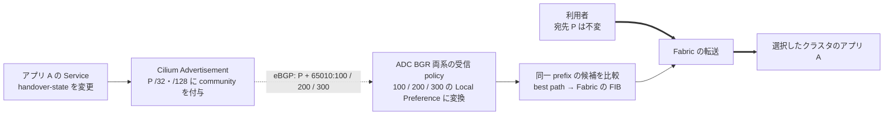

Cilium が広告するのは community で、Local Preference を設定するのは BGR である。
新旧の P は同じ prefix 長に揃える。片方が集約経路だけなら、この優先度比較より longest match が先に効く。

| 図のステップ | k02 の P 広告 → LP | k04 の P 広告 → LP | P の通常通信先 | 次へ進む確認 |
|---|---|---|---|---|
| 0：移行前の基準 | `65010:200` → 200 | クラスタなし | k02 | exact route と BGR policy の準備済み |
| 1：追加・事前検証 | `65010:200` → 200 | `off` | k02 | full mesh、NodePort、データ・Egress |
| 2：候補広告 | `65010:200` → 200 | `65010:100` → 100 | k02 | k04 が受信可能、両 BGR と FIB の選択一致 |
| 3：アプリ A を移行 | `65010:200` → 200 | `65010:300` → 300 | k04 | A は新、B は旧、DR・復帰試験 |
| R：A を復帰 | `65010:200` → 200 | `65010:100` → 100 または `off` | k02 | データ復帰・Egress・応答確認 |
| 4：旧 A の広告撤回 | `off` | `65010:300` → 300 | k04 | 全選択点で旧 P が消滅 |
| 5：新現用・旧撤去 | 旧クラスタ削除 | `65010:200` → 200 | k04 | 全アプリ移行、旧 Mesh 情報消滅 |
| 6：次回の新 k02 を準備 | `off` → `65010:100` → 100 | `65010:200` → 200 | k04 | 旧世代削除・新世代同期・事前検証 |
| 7：次回 k04 → k02 | `65010:300` → 300 | `65010:200` → 200 | 新世代 k02 | 前回と同じ移行・復帰条件 |

#### Step 0：移行前の基準を作る

6 節の手順で k02 の P を exact route にし、BGR の変換 policy を準備した後の状態である。
現行の集約設定が、そのままこの図の状態になっているわけではない。

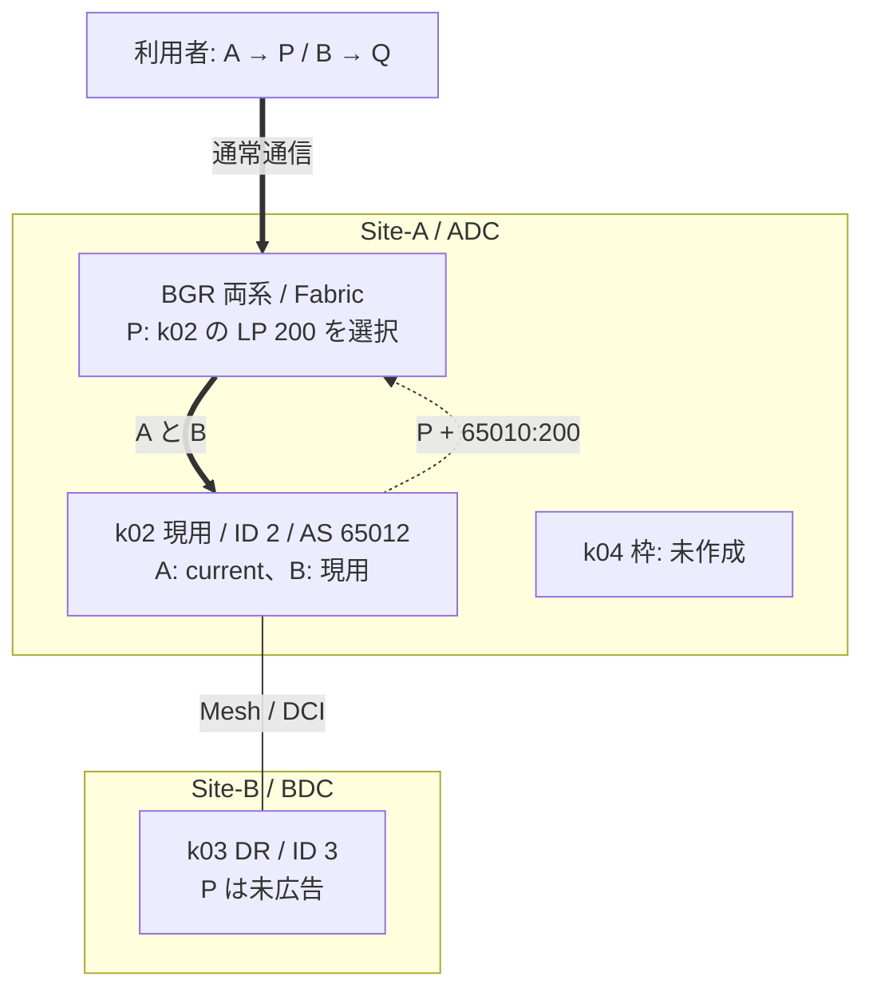

確認点：P の両 AF の経路・応答が k02 を選び、Q と Mesh API の経路が維持されること。

#### Step 1：k04 を追加し、P を広告せずに検証する

k04 の Mesh API を到達可能にし、3 クラスタを接続する。アプリ A に同じ P を割り当てるが、P の広告は `off` とする。

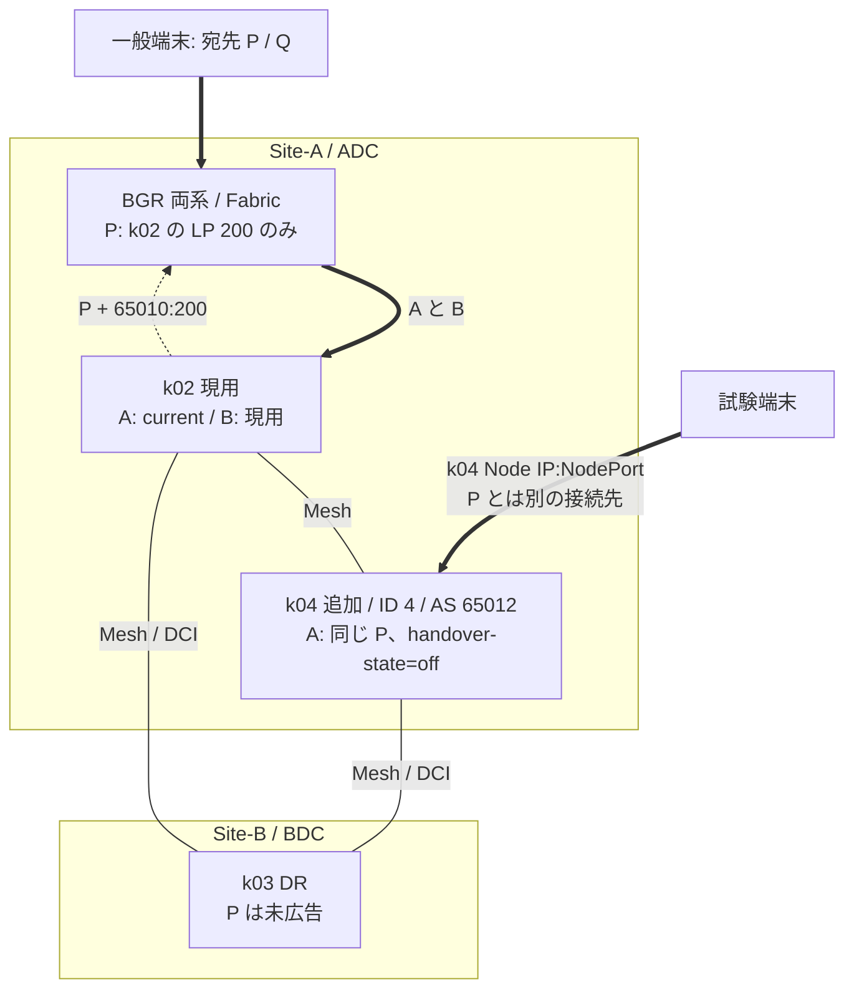

確認点：試験端末から k04 の A を検証でき、一般端末の P は k02 のままであること。
NodePort の矢印は論理的な接続を示し、実際には Fabric を通る。送信元制限は別途設定する。

#### Step 2：k04 の候補経路を低優先で広告する

k04 が実通信を受けられる状態になったら、A だけを `candidate` にする。一般端末の選択先はまだ k02 である。

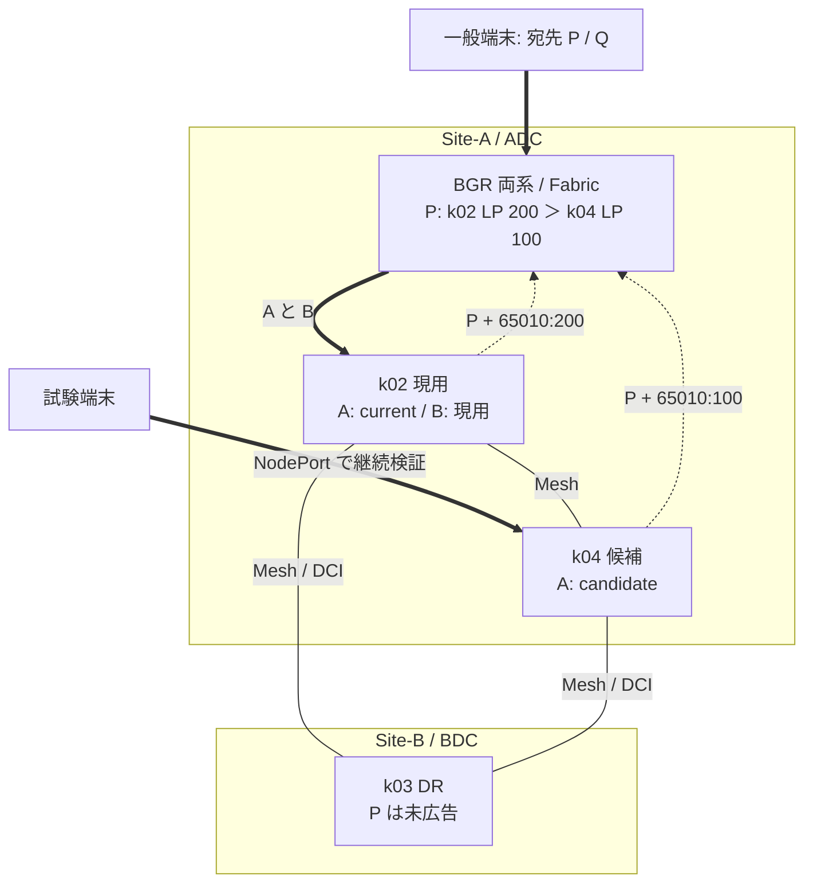

確認点：両 BGR で community と LP が対応し、新旧クラスタ間の ECMP が発生しないこと。
この状態で k02 の経路が消えると k04 が選ばれ得る。未準備なら Step 1 の `off` を維持する。

#### Step 3：アプリ A だけを k04 へ移行する

k04 の A を `preferred` に上げる。アプリ B の Q は操作しないため、B の利用者は k02 を継続する。

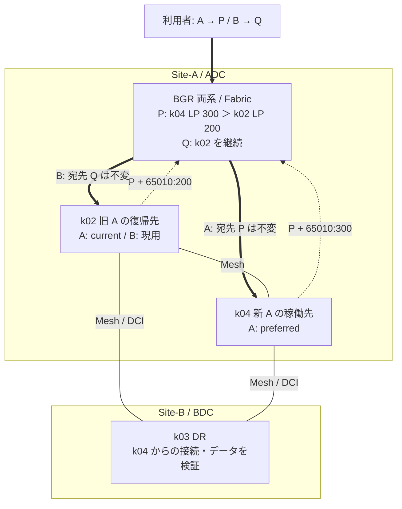

確認点：A の新規接続は k04、B は k02 と識別できること。k04–k03 の直接通信、DR と復帰条件を確認する。
ここから Step 4 へ進むか、不具合時は Step R へ分岐する。

#### Step R：アプリ A を k02 へロールバックする

7.4 節に従いデータ・Egress を復帰可能にしてから、k04 の A を `candidate` に戻す。
下図は k04 が健全な候補として残せる場合で、不健全なら `off` にして k04→BGR の P 広告を撤回する。

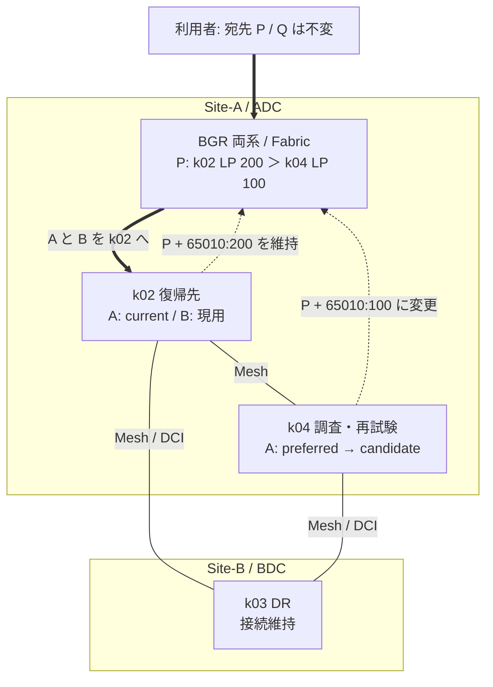

確認点：k02 の優先度を上げ直さずに復帰でき、両 AF の応答・Egress・データ整合が戻ること。
再試行は修正・事前検証後に Step 2／3 へ戻る。クラスタ削除後の復元はこの即時復帰とは別手順である。

#### Step 4：観察期間を終え、旧 A の広告を撤回する

A の復帰期間を終了すると決めたら、k02 の A を `off` にする。k04 はまだ `preferred`／300 を維持する。

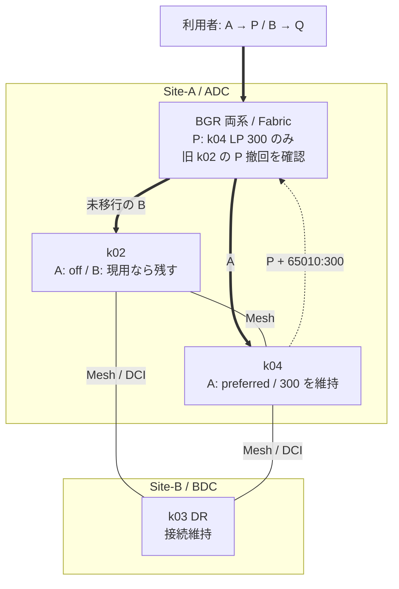

確認点：旧 P の exact route が全選択点から消えた後に、k04 の A を `current`／200 に戻す。
B が旧に残る間は k02 を削除しない。B 以降も各 VIP について Step 1～4 を繰り返す。

#### Step 5：全アプリ移行後、旧 k02 を撤去する

全アプリで旧広告撤回と新現用への正規化を終え、11 節の削除条件を満たしてから k02 を削除する。
図の Q も B の移行手順を終えた状態である。

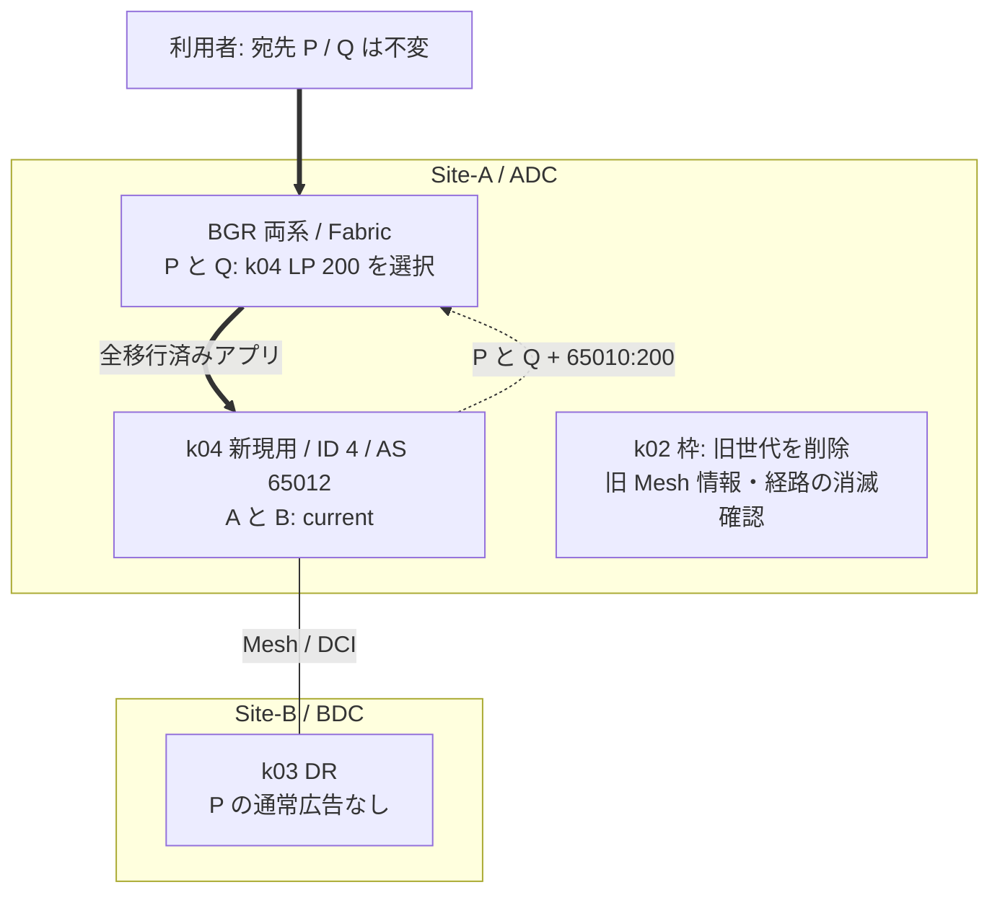

確認点：k04 と k03 だけで運用・DR が成立すること。P／Q は使用中なので、k02 枠の削除で解放しない。

#### Step 6：次回は同じ識別子で k02 を新規構築する

11.2 節の旧世代削除確認後、k02 の Name／ID／固定 IP を再利用する。
初めは P を `off` として検証し、受信可能になった後の `candidate` 状態を下図に示す。

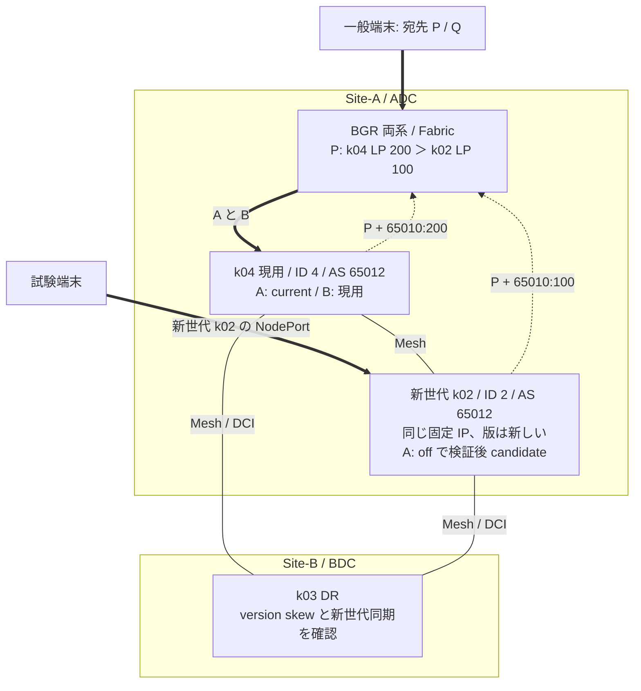

確認点：旧世代 k02 の endpoint／identity の誤使用がなく、新世代の Policy・データ・Egress が成立すること。
この時点で一般端末の P は k04 を使う。Name／ID が同じでも Kubernetes の状態は新規構築である。

#### Step 7：次回のアプリ A を k04 から新世代 k02 へ移す

新世代 k02 の A を `preferred` にする。初回と同じ数値・意味で、操作対象のクラスタだけが交替する。

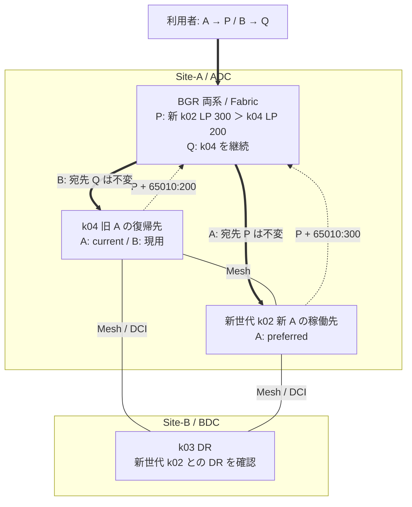

復帰は新世代 k02 を `candidate`／100 または `off` に戻す。成功時は Step 4／5 の k02 と k04 を入れ替えて実施し、
旧 k04 の P 撤回確認後に新世代 k02 を `current`／200 にする。全アプリ移行後の k04 枠を、その次の更新に再利用する。

図は新旧への自動 fallback を許容できるアプリの基準形である。Stateful で単一 writer が必要な場合は、
7.3／7.4 節の fencing・逆同期・旧広告停止を加える。Ingress の矢印は Egress IP の所有権移管や
既存 TCP 接続の引継ぎを意味しない。Egress の Step 0～7／R は [8.6 節](#egress-upgrade-steps)の表と図を合わせて使う。

<a id="egress-choice"></a>

## 8. Egress IP：別 IP と同一 IP の両パターン

### 8.1 Ingress と分ける理由・現在の制約

Ingress の P は「外部からの宛先」、Egress の E は「外部へ出る通信の送信元」である。
P の BGP 優先度を変えても、Pod の送信元 NAT、外向き経路、外部許可リストは変わらない。
Ingress の返信 SNAT と、Pod が開始する外向き通信の Egress IP も分けて観測する。

現行 multisite は Egress Gateway を無効にしており、一般的な masquerade の設定がある。
外部で実際に見える送信元は経路ごとに確認する。Node IP になると仮定して allowlist を確定しない。
固定 E は旧・新それぞれの専用 Gateway が SNAT する構成とする。E-A は別 IP、E-B は同じ IP を Gateway 間で移す。
Gateway の実装と IP 所有権の移管手順を分けて扱う。

| Gateway 実装 | 本書での位置付け |
|---|---|
| k02／k04 の worker 上の Cilium Egress Gateway | 想定するクラスタ内の比較対象。ただし現行公式の Cluster Mesh 非互換条件に該当し、両機能併用をサポート済み構成とは扱わない |
| k02 専用 G2／k04 専用 G4 の独立 Linux Gateway | IP 移管手順を Mesh 有効の環境で検証する候補。各クラスタが自分の Gateway を使い、E のアドレス・SNAT・広告を G2 から G4 へ移す |

後者も新旧で 1 台の NAT を共用する構成ではない。2 台の所有者の切替を実際に検証する。
Cilium の実装試験は既存の共存実験として別判定にし、独立 Gateway での成功を Cilium の非互換解消とはしない。
参照：[Cilium Egress Gateway の非互換条件](https://docs.cilium.io/en/stable/network/egress-gateway/egress-gateway/#incompatibility-with-other-features)、
[既存の共存実験](../tests/egress-clustermesh-coexistence-test.md)。

### 8.2 E-A：旧・新で別 Egress IP

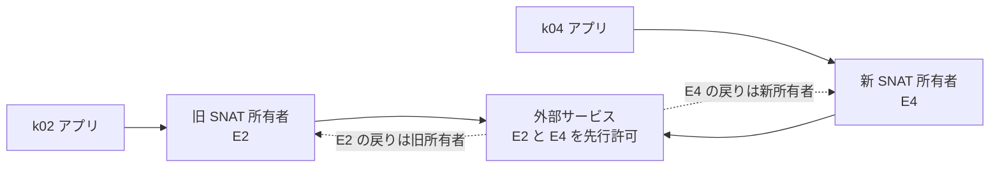

1. E4 とその戻り経路を準備し、外部許可リストへ E4 を追加する。E2 は残す。
2. k04 から接続し、外部受信記録と NAT／戻り経路で E4 を確認する。
3. Ingress を切り替える。旧の処理・接続は E2、新は E4 として同時に存在できる。
4. rollback は旧のデータ／ジョブを復帰してから Ingress を戻す。E2 の許可が残っていることを確認する。
5. 観察期間後、旧接続・旧ジョブ消滅を確認して E2 の許可と経路を撤去する。

送信元変更を許容するならこの方式が最も単純である。E2／E4 の所有者は別クラスタでも外部 NAT でもよいが、
採用機能のサポート範囲を守る。図は Cilium Egress Gateway と Mesh の同時利用を前提にしていない。

### 8.3 E-B：同じ Egress IP 自体を移管する

**E は同じ値を保ち、所有者を旧 Gateway G2 → 新 Gateway G4 へ移す。**
G2／G4 は旧・新それぞれの専用送信経路に置く。共有 NAT は使用しない。
同時に有効な E の所有者・SNAT 実行者は 1 台とし、NAT 状態の複製は今回の前提に含めない。

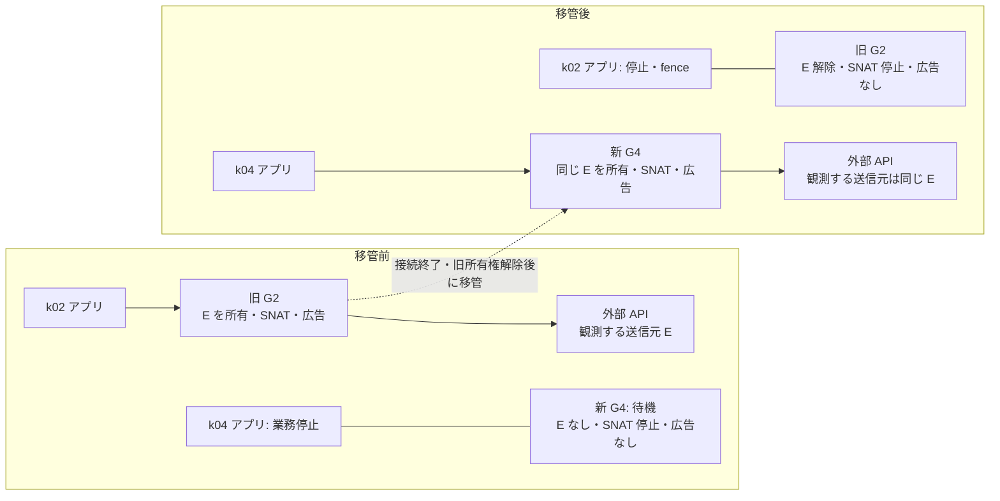

1. Step 1／2：G4 の経路・NAT 規則・受信許可を準備するが、E はまだ付けず、送信と広告も停止する。
   k04 の Ingress P は `off` を維持する。E を使う最終的な外部試験は移管後に行う。
2. Step 3a：対象アプリの入口・CronJob・consumer・retry を停止し、旧 P の広告も止める。
   E を共有する全アプリの処理と外向き接続を drain／終了する。期限内に終了しない場合は移管を中止するか、
   許容する接続切断・再実行方法を事前に決める。NAT 表を消すだけで業務完了とはしない。
3. 旧から再送信されないよう fence し、旧 E の広告を停止する。両 BGR／入口 FIB の旧 exact route と stale path を確認し、
   旧 Gateway から E を外す。集約が残る場合の fallback と、旧経路への到達も確認する。
4. Step 3b：旧が E を再取得しないことを確認してから、新 G4 に同じ E と SNAT 設定を有効化する。
   新しい E の exact route を広告し、両系・両 AF の戻り先が G4 へ収束したことを確認する。
   この間、業務送信は止めたままで、外部 API の副作用のない probe だけを許可する。
5. probe で送信元 E、認証、応答、外部状態を確認する。失敗したら Ingress を切り替えず、E を旧へ戻す。
6. Step 3c：k04 の P を `preferred`／300 にし、新側の業務・ジョブを再開する。
   E を失った旧の P は `off`／fence を維持し、自動 fallback 先に残さない。
7. Step R：新業務の受付・送信を停止し、結果照合・必要な逆同期・接続終了を行う。
   新を fence → 新 E 広告・所有権解除 → 旧へ E・SNAT・戻り経路を復元 → 旧 probe 成功 → 旧 P 再開の順に戻す。

新旧で同じ E を同時に SNAT に使い、戻りの BGP だけを新へ優先させると、旧接続の返信も新へ届き得る。
新側には旧 NAT 状態がないため、**Ingress の低優先候補と同じ扱いにはしない。**
この案では既存 TCP／UDP の状態を引き継がず、新側で接続を作り直す。停止時間は drain と移管・再接続も含めて測定する。
参照：[Netfilter NAT の接続状態](https://wiki.iptables.org/wiki-nftables/index.php/Performing_Network_Address_Translation_%28NAT%29)。

複数アプリが同じ E を共有する場合、移管単位はその全アプリである。アプリ単位で独立して移行する要件なら、
移行前からアプリ専用 E を割り当てるか、共有する全アプリを同じ停止・復帰単位として扱う。
専用 E への変更自体が外部 IP 条件に抵触する場合は、勝手に分割しない。

上記は routed E を BGP で運ぶ場合の手順である。同一 L2 で E を移す構成は、単独所有と ARP／ND 更新・収束を確認する。
旧・新が異なる Node セグメントなので、本 lab は E を独立した `/32`／`/128` として経路制御する案を基本とする。
Node の InternalIP、Mesh API VIP、Ingress P は E と区別し、E の移管で Node のアドレスは変更しない。

### 8.4 Cilium Interface 広告との関係

既存の [Egress 経路設計](egress-gateway-routed-design.md) は `egress0` のアドレスを
`advertisementType: Interface` で広告する。Service の aggregation 設定とは別である。
Interface 広告は exact route であり、現行の Egress `/24`／`/64` 集約は NX-OS の BGP 終端で生成する。
保存 config は `summary-only` を指定していない。exact route と集約の両方を確認する。

Interface 広告はアドレス所有・広告を扱うだけで、NAT 状態、Policy の選択、アプリの健全性を同期しない。
複数アドレスを持つ同じ `egress0` に属性を付けると影響単位が広がるため、アプリ単位の所有者・interface 分離を設計する。
この方式の実験は、公式非互換を解消したことにはならない。
参照：[Interface IPs](https://docs.cilium.io/en/stable/network/bgp-control-plane/bgp-control-plane-configuration/#interface-ips)。

<a id="egress-migration-record"></a>

### 8.5 アプリごとの Egress 要件と移行票

E-A と E-B はどちらか一方をクラスタ全体で選ぶものではない。同じ k02／k04 に両方のアプリを置き、
それぞれの P、外部依存、Egress 条件を満たした順に移行する。

| 要件 | E-A：別 IP | E-B：同じ IP・所有権移管 |
|---|---|---|
| 外部の IP 許可 | E2／E4 の併記が可能 | E を変更せず、IP の所有者を旧から新へ移す |
| 新側の事前検証 | E4 を先行許可して通常経路で検証 | 同じ E での最終確認は移管後。事前は別の試験先・試験用 IP で限定検証 |
| NAT の位置 | 旧 G2 と新 G4 がそれぞれ SNAT | 旧・新 Gateway の単一所有を入れ替える |
| 新旧同時通信 | E2／E4 で可能。業務の二重実行可否は別 | 同じ E の独立 NAT を同時稼働させない |
| 切替時の E の経路 | E2／E4 の各所有者を維持 | 戻り経路を新所有者へ移す |
| 主な選択理由 | 外部許可を変更でき、移行を独立させたい | Gateway 自体も交換する必要があり、停止を許容できる |

各アプリの移行票に次を記録する。初回も次回の逆方向更新も、同じ票を世代別に作る。

| 記録項目 | 決める内容 |
|---|---|
| 対象 | namespace／Service／Ingress P、クラスタ世代、方式 E-A／E-B |
| 外部依存 | 宛先 FQDN／CIDR／port／protocol、DNS、TLS／mTLS、許可リストの変更主体 |
| 外部で必要な送信元 | E2／E4 または E、IPv4／IPv6 別、IP と認証情報の紐付け・同時接続制限 |
| 実際の経路 | Node／Pod から NAT までの経路、NAT が観測する送信元、返信経路、迂回経路の有無 |
| アプリの動作 | HTTP API、長時間接続、CronJob／queue consumer、書込み、冪等性、処理中要求の扱い |
| 切替条件 | 新側 probe 成功、旧処理の drain、ジョブ／writer 所有権、許容停止時間 |
| 復帰条件 | 旧の E の経路・許可・容量、逆同期、外部処理結果の照合、復帰期限 |
| 共有範囲 | 同じ E／NAT／資格情報を使う他アプリ、撤去時に影響する対象 |
| DR | k03 用 E3 を許可するか、同じ E を維持するか、NAT の障害ドメイン、RPO／RTO |

「同じ E」は現在の外部観測値との比較で定義する。現行が Node InternalIP の masquerade なら、
そのまま同じ Node IP を新 Node に重複設定しない。専用 E の初期導入と外部許可の変更を Step 0 前に整理する。
すでに専用 E を使用中ならその値を引き継ぐ。E と同じ IP を旧・新へ事前に二重設定することはしない。

<a id="egress-upgrade-steps"></a>

### 8.6 Ingress と Egress を合わせたアップグレード手順

7.6 節と同じ Step 番号を使う。**外部通信の準備と確認 → Ingress 切替 → 業務受入**を 1 アプリの移行単位とする。
BGP の Service label 変更と NAT／外部許可更新は原子的な操作ではないため、各確認で次へ進むかを判断する。

| Step | Ingress／アプリ共通 | E-A：別 IP | E-B：同じ IP・所有権移管 |
|---|---|---|---|
| 0：基準 | 旧 current／200、旧を現用として計測 | E2 と外部許可を記録。E4 を予約 | E の旧所有者、共有アプリ、停止範囲を記録 |
| 1：新規構築・事前検証 | 新の P は off。NodePort でアプリを確認し、方式ごとの外部試験を実施 | E4 の SNAT・往復経路・許可を先行追加。E2 も維持 | 新 Gateway を待機状態で準備。同じ E の送信・広告はまだ禁止。内部・mock 試験を行い、同じ E の外部試験は 3b へ |
| 2：候補広告 | 安全に受信できる場合だけ新を candidate／100 | E4 を使う業務試験に合格してから候補化 | E をまだ利用できないため off を維持 |
| 3a：本切替準備 | 新の業務ジョブは待機。必要な入口抑止・旧 drain・データ同期を実施 | 許容できる旧接続は E2 で残す。新規ジョブ所有権を確定 | 対象入口を抑止し旧 P 広告も off。共有 E の全送信を停止・drain・fence |
| 3b：Egress 受入 | 新から副作用のない probe を行う。不合格なら Ingress を切り替えない | 外部観測 E4、認証・往復を再確認 | 旧所有権／広告解除 → 新に E を設定 → 戻り経路収束 → 新 probe |
| 3c：本切替 | 新 preferred／300。新規業務を受け付け、対象ジョブを一方だけ再開 | 新要求は E4。旧の処理が残るなら E2 と区別 | 新からだけ E を使う。旧 P は off／fence を維持 |
| R：旧へ復帰 | 必要な入口抑止・新処理停止・データ復帰 → 旧 Egress probe → 7.4 節の Ingress 復帰 | E2 の許可・経路を確認。新の未完了処理は完了／取消を照合 | 新送信停止・drain・fence → 新所有権解除 → 旧へ E を戻す → 旧 probe → 旧 P 広告再開 |
| 4：観察終了 | 対象アプリの旧 P 撤回確認後、新を current／200 | 旧接続・旧ジョブ・他アプリ利用がなくなるまで E2 を残す | 旧 Gateway の再起動で E が復活しないよう構成元も更新 |
| 5：旧クラスタ撤去 | 全アプリの移行と復帰期限終了、DR 確認後に撤去 | 最終利用者がいなくなった E2 の許可・経路・規則だけを撤去 | 新所有者と E を残し、旧 Gateway を依存確認後に撤去 |
| 6／7：次回の逆方向更新 | 新世代 k02 に対して Step 1～5／R を反復 | E2 を再使用するなら予約・外部許可・古い接続状態を再確認 | 同じ E の所有権を逆方向へ単独移管 |

E-A でも新旧の同時業務処理を許容しないアプリは、Step 3a で旧側を停止する。
E-B で E を新へ移した後は、旧の current／200 を fallback として残せない。BGP だけ戻しても旧側の外部通信は復旧しない。
入口抑止は P の広告 off だけに頼らず、アプリの受付停止や入口の制御も使う。残る集約からの到達も確認する。

#### E-A：別 IP の切替・復帰図

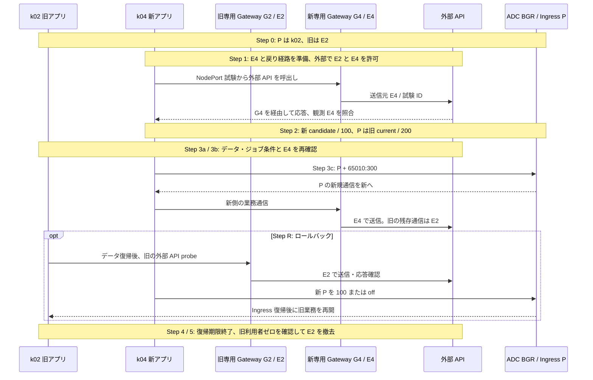

#### E-B：同じ IP の所有権移管と停止区間

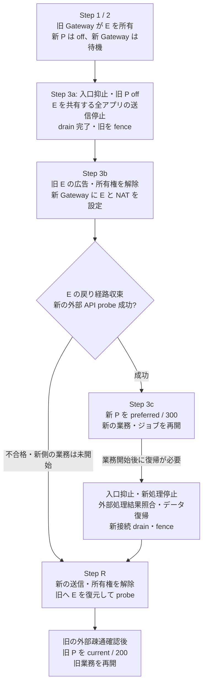

ここで E の経路を BGP で運ぶ実装なら、広告はその時点の唯一の所有者から行う。
Ingress 用 `65010:100/200/300` を付け替えるだけの操作にはせず、E の送信禁止・所有権・NAT・戻り経路を一組で操作する。

<a id="egress-app-examples"></a>

### 8.7 2 パターンのアプリケーション例

以下は containerlab 内の外部 API mock を使う未実装の試験例である。実サービスへの副作用は発生させない。
[試験アプリケーションの詳細設計](clustermesh-upgrade-test-applications.md)で API・観測・データ復帰を具体化した。
初回は同じ A の枠を独立した試験回で再利用し、旧に残す比較用 B は別 VIP とする。
各例を移行対象のアプリ A として 7 節の P に割り当てて個別実行できる。
両例を同時に置く場合は独立した Service／VIP を割り当て、先に移すアプリと旧に残すアプリを分ける。

| 項目 | 例 1：`report-api`／E-A | 例 2：`partner-submit`／E-B |
|---|---|---|
| 業務例 | 外部参照 API から情報を取得して返す Stateless API | 取引先 API に依頼を登録し、受付 ID を保存する API |
| 外部 IP 条件 | 登録元 IP を複数許可できる | 契約上、登録元 IP は E の 1 個に固定 |
| 外向き通信 | `GET /reference` | 試験は `GET /health`、業務は `POST /requests` |
| 新旧の外部観測 | 旧 E2、新 E4 | 旧も新も同じ E |
| 同時実行 | 参照要求は許容。周期実行の負荷・制限は確認 | 本処理の所有者を一方に限定。冪等キーと受付 ID で重複を防ぐ |
| 事前検証 | E4 を先行許可し、新への NodePort 要求から参照 API まで成功 | 事前は内部処理と試験先を確認。同じ E による health は旧の停止・E 移管後に行い、本登録はまだ止める |
| 復帰 | E2 の許可を残し、旧の参照成功後に P を戻す | 新の未確定要求を外部受付 ID と照合し、データ復帰・旧の E 接続確認後に P を戻す |
| 必須の失敗試験 | E4 の許可漏れ、戻り経路不備、IPv6 だけ別送信元 | NAT 経路の迂回、NAT 障害、新規登録後の復帰、長時間接続の再接続 |

例 2 は E-B の本試験として、停止区間・E の単一所有・新規接続による復帰を確認する。
同じ E を別アプリも使うケースを加え、一部アプリだけの Gateway 移管が成立しないことも確認する。

#### 小規模な lab 構成例

IP 移管そのものを検証する構成は、旧 k02 専用 G2、新 k04 専用 G4、外部 API mock とする。
E-A では G2 が E2、G4 が E4 を使う。E-B では G2 の E を解除した後、G4 に同じ E を設定する。
Cilium 実装では G2／G4 を各クラスタの Gateway worker に対応付けるが、Mesh 併用は 8.1 節の実験条件に従う。
独立 Linux Gateway を使う手順試験でも、旧・新それぞれの専用ノードを用意し、1 台を共用しない。

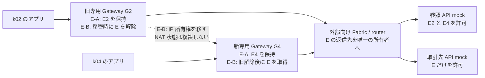

| 論理値 | IPv4 の説明用例 | IPv6 の説明用例 |
|---|---|---|
| E2 | `192.0.2.42` | `2001:db8:240::42` |
| E4 | `192.0.2.44` | `2001:db8:240::44` |
| 固定 E | `192.0.2.40` | `2001:db8:240::40` |
| 参照 API mock | `198.51.100.10` | `2001:db8:241::10` |
| 取引先 API mock | `198.51.100.20` | `2001:db8:241::20` |

これらは説明用アドレスで、現行 lab への予約・経路追加はしていない。mock と NAT の外側を隔離した試験網として設計する。
固定 IP 要件を IPv6 にも課す試験では各専用 Gateway の IPv6 SNAT を対象とし、IPv4／IPv6 の各経路・許可を独立に検証する。
IPv6 を NAT せず送る設計なら、その送信元と許可条件を別途記録し、「IPv4 の E が一致したので dual-stack 合格」としない。

NAT が見る送信元は、Cilium の masquerade 後の Node IP の場合もある。実測後に規則を決める。
このデモでは API の宛先を分けるため、NAT で旧・新の Node セグメントと宛先を組み合わせて選択できる。
同じ Node の複数アプリが同じ外部 API を使う場合、外部 NAT が Kubernetes の label を見て分離できるとは考えない。
その場合は専用送信経路／送信元、アプリを識別できる外部 proxy などを別途選ぶ。

対象 API 宛は各クラスタ専用 Gateway を通し、Docker 側の default route や別の IPv6 経路へ迂回しないことを確認する。
Mesh API／Node 間 VXLAN／cluster 内部通信まで NAT へ向けない。
外部 API が TCP 接続から観測した送信元、request ID、実行 cluster／世代、時刻、成功／失敗を記録し、
自己申告の HTTP header だけを送信元 IP の証拠にしない。新規接続、keepalive、長時間接続、ジョブを別々に試験する。

<a id="egress-implementation-scope"></a>

### 8.8 経路・DR・撤去時の実装範囲

E-A は E2／E4 の所有者を分けて両方を稼働させ、E-B は同じ E の所有者を切り替える。
Ingress P の優先度 community は E の所有権管理には流用しない。
E-B の routed 構成では、G2 の E `/32`／`/128` を撤回し、単独所有を確認した後に G4 から同じ prefix を広告する。
旧 aggregate が残る場合も、新 exact route が全選択点で優先されることを確認する。
E の exact route が失われたときに旧 aggregate へ戻っても、fence 済みの旧側が送信を再開してはならない。

| 実装対象 | 必要な追加・確認 |
|---|---|
| Gateway の IP | E は Node InternalIP と別の専用アドレス。旧から解除、新へ付与。自動再起動時も旧が E を再取得しない |
| SNAT／アプリ | Gateway 選択、対象アプリ・宛先、送信禁止と解除、既存接続の終了、外部処理の照合 |
| E の BGP 広告 | 所有者の interface／専用広告だけに限定。Ingress Service の label 変更だけで動かさない |
| BGR／接続 router の受信 | 旧・新 peer の E exact prefix を事前に限定許可。k04 の現在の Config は E を拒否するので別差分が必要 |
| 外部 API の返信 | E への経路が新 G4 に収束してから新送信を許可。両 AF と両 BGR、必要な外部 router で確認 |
| Node から外部への経路 | クラスタに対応する Gateway へ送る。Docker 側や別 AF への迂回を防ぎ、Mesh 内部通信は対象外にする |

既存の Nexus 追加 Config は Node／Mesh／Ingress P が対象で、E の受信許可・外部経路と Gateway の IP／SNAT 操作は未実装である。
Cilium worker を G4 に使う実験では ADC BGR の k04 inbound policy に、対象 E だけの許可を追加する案が必要となる。
独立 Linux Gateway を使うなら、その実際の接続 router／peer に対して許可する。k04 の LB pool を広げて代用しない。
E 用の用途識別 community を採用する場合も、許可対象 peer と exact prefix の照合を残し、Ingress の rank と分離する。
具体的な E の値・Gateway の配置・広告の制御方式を確定してから Config を作成する。

Cilium Egress Gateway の実験では、Gateway の interface に E を設定するだけで Policy の選択が更新されるとは考えない。
アドレス変更後の Policy 再適用・再選択、BPF の Egress map と実送信元を確認し、広告だけ成立した状態を合格にしない。
これは IP 移管時の実装上の確認であり、Cluster Mesh との非互換条件を解消する操作ではない。
参照：[Cilium Gateway の IP／interface 選択](https://docs.cilium.io/en/stable/network/egress-gateway/egress-gateway/#selecting-and-configuring-the-gateway-node)。

BGW は既存の DCI 伝播を維持する。E を運ぶために BGW へ新しい制限 policy を導入する必要はない。
E の経路が必要な外部／DR 接続まで届くかを確認し、任意の DCI 制限案を採用した場合だけ許可条件を見直す。

DR の k03 は移行途中も full mesh に残す。E-A は k03 用 E3 の外部許可と往復経路を準備する。
E-B の DR は Site-A の所有者を確実に fence してから、k03 側 Gateway G3 に同じ E を移す。
旧サイトの停止・隔離を確認できない場合は、単に到達不能という理由だけで同じ E を二重所有させない。
サイト復帰時も E とジョブが旧側で自動復活しないことを確認する。

E2 を他アプリが使う間は E-A の許可を消さない。E-B の移管後に旧 k02 枠を削除しても、新 G4 が所有する E は解放しない。
Gateway の規則や conntrack を全体初期化せず、移行対象に限定する。
E を共有する全アプリの停止合意と復帰確認を移管条件とし、IP 許可に加えて資格情報・重複実行・レート制限も検証する。

## 9. DR・Global Service・Stateful の扱い

通常時は Production と DR、移行中は旧・新・DR の full mesh とする。
partial mesh を情報や通信の自動中継に使わず、新から DR へ直接到達できることを移行前に確認する。
保存構成の BGW は DCI EVPN neighbor に prefix／community の制限を設定しておらず、既存 tenant の経路伝播を維持する。
k04 も既存 VRF／L3 VNI を使うため、BGW での追加許可は標準案に含めない。
Node／Mesh API だけでなく、BGR が受け入れた一般 application VIP も伝播対象になり得る。
既存の別設計にある「Mesh API だけを許可する」DCI filter は任意案であり、現状と混同しない。

初回の DR は **手動昇格** とし、P は DR から常時広告しない。
Site-A 障害時は旧／新の writer・送信元を fence → DR のデータ／アプリ／Egress を確認 → k03 から P の広告を開始、
という順とする。復旧時もデータ同期と単一 writer を確認してから逆順の切替を行う。
DR 受入では BDC Leaf の k03 受信 filter が引継ぎ P を許可するかを確認し、必要な受信許可と E の外部経路を設計する。
DCI の既存伝播で到達できる場合、BGW で P の追加許可は不要である。
任意の Mesh API 限定 filter を採用した場合だけ、DR 用 P／E の限定通過を追加する。
その場合も Mesh API 用の `dci-export: clustermesh` を application route へ流用しない。
異なる AS／サイト間で優先順位を使う常時広告型 DR は、5.2 節の community 伝播・再変換を含む追加設計とする。

| 機能 | 今回の使い方 |
|---|---|
| Global Service | クラスタ間依存の検証用。入口の P を試す Service は local backend に限定 |
| Service Affinity | `local`／`remote` の相対優先。3 クラスタの「k04 優先、次に DR」は表現しない |
| MCS | 初回は無効を維持。ServiceExport／Import・DNS の比較は後続試験 |
| namespace／Policy | `defaultGlobalNamespace: false` と `policyDefaultLocalCluster: true` を継承し、両端の共有許可・remote selector を明示 |
| Stateful | 単一 writer、複製遅延、schema 互換、逆同期、RPO／RTO、fencing を先に設計 |

Stateless でもセッション、アップロード、外部キャッシュ、CronJob、queue consumer の二重実行を確認する。
Cluster Mesh は Deployment／Secret／PVC／DB を複製しない。必要な resource は各クラスタへ別途配布する。
`cacheTTL: 10m` は remote state の保持時間であり、アプリの RTO や NAT の drain 時間ではない。
新側での不可逆なデータ更新後に BGP だけ戻すことは、安全な rollback ではない。

## 10. 試験順序と判定

<a id="upgrade-prerequisites"></a>

### 10.1 現状構成で先に実施する試験

**Cilium Egress Gateway を使う E-A／E-B は、k02／k03 の共存試験を先に実施してから実装方式を確定する。**
設計比較・Config のレビューは並行して進められるが、共存を確認せずに同一 VIP／Egress IP の統合切替へ進まない。
以前の「共存試験は最小移行試験の後続」という順序は、クラスタ内 Egress を採用する案には適用しない。

当初の計画策定時の根拠は 2026-09-13 までの保存結果だった。
multisite は Mesh 接続、Pod HTTP `16/16`、Global Service HTTP `8/8`、k03 外部 LB HTTP `12/12` が成功しているが、
障害・退避・全体 connectivity は未受入である。[共存試験](../tests/egress-clustermesh-coexistence-test.md)は計画済みで、
その後の 2026-09-25 に [復旧後の限定共存試験](../results/multisite/2026-09-25/egress-clustermesh-coexistence.md)を実施した。
通常時の両 AF SNAT・remote 非選択・Mesh／Service と API 障害分離は成功したが、
Gateway の link 復帰時に Node アドレス・経路の再設定が必要で `Partial`。`TI-009` と Stage 5 の残受入を解消してから統合切替へ進む。
追加の [別クラスタの Egress Gateway を利用できないことの確認試験](../results/multisite/2026-09-25/remote-egress-gateway-negative-test.md)では、
k02／k03 の両方向・両 AF で標準 Policy が対向 Gateway を選択できず、`NO_EGRESS_GATEWAY` で破棄された。
したがって新クラスタの Pod が旧クラスタの Cilium Egress Gateway を借りる移行段階は採用しない。
同一 Egress IP 案は旧側の利用停止後に IP の所有・広告を新側へ移し、別 IP 案は各クラスタの local Gateway を使う。
この結果は共存全体の `Partial` 判定を変更しない。
single-site の Egress 基本機能・計画切替の実績は継承し、全項目の再実行を前提にしない。

| 推奨順序 | 現状構成の試験 | 次へ進む条件・アップグレードとの関係 |
|---|---|---|
| P0：基準値 | k02／k03 の Node IP、BGP、Mesh、DNS／TLS、LB、採用 values、CPU／RAM を再確認。`CM-00`～`CM-04`、`CM-14` の記録と照合 | 手動補正した Node IP／初回 ARP・ND を識別し、試験開始前の通信・観測・復旧基準を確定。保存時点の空きメモリだけで k04 の収容を判断しない |
| P1：2 クラスタの通常通信 | `CM-05` の両 AF・TCP／UDP／ICMP、`CM-06` の local 優先／remote fallback、`CM-07` の local／remote Policy。MTU 境界、経路途中の PMTUD、低レート通信、checksum、connectivity の未受入分 | 単純な HTTP 成功と区別して受入。既存の `remote` affinity デモを local 優先の合格証跡にしない。高負荷性能とは別に低レートで安定して判定できること |
| P2：2 クラスタの障害・復帰 | `CM-08` API 片系 → `CM-12` 計画退避 → `CM-09` API-only 断 → `CM-10` VXLAN-only 断 → `CM-11` DCI 断 → `CM-13` site 障害。各回で復帰を確認 | API Ready とデータ通信を分け、stale state／TTL、local 継続、復旧・再同期を記録。Egress を重ねる前に Mesh 単体の失敗を識別できること。これはアプリの DR 昇格試験とは別 |
| P3：Egress の実施前確認 | Stage 2B の既存結果を照合し、未解決・環境差分だけを確認。k02／k03 の専用 E、Interface 広告、受信 filter、戻り経路、site-local 外部 observer、完全な復帰手順を準備 | `egress0` の存在だけで SNAT 成功としない。k03 の IP 重複と外部 observer は 09-25 の限定試験で確認済み。次回は一時リソースを再準備する。Stage 2B の全負荷試験を再実行する必要はない |
| P4：共存試験 | `COEX-00`～`COEX-11`。k02 のみ有効化 → k03 も有効化 → local Egress／remote 誤選択なし → Mesh／Service／Policy 回帰 → 障害分離 → rollback | 両 AF・両クラスタの結果を別記録し、`Pass (unsupported)`／`Partial`／`Fail` で判定。`COEX-08` は現在採用する Global Service で実施し、未採用の MCS を前提にしない |
| P5：IP 移管の小規模試験 | 採用する Gateway 実装で、まず k02 内の試験専用 E を worker → worker2 → worker と単独移管。業務停止、接続終了、旧広告・所有権解除、新設定、Policy 再選択、戻り経路、外部観測、復帰を確認 | 同じ E が同時に有効にならず、旧側の初期化処理・Pod 再配置・再適用で E が復活しないこと。既存 `W-EGRESS-09` の Gateway 選択変更だけでは、この試験を代替できない |
| P6：k04 構築の開始判定 | k04 の収容資源、Leaf 変更の停止影響・復旧、Node IP／ARP・ND／MTU の初期化手順、採用 Gateway 方式と未解決事項を確定 | Kubernetes `1.36.4` の k04 追加へ進む。Cilium は `1.20.1` に揃え、新規構築と Kubernetes minor 差を `UG-01` で受け入れる |

P1 のうち障害試験に必要な安定した通信・観測を先に確保し、P2 の各障害は一つずつ戻してから次へ進む。
P3 の台帳・observer・差分レビューは P1／P2 と並行してよい。P4 の変更は既存の Stage 5 開始条件を満たしてから実施する。
P5 は追加の試験設計であり、現行の初期化 DaemonSet／広告 selector が両 Node に E を再付与しない実装と、
試験用 IP の割当・rollback を具体化してから行う。k02 内の成功だけでクラスタ間移管を合格にせず、k02 → k04 は `UG-06B-own` で再検証する。

新規 Pod の初回送信も P3／P4 で測定する。既知の `TI-006` は初回 timeout であり、送信元 IP の漏れと同一原因とは断定しない。
公式には新規 Pod の Egress Policy 適用遅延が記載されているため、外部 observer で初回からの送信元と成功・失敗を記録する。
固定 IP 以外の送信が許されないアプリは、Policy／map と外部 probe の確認までジョブ・consumer の送信を開始しない。
readiness だけではバックグラウンド送信を止められない。Pod の再作成・Gateway の復帰後も同じ開始条件を確認する。
参照：[新規 Pod の Egress Policy 適用遅延](https://docs.cilium.io/en/stable/network/egress-gateway/egress-gateway/#delay-for-enforcement-of-egress-policies-on-new-pods)。

| 共存試験の結果 | 次の扱い |
|---|---|
| `Pass (unsupported)` | 試験した version／values の実験として P5 → Kubernetes `1.36.4` の k04 基盤・共存回帰 → E-A → E-B へ進む。3 クラスタ時と新 Cilium version でも local 選択・remote 非選択・障害分離・復帰を再確認する |
| `Partial` | 不合格の AF／クラスタ／障害条件を使う統合試験は保留。片 AF の成功で dual-stack の移行を合格にしない |
| `Fail` | Cilium Egress と Mesh を併用する統合案を保留し、原因を切り分ける。独立した専用 Gateway 案は別実装として比較する。共通 NAT への置換は行わない |

Ingress のみの試験や Config レビューは、Egress 共存に失敗しても独立して継続できる。
独立 Gateway を採用する場合も、その実装の単体・Mesh 環境・IP 移管試験を満たしてから統合する。

先行試験のために、残課題をすべて解消する必要はない。ただし影響する試験を合格扱いにしない。

| 残課題・発展試験 | 今回の優先度 |
|---|---|
| `TI-002`：FIB／ECMP の表示・転送差 | exact route の実転送・撤回・片系切替は VIP／E 移管前に確認する。ECMP 冗長性を主張する場合は別途受入が必要。RIB に経路があるだけで代用しない |
| `TI-004`：負荷時の遅延・損失 | 低レートの基準試験と切替計測が安定する範囲を先に確定。低負荷でも復帰判定を妨げる場合は調査を優先。最大性能・長期負荷の完了は機能試験の必須条件にしない |
| single-site の既存合格 | MTU／Fabric 終端／Egress 初期化、NP／Tetragon は結果を継承。multisite の経路差分・変更箇所を再確認し、全試験を無条件に繰り返さない |
| SNAT port 枯渇、長期負荷、追加 Tetragon、MCS、WireGuard、kernel 更新 | 初回の低レート・計画移行試験より後。容量・性能保証が必要な段階では別途受入。kernel 更新は今回の Cilium／Kubernetes の比較と混ぜない |

<a id="upgrade-current-gates"></a>

### 10.1.1 共存試験後の残確認と、段階ごとの開始条件

2026-09-25 の実測を反映した整理。**設計検討は継続でき、全残試験を終えるまで k04 の構築検証を止める必要はない。**
上記 P0～P6 は確認項目の整理であり、すべてを k04 構築前の一律必須条件とはしない。
以下の「必要になる段階」を優先し、Egress を含まない構築・Ingress 試験と、Egress の統合受入を分ける。

| 推奨順序 | 残確認 | 必要になる段階／終了条件 |
|---|---|---|
| 1 | Node IP／経路／MTU の初期化、資源・アドレス・空きポート | k04 構築前に保存設定と再現手順を確定し、追加分の余力と競合を確認。k04 の初回構築で手動補正なしに反映されることを実証。再起動・link 復帰試験は別途対象を指定して行う |
| 2 | 既存 k02／k03 の通信基準と観測 | k04 追加前の両 AF の Pod／Service／LB／DNS／Policy を保存。追加後に同条件で回帰。単発 HTTP に加え低レート TCP／UDP／ICMP、MTU 境界・PMTUD を必要な経路で確認 |
| 3 | BGP の exact VIP、集約、community、片経路撤回、FIB | 同一 VIP の切替前に `TI-002` の影響を切り分け、実転送と復帰を確認。`maximum-paths` や RIB 表示だけで合格にしない。k04 が必要な新旧比較は構築後に行う |
| 4 | Mesh／DR のデータ通信断と復帰 | DR／障害時の切替を受け入れる前に、API-only 断、VXLAN-only 断、経路・DCI 断を一つずつ復元して確認。local 優先／remote fallback の限定成功を、全 site 障害や Stateful 昇格の合格へ広げない |
| 5 | `TI-009`：Gateway のアドレス・経路消失 | Cilium Egress の障害・復帰を含む統合試験前に対処して再試験。通常共存の成功と無介入復帰は別判定。再起動・Node 再作成時の IP 再付与も確認する |
| 6 | `TI-006` と Egress Policy 適用直後の送信 | 固定送信元を必要とするアプリの移行前に、新規 Pod の最初の送信から成功率と送信元を外部観測。初回 timeout と別 IP での送信を区別し、開始待ち・再試行をアプリ要件に合わせる |
| 7 | 同一 Egress IP の単独移管 | 同一 E 案の開始前に P5、その後 k02–k04 で `UG-06B-own`。旧所有・広告・再付与の停止、新側有効化、戻り経路、逆移管を確認。別 E 案のみを先行する場合はこの試験を開始条件にしない |
| 8 | version 組合せ、データ・アプリ rollback | 実 version 更新前に k02／k04／k03 全組合せを確認。Kubernetes と Cilium の対応表、CRD／API、CA／TLS、PV・DB 互換性、書込み後の復帰条件を確定 |

通常時の両 AF Egress／Mesh 共存と、対向 Gateway を利用できない制約は確認済みである。
共存試験全体の `Partial` は維持するが、同じ確認を追加情報なしに繰り返す必要はない。
k04 追加後の 3 クラスタ構成、新しい Cilium 版、変更した Gateway 初期化処理では、該当差分の共存回帰を行う。

Cilium の Cluster Mesh 要件では版差は最大 1 minor。例えば DR が `1.20.x` のままなら、
新側を `1.22.x` にする案は要件を満たさない。これは Kubernetes のクラスタ間 version 制約と同一ではない。
移行先は Kubernetes `1.36.4`／Cilium `1.20.1` とする。k04 を初回から新しい Kubernetes で作成し、
既存の k02／k03 は `1.35.5` に維持する。Cilium の版差はこの初回試験に混ぜない。
参照：[Cluster Mesh version 要件](https://docs.cilium.io/en/stable/network/clustermesh/setup/#cluster-addressing-requirements)。

`TI-004` の最大性能・長期負荷、SNAT port 枯渇、MCS、kernel 更新は初回の構築・低レート移行確認より後でよい。
ただし低負荷でも結果判定を妨げる遅延や欠落は先に切り分ける。既存の single-site 合格を無条件に全再実行しない。

### 10.2 k04 追加後のアップグレード試験

既存 [CM 試験](clustermesh-fabric-dci-and-acceptance.md#10-test-id) と
[課題台帳](../test-issue-register.md) の結果を維持する。10.1.1 節の段階別開始条件に従って、次の順に追加する。

| 順序／ID | 試験 | 合格・確認条件 |
|---|---|---|
| 0／UG-00 | 現状と資源の再確認 | 保存差分、version、Node IP、初回 ARP／ND、CPU／RAM、BGP／Mesh の基準値がある |
| 1／既存 CM・COEX | 先行試験の開始判定 | 10.1.1 節の段階別条件と未解決事項を照合。構築・Ingress 試験は独立して開始できる。Cilium Egress の統合試験は該当条件の COEX 受入後 |
| 2／UG-01 | Kubernetes 1.36.4 の k04 新規構築 | 初期化再現性、Kubernetes minor 差、Pod／ServiceCIDR 非重複、Mesh API・full mesh。先行する Leaf 工事後に既存を再受入。Cilium Egress 採用時は新 Kubernetes を含む 3 クラスタで共存回帰 |
| 3／UG-02 | exact route と集約の比較 | k02 P の exact route、他アプリの集約維持、k04 off、未割当 VIP の loop なし |
| 3a／UG-06A-pre | 別 Egress IP の切替前受入 | E4 の先行許可、NAT 選択と戻り経路、NodePort → 外部 API を確認。許可漏れ・迂回経路は切替を止める |
| 3a／UG-06B-pre | 同一 Egress IP の移管準備 | 旧のみ E を所有、新は E 未設定・SNAT 停止・広告なし。停止範囲、受信 filter、戻り経路の準備を確認。新 P は off |
| 4／UG-03 | 独自 community と ASN 比較 | E-A の受入可能なアプリで同一 ASN の k02：200／k04：100 を変換し k02 を選択。不明・複数 rank を拒否。別 ASN 案も同じ条件で比較。E-B は移管前の新 P が off であることを確認 |
| 5／UG-04 ＋ UG-06A/B | Ingress／Egress の統合切替・復帰 | E-A と E-B のそれぞれで Step 3a～3c／R を実行。P の応答、外部観測 E、外部処理結果が一致。対象外アプリを維持 |
| 5a／UG-06B-own | 同じ E の所有権移管 | 入口抑止、旧送信停止・drain・fence、単独移管、新 probe、P 切替、逆方向復帰を確認。共有 E の他アプリへの影響も測定 |
| 6／UG-05 | 障害時の復帰条件 | Pod／Node／API 障害に加え、外部許可の撤回・NAT 障害・返信経路断を試験。P の応答だけ成功する状態を合格にしない |
| 7／UG-06C | 観察・撤去と接続状態 | 新規／既存／長時間接続・ジョブを区別。E2 の早期撤去を防ぎ、移管済み E を新 Gateway に維持。同じ E の独立 NAT 所有者の同時稼働なし |
| 8／UG-07 | DR 昇格・復帰 | 旧を経由しない k04–k03 通信、データ昇格、必要な P／E 経路、単一 writer |
| 9／UG-08 | 後続の Cilium 版差と Stateful | Kubernetes minor 差は UG-01 から確認済みとする。Cilium 更新は別試行で共存回帰を行う。Stateful を移行する場合はこの受入を UG-04 より前へ移し、新側書込み後の逆同期・復帰も確認 |
| 10／UG-09 | 旧撤去と同一識別子の再利用準備 | 11 節の旧経路・Mesh state・データ依存の消滅を確認。同じ Name／ID／固定 IP の使用前に旧世代が復帰しない |
| 11／UG-10 | k04 → 新世代 k02 の全サイクル | 同じ Name／ID／固定 IP で再構築し full sync、旧 endpoint／identity の誤使用なし、Policy の許可・拒否、切替・復帰・DR を再確認 |

初期の lab 目標は計画 VIP 切替の新規通信回復 `5 秒以内`、復帰操作からの回復 `5 秒以内` とする。
これは合意済み SLO や実績値ではなく、初回測定用の提案である。
この `5 秒` は Egress／データの受入後に開始する Ingress 操作の目標であり、業務全体の停止時間ではない。
Step 3a の入口停止から外部 API を含む業務再開まで、E-B の drain／所有権移管、Step R のデータ復帰も別に計測する。
Egress の合格は「新規 probe と業務処理が成功し、外部観測 E が方式どおり」で判定し、P の疎通だけで代用しない。
観測は両 AF・各操作で最低 `60 秒` の切替前／後を取り、既存接続の reset と新規接続の失敗数を分ける。
収束後の観測窓では一般端末の応答 cluster 誤選択 `0`、対象外アプリの新規失敗 `0` を目標とする。
writer 二重化は `0`、同じ E を持つ独立 NAT 所有者の同時稼働は `0`。RPO はデータ方式ごとに別途確定する。
非計画 BGP 障害は現在の Hold time `30 秒` 等に依存し、計画切替の目標値をそのまま使わない。

Cilium の advertised route → 両 BGR の受信属性／best path → EVPN／FIB → 外部応答を同じ時刻軸で記録する。
データ同期、外部で見える送信元、NAT の戻り先、Hubble の cluster／drop、資源も併記する。
lab の `TI-002` の FIB／ECMP、`TI-004` の遅延は未解決として切り分ける。
UI 表示や Mesh Ready だけで通信切替を合格にしない。

SNAT port 枯渇、長期負荷、kernel 更新、MCS はこの最小移行試験の後続とする。
Egress／Mesh 共存実験は、Cilium Egress を採用する統合試験の前提とする。

<a id="slot-reuse"></a>

## 11. 撤去条件・再利用・実装差分

### 11.1 固定枠を交互に作り直す方式

**k02 → k04 → 新世代 k02 → 新世代 k04 の反復を設計案とする。**
k02 は常に `adc-k02`／ID `2`、k04 は常に `adc-k04`／ID `4` とし、枠ごとの CIDR・固定 IP を再利用する。
同時に存在する k02 と k04 の識別子・Node IP・PodCIDR は別々であり、同じものへ統合しない。

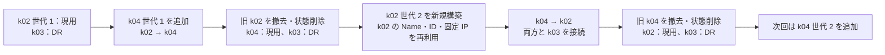

公式要件は Mesh 内の Name／ID の一意性であり、世代ごとに新しい値を永久採番することまでは要求していない。
ただし、同一識別子での削除・再作成について、この lab の全手順を公式が保証しているわけではない。
旧世代の状態を除去した後の再利用を本書の設計判断とし、UG-09／UG-10 で実証する。
世代ごとの新 Name／ID 採番は別の選択肢であり、本方式の必須条件にはしない。
参照：[Cilium Cluster Name／ID 要件](https://docs.cilium.io/en/stable/network/clustermesh/setup/#specify-the-cluster-name-and-id)。

| 値・資源 | 同じ枠の次世代での扱い |
|---|---|
| Cluster Name／ID、推奨 ASN | k02：`adc-k02`／`2`／`65012`、k04：`adc-k04`／`4`／`65012` を固定 |
| Node の Fabric 側固定 IP、PodCIDR、ServiceCIDR、Mesh API VIP | 旧世代の消滅確認後に枠ごとの値を再利用 |
| 個々の Pod IP／自動採番 ClusterIP | 同じ CIDR でも個別値の維持は保証しない。必要な Service IP は明示的に予約 |
| application VIP P／固定 Egress IP E | 枠の所有物ではなく現用アプリの所有物。移行先が使用中の値を枠の撤去で解放しない |
| Kubernetes etcd／resource UID、Cilium endpoint／identity、接続・NAT 状態 | 旧世代の状態を復元して引き継ぐ前提にしない。新規生成・同期 |
| API 証明書／kubeconfig、Mesh 証明書 | 新規発行・更新。Mesh の信頼 CA は共通管理し、旧 k02 への依存を除去 |
| Docker 管理側 IP、API host port、container ID | 再作成時の値を再検出。Fabric 側固定 IP の再利用とは区別 |
| workload／Secret／データ | 宣言設定とデータ復元・複製手順から構築。データの整合条件を満たす |

同じ表示名を使うため、試験記録には世代番号、構築日時、Kubernetes／Cilium version、image digest を残す。
旧と新の kubeconfig を区別し、古い API 接続先・認証情報の取り違えを防ぐ。

### 11.2 削除・再利用の判定手順

旧削除は即時 rollback の終了点である。全アプリ移行後、提案として少なくとも `24 時間` の観察期間を置き、
旧入口を使わない通信・DR 昇格・復帰・バックアップ復元を確認する。期間は利用形態に応じて実施前に確定する。
以下は初回の旧 k02 の例であり、次回は k04 と読み替える。

1. P／E の現所有者とデータ・ジョブ・CA の依存を記録し、旧 k02 を止めても k04／k03 が成立することを確認する。
2. 旧 k02 のアプリ広告と送信・writer／ジョブを停止する。両 BGR・Fabric・DCI の旧経路、GR による stale path を確認する。
   旧 P の撤回後に k04 を `current`／200 へ正規化する。Mesh API／Node 経路は切断作業が済むまで必要な範囲を残す。
3. 残存する **k04 と k03 の両方**から旧 k02 の Mesh 接続設定を除く。
   現行の `clustermesh.config.clusters` など保存された設定元も更新し、後の Helm 操作で旧接続が戻らないようにする。
4. 残存 agent／Mesh API／kvstore の旧 k02 に属する remote Node・endpoint・identity・Service 情報の削除を確認する。
   remote ID の登録解除と再同期可能な状態を確認する。削除が収束しない場合は再利用を止め、原因と版固有の手順を調べる。
5. 旧 k02 の container／Node と旧世代の永続状態を撤去し、自動再起動・再接続しない状態にする。
   終了時の Node／Mesh API／Pod 関連経路も確認する。対象に関係する DNS・ARP／ND・conntrack／NAT の残存は
   所有者と有効性を確認し、必要な範囲だけ失効させる。Fabric／他クラスタの状態を一括消去しない。
6. **旧 k02 が復帰せず、旧 remote state が消えたことを再利用条件とする。** `cacheTTL` の経過だけで可能とは判断しない。
   確認できなければ同じ ID／IP の新クラスタを接続しない。
7. 新版の k02 を fresh install する。同じ枠の CIDR・固定 IP と Name／ID を使うが、旧 etcd／Cilium 状態を丸ごと復元しない。
   再構築した k02 の IPAM が、k04 使用中の P を無関係な Service へ自動割当しないよう予約・selector を設定する。
   移行対象 Service への同一 P の明示割当は設計どおり行い、初期広告は `off` とする。
8. k04／k03 と改めて接続し、初回 full sync、証明書、remote endpoint、Policy の許可・拒否を確認する。
   再作成前の Pod／identity が誤った許可や Service backend として残らないことを確認し、7 節の次回サイクルを開始する。

### 11.3 実装差分

| 実装時の変更対象 | 必要な差分 |
|---|---|
| topology／kind／機器台帳 | k04 の 3 Node と接続、独立 CIDR、image digest、Node IP 初期化、資源 preflight |
| Cilium values／Mesh | k04 の ID／Name／API VIP、共通 CA 信頼、3 クラスタ map、namespace／Policy |
| LB IPAM／Service／BGP | P の固定割当、Service 単位状態、exact route、集約 selector 除外、必要な NodePort |
| ADC BGR／Fabric | 同一 ASN の k04 neighbor、両 AF の P 受信許可、独自 community → Local Preference、prefix 数上限、FIB 検査 |
| DCI／DR | 既存 DCI で k04 Node／Mesh API／P の伝播を確認。BGW 変更は任意の制限導入時のみ。DR の受信許可・fencing を別途設計 |
| Egress | 旧・新の専用 Gateway、E-A の別 IP／E-B の IP 移管、E exact 受信許可、往復経路、移行票、Step 3／R とジョブ制御を実装 |
| 構築 driver | k02／k03 固定から k04 とクラスタ別 version・世代を扱う設計へ拡張。枠の再利用と P／E 所有権を分離 |

Nexus 側の Leaf／BGR 標準差分と BGW の任意制限案は
[レビュー用 Config](../../../nxos_multisite/configs/changes/cilium-k04-upgrade/README.md)として作成した。未適用である。
2026-09-25 に [k04 の構築準備](../../../nxos_multisite/k8s_kind/k04/cilium/README.md)と
[CDC 除外＋k04 topology](../../../nxos_multisite/nxos-fabric-multisite-no-cdc-k04.clab.yaml)を作成した。
Kind／Cilium／Tetragon、API 専用 BGP、3 クラスタ接続先 overlay、NodePort 検証、広告 `off` の引継ぎ例を含む。
既存 topology と基盤 resources を保持し、offline renderer／整合検査を追加した。未デプロイ・未適用である。
Egress 初期化・IP 移管とクラスタライフサイクルの自動化は、受入条件を満たしてから別途実装する。
NX-OS config を実装する際は正規の `generate_as_changes.py` と公開前サニタイズを適用する。

## 12. 未確定事項と参照資料

実装前に確定するのは、k04 の収容・Node ネットワーク、移行する Service／固定 P、事前検証端末、
Egress のアプリ別方式・既存の外部観測 IP・専用 Gateway 配置・外部許可リスト、データ方式・RPO、停止許容時間、DR の公開先である。
本書の最小試験構成は「固定 k02／k04 枠・同一 ASN＋NodePort 事前検証＋独自 community／広告 gate＋旧・新専用 Gateway／API mock」とする。
E-A の別 IP と E-B の同一 IP 移管を両方の受入対象とし、E-B は停止・接続再確立を含む計画更新として扱う。
Cilium Gateway worker と Mesh の併用は別の実験判定とし、Gateway 実装の選定前に成立済みとは扱わない。
同じ P への試験端末限定が必要と判明した場合だけ、PBR／専用 VRF 案を追加する。
ASN は同一を推奨するが、AS_PATH による識別が必要なら別 ASN 案へ変更できる。両案で移行状態の設計は共通とする。

- [アドレス台帳](parameter-and-address-allocation.md)
- [既存の集約設計](bgp-route-aggregation-design.md)
- [既存の Node 保守・経路退避](../runbooks/bgp-maintenance-and-route-drain.md)
- [Cilium Global Services](https://docs.cilium.io/en/stable/network/clustermesh/global-services/)
- [Cilium Service Affinity](https://docs.cilium.io/en/stable/network/clustermesh/affinity/)
- [Cilium MCS](https://docs.cilium.io/en/stable/network/clustermesh/mcsapi/)

公式機能の記述と、本 lab 向けの値・操作順序・受入目標を区別する。
参照日は 2026-09-24。stable 文書は更新されるため、実装時は採用 patch の CRD・release note と再照合する。
