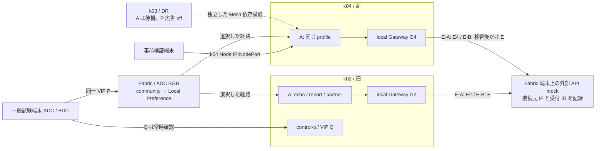
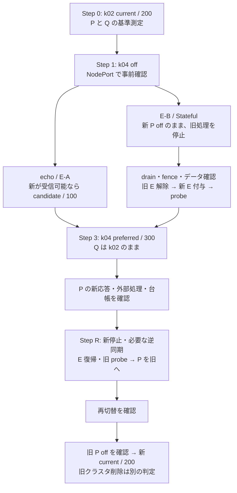

# クラスタアップグレード試験のアプリケーション設計

作成日：2026-09-25。初版は設計のみ。後続の [移行・復帰の手順](../tests/upgrade-rehearsal-runbook.md)で、
小規模な VIP／Egress 試験アプリと測定・撤去を実装し、[初回の往復試験](../results/multisite/2026-09-25/upgrade-rehearsal.md)を実施した。
Stateful／DR の全機能は未実装。

[クラスタ入れ替え設計](clustermesh-cluster-upgrade-design.md)のアプリ例を、実装・試験の単位へ具体化する。
推奨順は **Ingress の単純切替 → 別 Egress IP → 同一 Egress IP → Stateful → DR**。
最初から全機能を同時に動かさず、同じ移行対象 VIP を試験ごとに再利用して構成を小さくする。

## 1. 初版作成時に計画・準備されていた範囲

| 対象 | 現在の状態 | 今回補う内容 |
|---|---|---|
| `report-api`／別 Egress IP、`partner-submit`／同一 Egress IP | 既存設計の 8.7 節に業務例・切替・復帰の案あり。未実装 | API、外部観測、データ、合否を定義 |
| k04 の `app-a` | [nginx のマニフェスト](../../../nxos_multisite/k8s_kind/k04/cilium/manifests/handover/app-a/workload.yaml)と Pool／Advertisement を準備済み。未適用 | k02 の対になる構成、比較用アプリ、測定 runner を追加する必要あり |
| k04 の `k04-preflight` | [導入記録](../results/multisite/2026-09-25/k04-clustermesh.md)で稼働・NodePort `32583` を確認済み | 基盤確認用として維持。アプリ移行試験の代用にはしない |
| 3 クラスタ Mesh | 接続と限定疎通を確認済み | アプリの切替・データ復帰・DR 昇格は未実施 |
| Egress／Mesh | k02／k03 の限定試験は `Partial`。現在は Egress Gateway 無効へ復帰済み | k04 を含む共存回帰と、方式ごとの開始条件を満たす必要あり |

既存 nginx は `cluster`／`pod` を返すだけで、外向き API 呼出し・データ保存・冪等性を実装していない。
これは初版作成時の棚卸しである。後続のリハーサルでは専用 namespace の別定義を使い、
同一 VIP と E-A／E-B の外部 API 往復まで実装・試験した。以下の Stateful／DR などは引き続き後続計画とする。

## 2. 推奨するアプリセット

| 論理アプリ | 役割・配置 | 状態／外部依存 | 主な確認 |
|---|---|---|---|
| `app-a`／echo | 移行対象。k02／k04 各 2 Pod、worker ごとに配置 | Stateless、外部依存なし | 同一 VIP、community、応答先、切替・復帰 |
| `control-b` | 移行しない比較用。k02 に 2 Pod | Stateless、専用 VIP Q | A だけが切り替わり、B の経路・通信が維持される |
| `report-api` | A の別 Egress IP 試験用 profile。旧・新各 2 Pod | Stateless、参照 API mock | 利用者 → P → アプリ → 外部 API の一連の成功と E2／E4 |
| `partner-submit` | A の同一 Egress IP 試験用 profile。各クラスタ 1 Pod、現用のみ処理 | 取引先 API mock。後続 profile でローカル台帳を追加 | E の単独移管、再接続、重複登録なし、データ復帰 |
| `mesh-dependency` | k02／k04／k03 各 1 Pod、別 namespace | 読取専用 Global Service | k04–k03 の依存通信、local 優先／remote fallback |
| 外部 API mock | 既存 Fabric 端末上の専用プロセス／コンテナ | 接続元 IP の許可判定、受付台帳 | 実際の送信元、要求と副作用の照合 |
| 試験 runner | ADC／BDC の既存 Fabric 端末 | JSONL 記録。業務状態は持たない | 両 AF、操作時刻、失敗、応答 cluster、長時間接続 |

`echo` → `report-api` → `partner-submit` は **独立した試験回**として同じ A の枠を使う。
各回で旧を基準状態へ戻し、前回の試験資源・Egress Policy を撤去してから profile を変更する。
切替中にアプリ実装まで取り替えない。B は各回を通じて旧クラスタに残す。
複数アプリを同時に順次移す追加試験では、後続アプリに別 VIP を割り当てる。
同じ VIP の port／URL の違いを BGP で個別移行できるとは扱わない。

最小構成では nginx の A と B の計 6 Pod＋端末の runner から始める。
Egress 段階で A を小さな HTTP アプリに置換し、外部 mock を追加する。
巨大なデモ一式、外部共通 NAT、常設 proxy、新しい containerlab ノードは必須にしない。

## 3. 構成と通信の見分け方

図の G2／G4 は各クラスタ内の Cilium Gateway worker を想定する実験構成。
**共通 NAT は使わず、E-B は E 自体を移す。** 旧 Gateway を新クラスタから借りない。
外部 mock は受信先であり、NAT や中継 proxy ではない。

入口 Service は `global=false`／`shared=false` とし、local backend だけを選ぶ。
BGP が k02 を選んだのに Global Service が k04 の Pod へ転送するような観測の混在を避ける。
応答の `cluster` だけで入口を断定せず、両 BGR の best path／FIB、Hubble、Pod ログも対応付ける。

事前検証は新 P を `off` にして k04 の NodePort を試験端末から呼ぶ。
これは宛先を変えて試験通信だけを新へ送る方式であり、送信元別の BGP 選択ではない。
試験端末以外を技術的に拒否する場合は NodePort の入口 ACL 等を別途用意し、実際に見える送信元と拒否を確認する。
アプリ内の Header による送信元判定をアクセス制御の根拠にしない。

## 4. VIP・Egress IP・リソースの扱い

| 用途 | 設計値・決め方 | 状態 |
|---|---|---|
| A の P | IPv4 `172.16.14.20`、IPv6 `fd21:0:0:14:0:0:1:100` | 既存ひな形の値。実装前に全クラスタの Service／Pool と稼働 RIB で所有を照合 |
| B の Q | 候補 `172.16.14.21`、`fd21:0:0:14:0:0:1:101` | 未予約。P と同じ既存集約内の比較用。競合確認後に確定 |
| Mesh API VIP | クラスタ固有の既存値 | 試験 A／B の Pool・Advertisement から除外 |
| E-A | アプリ専用の E2／E4、DR 時は E3 | 具体値は未予約。既存 Egress 台帳、再付与 helper、全 Node の所有を照合して決定 |
| E-B | アプリ専用の固定 E、両 AF 各 1 個 | E2／E4 と別に予約。Node IP や Mesh API VIP を流用しない |
| A の namespace／Service | `cilium-upgrade-app-a`／`app-a` | 既存ひな形を継承。profile ごとの backend を選ぶ |
| B の namespace／Service | `cilium-upgrade-control-b`／`control-b` | 新規作成予定 |
| 外部 mock | ADC `t1sv0101`、BDC `t1sv0104` の Fabric 側 IP を候補とする | 先行共存試験で使用実績あり。専用 port の空き・経路は実装前に確認 |

既存設計の説明用 E／mock アドレスを、そのまま稼働環境に割り当てない。
同じ E を別アプリと共有すると移行単位も共有アプリ全体になるため、基本試験では専用 E とする。
共有 E の制約確認は、後続の独立した試験回で sender をもう 1 個追加する。

P は exact route `/32`／`/128`、B は旧の既存集約経路を使う対照とする。
移行ラベルは `off`／`candidate`／`current`／`preferred`、広告時の community はそれぞれなし／
`65010:100`／`65010:200`／`65010:300`。ADC BGR の LP 変換は既存設計に従う。
P の広告を止めても旧集約経由で届く可能性があるため、処理停止は広告だけに頼らない。

現在の k04 BGR policy は Mesh API のみが基本で、準備済み移行 policy も P が対象。
E の受信許可・戻り経路、k03 の P／E 受入、必要な Pool／Advertisement は追加実装が必要である。
BGW の変更は既存伝播で不足する証拠がある場合に限定する。

## 5. アプリの実装仕様

### 5.1 共通部分と echo

既存 nginx と curl の digest 固定 image を echo／比較用に再利用する。
`report-api` と `partner-submit` は小さな HTTP サーバとして同じコードベースの profile で実装する案とし、
標準ライブラリ中心の Python と SQLite を候補にする。image の具体 tag／digest は実装時に固定する。
旧・新は初回に同じアプリコードを使い、`cluster`／`generation` だけ変える。
Kubernetes 更新とアプリ更新を同時に原因候補へ加えない。意図的な不具合版は後続試験で導入する。

| API／制御 | 仕様 |
|---|---|
| `GET /healthz` | プロセスの生存。外部 API の成功とは区別 |
| `GET /readyz` | 受付可能か。待機・drain 中は新規業務を受けない |
| `GET /whoami` | `app`、`cluster`、`generation`、`pod`、`request_id` を返す |
| `GET /stream` | 1 秒ごとの連番と cluster を返す長時間応答。切断と再接続を別記録 |
| 業務受付停止 | 管理操作で新規受付を止め、処理中件数を取得。管理 API は利用者用 Service に公開しない |
| 不具合注入 | 新側だけで業務 `503`、外部 timeout、応答後遅延を個別に再現。BGP が正常でも失敗を検出できること |

通常は 2 replica を worker 間に分散し、既存 `externalTrafficPolicy: Cluster` を継承する。
Stateful profile は 1 writer／1 replica に変更する。変更は別試験回の準備段階で行う。
readiness だけを writer の fencing とせず、処理停止・実行主体の停止と外部側の確認を組み合わせる。

### 5.2 report-api：別 Egress IP の業務

`GET /report?request_id=...&upstream_af=4|6` が外部 mock の `GET /reference` を呼び、
参照値、実行 cluster、mock の観測送信元、外部要求 ID を返す。
外部依存が失敗した場合は `502`／`504` を返し、固定文の `200` で成功扱いにしない。
mock は E2／E4 の両方を許可し、先行許可漏れでは `403` と実接続元を記録する。

主試験は Ingress IPv4 → Egress IPv4、Ingress IPv6 → Egress IPv6。
追加で 4→6／6→4 も行い、入口の AF から出口の AF を推測していないことを確認する。
初回は自動再試行を無効にし、次の試験で回数制限つき再試行を有効にする。
両クラスタで参照要求を同時処理してよいが、CronJob／書込みはこの profile に含めない。

### 5.3 partner-submit：同一 Egress IP と副作用

最初はローカル DB を持たない profile で E の移管・逆移管を確認する。
`POST /submit` は client が指定した冪等キーを外部 mock の `POST /requests` へ渡す。
外部 mock は `run_id + idempotency_key` を一意にし、同じ payload の再送には同じ receipt を返す。
同じキーで異なる payload は拒否する。IPv4／IPv6 listener は同じ受付台帳を参照する。

外部登録後に応答が失われた場合も、別キーで作り直さず、同じキーで照会・再送する。
`GET /requests/{key}` で照合できない間は結果不明として停止し、成功や取消を推測しない。
定期 sender は通常停止し、ジョブ試験時だけ現用側の 1 個を有効にする。

新側の事前確認は内部機能と別の試験用 mock に限定する。
E-B の本番相当 mock に、Node IP／E4 等の代替送信元を許可して事前確認を通さない。
旧停止 → E 単独移管 → 新の `GET /health` 成功を確認するまで新側の登録を禁止する。

### 5.4 Stateful の追加 profile

`partner-submit` に、クラスタごとの独立 PVC と SQLite 台帳を追加する軽量案を初回に採る。
1 クラスタ 1 Pod／1 writer、同じ schema のまま、停止中の export／import で移行する。
Cluster Mesh を DB／PVC の複製機構とは扱わない。共有 DB を使ってクラスタ間データ移行を省略しない。

台帳は冪等キー、payload hash、状態 `pending/committed`、外部 receipt、連番を保持する。
外部呼出し前に `pending` を永続化し、外部受付を照合して `committed` にする。
切替直前に処理を止め、未確定要求を解決して、停止済み台帳の論理 export・件数・hash を取得する。
新側へ import して全行を比較した後、旧 writer が動かない状態で新 writer を有効化する。

**rollback は新側で書いたデータを旧へ戻すところまでが試験対象。**
新側を停止・fence → 未確定要求の照合 → 新台帳を export → 旧へ import／比較 →
旧側へ E を逆移管 → 外部 probe → 旧 writer・Ingress を再開する。
旧の古い PVC をそのまま起動する復帰は合格にしない。
受付成功済みの全 ID の欠落 0、重複外部登録 0、同時 writer 0 を計画移行の目標とする。

この方式は停止を伴う小規模データ移行・復帰の検証用であり、実 DB のオンライン複製や HA を証明しない。
実アプリが PostgreSQL 等なら、その DB 固有の複製・昇格・逆同期・schema 互換試験を別途追加する。
PVC の容量案は各クラスタ `256Mi`、少量の試験データに限定する。
StorageClass／Provisioner は未確認であり、クラスタ間コピーと Node 障害復帰を混同しない。

## 6. 外部 mock と観測

mock の要求ログには、実 socket の peer IP、時刻、`run_id`、冪等キー、payload hash、receipt、
受付結果、アプリが申告した cluster／generation を記録する。
送信元の証拠は socket／packet capture とし、`X-Forwarded-For` や自己申告 JSON で代用しない。
許可外 IP は処理前に拒否し、拒否した接続元もログへ残す。

参照 API と登録 API は許可 IP と台帳を分離する。登録台帳は試験中に再起動しても保持する。
ADC／BDC に同じ登録 mock を独立配置して二つの台帳を作ることはしない。
Site-A 全断を扱う DR 試験では、登録 mock の正本を最初から BDC 等の障害対象外へ置き、
その回の通常運転・移行・DR で同じ台帳を使う。ADC 内 mock の消失を DR アプリ障害と混同しない。

runner は接続開始・終了の単調時刻、操作 ID、AF、VIP／NodePort、HTTP status、応答 cluster、
接続／全体時間、エラー、外部 receipt を JSONL に保存する。再試行の全 attempt を残す。
通常の新規接続、keepalive、長時間接続、ジョブを別々の試験回に分ける。
NAT／conntrack のクラスタ間引継ぎは前提にせず、既存接続の切断数と新規接続の復旧を分けて評価する。

## 7. ステップと期待結果

| 順番 | 試験 | 主な判定・既存 ID |
|---|---|---|
| 1 | A／B の基準、P exact route と B の集約 | P のみ対象。Mesh API と Q を維持。`UG-02` |
| 2 | echo の candidate → preferred → rollback | 両 BGR の属性と実応答が一致。候補は準備完了後だけ広告。`UG-03/04` |
| 3 | echo の新側業務 `503` | BGP 正常でも runner が失敗を検出し、手動 rollback で回復。`UG-05` |
| 4 | report-api の E-A | E4 事前許可、旧 E2 維持、移行／復帰ごとの外部送信元と成功。`UG-06A` |
| 5 | partner-submit の E-B、DB なし | 旧送信停止、単独所有、移管、probe、本処理、逆移管。`UG-06B-own` |
| 6 | partner-submit の Stateful | 停止中コピーを予行し、新側書込み後の逆同期まで実施。`UG-08` をこの移行の前提へ |
| 7 | 接続・ジョブ・共有 E の追加条件 | 既存接続と新規復旧、二重実行 0、共有 E の全利用者停止。`UG-06C` |
| 8 | k04–k03 の依存通信、手動 DR 昇格・復帰 | 依存通信と P／E／writer の昇格を別判定。`UG-07` |

E-B／Stateful は旧が受信不能になるため、旧 P を自動 fallback 先として残さない。
データ・E の準備失敗時は入口を再開せず、旧への復帰条件を満たしてから戻す。
新の `preferred` を `current` へ下げるのは、旧広告の撤回を全選択点で確認した後に限定する。

## 8. Mesh・DR の専用試験

`mesh-dependency` は Global Service 用 namespace を明示して共有し、各クラスタで同名 Service を作る。
入口の P／Q と独立した ClusterIP とし、`affinity=local` を基準にする。
local endpoint の停止と復帰、remote の実行 cluster を記録する。
k04→k03 を確認する回では、k02 の共有を止める等により候補を明示的に限定する。
`local`／`remote` だけで複数 remote cluster の順序を指定できるとは扱わない。
この機能の意味は [公式 Service Affinity](https://docs.cilium.io/en/stable/network/clustermesh/affinity/)に従う。

k03 の業務アプリは事前配備するが、P の広告・writer・ジョブは待機状態とする。
DR 昇格は Site-A の送信／writer を fence し、データ・Egress を受け入れてから P を広告する。
計画停止コピーの Stateful profile は、突然の site 喪失に対する RPO 0 を保証しない。
非計画 DR を行う回では事前に保存した checkpoint を用い、失った成功 ID と復旧時間を実測する。
Site-A 復帰で旧 writer／E が自動復活しないことも確認する。
MCS は初回に追加しない。

## 9. 合否・開始条件・資源

切替前／後に各 `60 秒以上` を記録し、収束後の誤 cluster 応答 0、対象外 B の新規失敗 0、
Egress の想定外送信元 0、重複登録 0、同時 writer／同一 E 所有者の二重化 0 を目標にする。
入口の計画切替・rollback の回復 `5 秒以内` は既存設計の提案目標であり、達成済みの値ではない。
操作開始から期待 cluster への連続成功 3 回を確認するまでを測り、その後も観測窓全体の継続を確認する。
業務停止時間は受付停止から外部処理成功まで別計測し、データコピー時間を除外して短く見せない。

[初回の k04 試験](../results/multisite/2026-09-25/k04-clustermesh.md)には短 timeout／並列条件で失敗がある。
低負荷から始め、端末・AF の組を分け、対象 P と対照 Q の同時要求をまず計 2 以下にする。
各回で timeout・頻度・並列数を固定し、操作のない基準測定が同条件で安定することを開始条件にする。
例として connect `3 秒`／全体 `5 秒`、各対象最大 `1 request/秒`、未完了要求の無制限な積み上げなしを用いる。
この条件で基準自体が不安定なら `5 秒` の切替目標は判定保留とし、原因調査へ戻る。
長い timeout での成功は到達性の別結果として記録し、切替目標の合格に置き換えない。

Cilium Egress と Mesh は引き続き公式非互換扱いの実験である。
同一クラスタの Gateway を使用し、新規 Pod の Policy 反映前の送信も観測する。
実装上の制約は [公式 Egress Gateway 文書](https://docs.cilium.io/en/stable/network/egress-gateway/egress-gateway/)を参照。
参照時の stable は `1.20.2`、今回の稼働版は `1.20.1` であり、公式記載と lab の実測を区別する。
固定 IP 必須の業務送信は Policy／BPF map／外部 probe の確認まで停止する。
許可外 IP の接続を外部で拒否できても「その IP の packet が送出されなかった」証明にはしない。

Egress 統合前には k04 を含む共存回帰、E の初期化・単独移管・戻り経路を受け入れる。
Node／Gateway 障害を含む試験は `TI-009` のアドレス・経路復帰も開始条件にする。
詳細は [既存設計の段階別条件](clustermesh-cluster-upgrade-design.md#upgrade-current-gates)を継承する。

資源の初期案は nginx が既存どおり request `20m/32Mi`、HTTP アプリが `50m/64Mi`・memory limit `128Mi`。
mock と runner は各 `128Mi` 程度を初期枠とし、起動前後の実測で調整する。
Stateful／DR の profile は順次追加し、待機を含めた Pod 数・メモリ・ホスト CPU を記録する。
過負荷で Fabric の既知遅延を増やした場合は、機能の切替失敗と分けて扱う。

## 10. 次の実装単位

1. k02／k04 の echo A、k02 の B、共通 runner、移行票・結果集計を準備する。
   P／Q の予約、Pool 重複、BGR policy の差分、切替前状態への復帰手順を具体化する。
2. 共通 HTTP アプリと外部 mock、E-A／E-B の独立 profile を作る。
   専用 E の実値、Gateway worker、再付与構成、IPv4／IPv6 別 Policy、受信許可を確定する。
3. Stateful の export／import／照合、ジョブ停止、障害注入、k03 の DR profile を追加する。
   停止コピーと逆同期を予行してから、書込みを伴う本切替へ進む。

各試験の manifest・image・設定 hash、開始時状態、適用差分、戻し方を結果と一緒に保存する。
生ログと実行時データは Git 対象外の `operations/` に置く。
撤去は対象 namespace／Policy／専用 IP／経路に限定し、共有 CA・Mesh API・無関係なアプリを削除しない。
旧クラスタ削除と次世代 k02 の再作成は、このアプリ試験の合格後に別の実施段階として扱う。

文書のローカルリンク・コードブロックと差分の空白検査は成功した。
公開 config 検査も 140 ファイルで成功し、変更 0、除去対象 username block 0、
保持した lab 用管理設定 530 件、global address 等の検査違反 0。
今回は文書整備のみであり、新しいアプリのビルド・デプロイ・実通信試験、Git 履歴の機密情報調査は実施していない。
