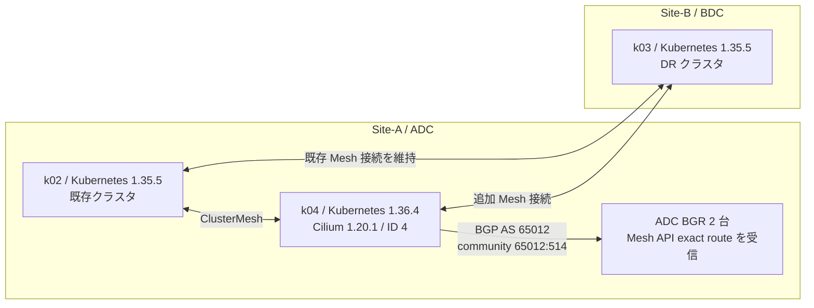

# k04 の Cilium 導入と 3 クラスタ Mesh

2026-09-25 実施。[k04 の追加](k04-addition.md)に続く基盤導入。
**k04 の基盤導入と 3 クラスタ Mesh の接続・限定疎通は完了。短い timeout／並列条件での遅延は残課題とする。**

## 対象と構成

| 項目 | k02 | k03 | k04 |
|---|---|---|---|
| 用途 | Site-A の既存クラスタ | Site-B の DR クラスタ | Site-A のアップグレード先 |
| Kubernetes | 1.35.5 | 1.35.5 | 1.36.4 |
| Cilium／Tetragon | 1.20.1／1.7.0 | 1.20.1／1.7.0 | 1.20.1／1.7.0 を新規導入 |
| Cluster Name／ID | adc-k02／2 | bdc-k03／3 | adc-k04／4 |
| BGP ASN | 65012 | 65022 | 65012 |

k04 の BGP 広告は `172.16.34.10/32` と `fd21:0:0:34:0:0:1:10/128` の Mesh API 専用。
アプリ VIP の引継ぎ・優先度変更、Egress Gateway の有効化・Egress IP 移管は含めない。
BGW の設定変更も行わない。

## 実施と差分

1. ADC BGR 2 台の running／startup を退避し、前回追加分を startup-config へ保存。
   保存前 running と保存後 startup の設定行が両台で一致した。
2. k02／k03 の Cilium user values、全 values、manifest を非公開領域へ退避。
   Egress Gateway／BPF masquerade が false の通常構成であることを確認した。
3. k04 の kubeconfig の context が `kubernetes-admin@adc-k04` だったため、
   手順で使う `kind-adc-k04` へ参照名を正規化。API 接続先・CA・クライアント証明書は維持した。
4. worker の BGP label を設定し、preflight は `75 PASS / 3 WARN / 0 FAIL`。
   WARN は導入前の bpffs 未 mount で、Cilium の自動 mount 対象。
5. 共通 CA を k04 へ準備して Cilium を導入。初回の Pod 作成は Cilium API timeout が発生したが、
   自動再試行後に CoreDNS・証明書 Job・Mesh API が起動した。Agent／Node の再起動や再作成は行っていない。
6. 基盤 resources の server dry-run 後に適用。BGP は `8/8 Established`、両 BGR は上記 exact route を
   k04 の両 worker から受信し、community `65012:514` を保持した。
7. CoreDNS の upstream を Pod から到達可能な lab resolver に設定し、直接・Cluster DNS の名前解決を確認。
   Tetragon を observe-only で導入した。
8. k02、k03 の順に、保存した values へ `90-clustermesh-three-clusters.yaml` を重ねて Helm upgrade。
   接続先追加前の k04 では `etcdserver: permission denied` が発生した。相互設定完了後の状態と区別する。

## 検証結果

3 クラスタは各 remote 2 クラスタへ Agent `3/3`、KVStoreMesh `2/2` で接続した。
k02／k03 の user values の差分は `.clustermesh.config.clusters` だけであることを照合した。

| 検証 | 結果 |
|---|---|
| k04 Cilium／Envoy／Tetragon | 各 `3/3`、Mesh API `2/2` |
| k04 BGP | `8/8 Established`。両 BGR で IPv4／IPv6 各 2 path と `65012:514` を確認 |
| 3 クラスタ間 Pod HTTP | 6 方向 × 送信元 worker 2 台 × 宛先 worker 2 台 × 両 AF、`48/48` 成功 |
| NodePort | 両サイト × 入口 worker 2 台 × 固定 backend worker 2 台 × 両 AF × 3 回、`48/48` 成功 |
| 全クラスタ BGP | k02／k03／k04 各 `8/8 Established` |
| 最終 Node／Agent | 全 `9/9` Node Ready、Cilium／Envoy／Tetragon は各クラスタ `3/3` |
| 最終 Cilium health | 全 9 Agent から 9 Node の Node／health endpoint、両 AF・ICMP／HTTP、`648/648` 成功 |

最初の Pod 試験は並列 6、接続 3 秒・全体 6 秒で timeout が発生し、
検査用 `kubectl exec` 自体の 20 秒 timeout で全件の集計前に停止した。
最初の NodePort 試験は並列 8、接続 3 秒・全体 5 秒で `19/48` 成功だった。
これらの失敗を後続結果で上書きしない。

同時期の Cilium health でも Node／health endpoint の通信に数秒、最大約 8.6 秒の遅延を観測した。
Pod endpoint は Ready・Policy enforcement 無効で、単発の両 AF HTTP は成功した。
並列 2、接続 10 秒・全体 30 秒で再試験すると Pod `48/48`、NodePort `48/48` が成功した。
Pod HTTP の再試験は接続時間中央値約 0.38 秒・最大約 1.52 秒、全体中央値約 0.77 秒・最大約 2.42 秒だった。
長い timeout でしか成功しなかったという結果ではないが、初回と並列数・試験時刻も異なるため単一要因の比較ではない。
ホスト負荷や初期収束の影響を疑うが、負荷だけが原因と確定したわけではない。
この受入は到達性の確認であり、短い timeout 条件や性能の合格ではない。
初回・再試験とも外部端末の IPv6 受信 capture では不正 checksum を観測していない。
再試験では ADC 58 packet、BDC 68 packet で `cksum (correct)` を確認し、`incorrect` は 0。
k04 の `cilium_vxlan` の `tx-checksum-ip-generic` は初期値 `on` を維持している。
k02／k03 の既存回避策は変更しておらず、この限定試験をもって `TI-001` の恒久解決とはしない。
並列・遅延の観測は [課題台帳の TI-004](../../../test-issue-register.md)へ追記した。

## 終了状態と残項目

最終状態の採取時刻は 2026-09-25 13:37:02 JST。
3 クラスタの一時 namespace `cilium-k04-mesh-check` は撤去済み。
k04 の `cilium-k04-preflight` は確認用として残した。
試験中に固定した Service selector と追加 Pod label は復元し、現在は両 worker の backend を持つ。

| k04 の確認先 | 値 |
|---|---|
| namespace／Service | `cilium-k04-preflight/k04-preflight` |
| NodePort | `32583/TCP`（今回の割当。再作成時は取得し直す） |
| worker の IPv4／IPv6 | `http://172.16.6.21:32583/`、`http://[fd21:0:0:6::2:1]:32583/` |
| worker2 の IPv4／IPv6 | `http://172.16.6.22:32583/`、`http://[fd21:0:0:6::2:2]:32583/` |
| 応答 | `cluster=adc-k04 pod=...` |

これらは NodePort であり、アプリ用 VIP の BGP 広告は開始していない。
Egress Gateway は全クラスタで無効、Global Service 切替・Ingress 同一 VIP 引継ぎ・Egress 移管・障害／性能試験は未実施。
短い timeout での遅延と、先行試験の Node interface 復帰時のアドレス・経路復元課題は残る。
今後のアップグレード試験では、到達性と性能・無介入復帰の合否を分ける。

## 保存先と再適用

証跡・元の values・稼働設定は Git 対象外の
`nxos_fabric/nxos_multisite/operations/k04-mesh-20260925-130224/` に保存した。
Secret や生ログを公開ファイルへ転記しない。

公開 config の検査は 140 ファイルで成功し、変更 0、除去対象 username block 0、
保持した lab 用 SNMP／NTP／logging 等の管理設定は 530 件。global address 等の検査違反はなかった。
Git 履歴内の機密情報調査は今回の対象外。稼働証跡と kubeconfig が Git の ignore 対象であることも確認した。

k04 接続中に従来の 2 クラスタ用 `multisite-final` をそのまま再適用すると、接続先一覧から k04 が外れる。
再適用時は [k04 構築手順](../../../../../nxos_multisite/k8s_kind/k04/cilium/README.md)の
3 クラスタ用 overlay を最後に重ねる。k02／k03 の通常時用 values は 2 クラスタの基準として保持する。
