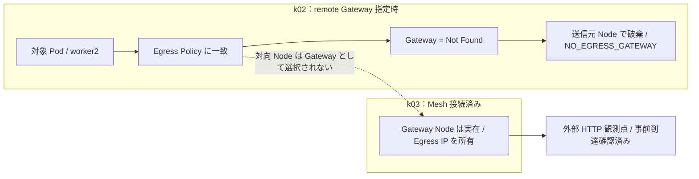

# 別クラスタの Egress Gateway を利用できないことの確認試験

2026-09-25、clab02 の k02／k03 で、ユーザー依頼に基づき実施した。
目的は「Mesh 上で認識・到達できる対向 Node を、Egress Policy の Gateway として選べるか」を確認すること。
同一クラスタ内の [共存試験](egress-clustermesh-coexistence.md)とは別に、対向クラスタの Gateway を利用できないという制約の確認結果を記録する。

## 試験条件

Kubernetes `1.35.5`、Cilium `1.20.1`、kernel `5.14.0-611.49.1.el9_7.x86_64`。
両クラスタで Egress Gateway／BPF masquerade を一時有効化し、CRD identity、CES 無効を維持する。
通常 values と `cilium-config` を変更前に保存し、試験後に戻した。

| 項目 | k02 | k03 |
|---|---|---|
| 試験 namespace | `cilium-remote-egress-0925` | 同左 |
| selected Pod | `smoke-worker2`、worker2 配置 | 同左 |
| control Pod | `smoke-worker`、worker 配置 | 同左 |
| local Gateway | `adc-k02-worker` | `bdc-k03-worker` |
| remote Gateway 指定 | `bdc-k03-worker` | `adc-k02-worker` |
| local Egress IP | `172.16.24.1`／`fd21:0:0:24::1` | `172.16.25.1`／`fd21:0:0:25::1` |
| 観測点 | ADC `t1sv0101` | BDC `t1sv0104` |

Gateway は `kubernetes.io/hostname` の完全一致で選択する。remote 指定時は `egressIP` も対向 Gateway が所有する IP へ変える。
Pod selector は両クラスタで同じ label／namespace とし、Policy の宛先はそれぞれの観測点 `/32`／`/128` のみ。
外部 HTTP 観測は専用 nginx の `8089/TCP` を使用する。
一方を remote 指定にする間も、対向クラスタは正常な local Gateway Policy を維持する。

## 事前確認と切り分け

- 変更前は両クラスタとも Cilium／Mesh／BGP／Hubble が正常。サイト間 Pod HTTP `16/16`、Global Service `8/8`。
- `cilium-dbg node list` は対向の 3 Node を `clustermesh` source として表示する。
- 予約済み Egress IP は全稼働 kind Node 上で未使用。今回の専用 interface と BGP 広告を作成した。
- 両 Gateway から自身の Egress IP を送信元に指定し、両サイトの観測点への IPv4／IPv6 HTTP が計 `8/8` 成功。
- 試験では Fabric interface down/up、Nexus の設定変更、Node label の追加を行わない。

経路・IP 所有・外部 server の正常性を先に確認し、単なる timeout を Gateway 非対応の根拠にしない。
対向 Node が存在するクラスタと存在しないクラスタの API selector 結果、Policy の API 受理、BPF map、
Hubble drop reason、外部 access log、local 指定へ戻した際の成功を照合する。

## 結果

**別クラスタの Gateway を利用できないことを確認した。Cilium `1.20.1` の標準 Policy では、対向クラスタの Node を Egress Gateway として選択できなかった。**
local 対照 → k02 の remote 指定 → local 復帰 → k03 の remote 指定 → local 復帰の順に実施した。

| 確認項目 | k02 Pod → k03 Gateway | k03 Pod → k02 Gateway |
|---|---|---|
| 対向 hostname と一致する Kubernetes Node | 自クラスタ `0`／対向 `1` | 自クラスタ `0`／対向 `1` |
| Policy の server dry-run／apply | 受理 | 受理 |
| 対象クラスタの全 3 Agent の BPF map | 両 AF の Gateway が `Not Found` | 両 AF の Gateway が `Not Found` |
| selected Pod の HTTP（各 AF 3 回） | IPv4 `0/3`、IPv6 `0/3` | IPv4 `0/3`、IPv6 `0/3` |
| 外部 access log の対象 request ID | 6 件すべて未到達 | 6 件すべて未到達 |
| 対象 Pod の Hubble drop | `NO_EGRESS_GATEWAY`、各 AF 6 flow | `NO_EGRESS_GATEWAY`、各 AF 6 flow |
| 両クラスタの control Pod と対向 local Egress | `18/18` 成功 | `18/18` 成功 |
| local Gateway に戻した後の通信 | `24/24` 成功 | `24/24` 成功 |

Hubble の 6 flow は各 AF の 3 接続試行に伴う SYN／再送であり、独立した 6 接続の意味ではない。
破棄地点は送信元 Pod の Node、理由コードは `194`。対象外 Pod は Node IP で通信し、
対向クラスタの selected Pod は自身の local Egress IP で通信を継続した。
各 Agent の map は自身のクラスタの selected Pod の IP のみを含み、対向 Pod は含まなかった。
local 復帰後、Egress を両側で有効にしたままの Mesh HTTP `16/16`、Global Service `8/8` も成功した。

### 解釈とアップグレード設計への反映

[公式 Egress Gateway 文書](https://docs.cilium.io/en/stable/network/egress-gateway/egress-gateway/#incompatibility-with-other-features)は、
Cluster Mesh との非互換と、Gateway が selected Pod と同じクラスタに存在する必要性を記載している。
今回の結果は後者の制約と一致する。Policy の API 受理は Gateway の発見・転送成功を意味しない。
Mesh の Node 一覧に対向 Node が存在していても、標準 Policy の Gateway 選択候補にはならなかった。

[Cilium `v1.20.1` の datapath 実装](https://github.com/cilium/cilium/blob/v1.20.1/bpf/lib/egress_gateway.h)にも、
Gateway 未選択時に `DROP_NO_EGRESS_GATEWAY` を返す処理があり、BPF map と Hubble の観測に整合する。
ただし、公式の「非互換」がこの制約だけを指すとまでは証明できない。
先の local 共存結果を、組合せ全体の公式対応や全条件での動作保証に読み替えない。
偽の Node 登録や独自の転送処理による回避は試験対象外である。

- **同一 Egress IP を移行する案**：k04 の Pod が k02 の Gateway を借りる中間段階は採用しない。
  対象アプリの外向き通信を停止・drain し、旧側の利用・経路広告を止めた後に Egress IP の所有と広告を新側へ移し、
  k04 内の Gateway／Policy で再開する。rollback も逆順とし、停止時間と既存セッションの再接続を前提にする。
- **旧・新で別 Egress IP を使う案**：各クラスタが自クラスタ内の Gateway と IP を使う。
  外部許可リストに両 IP を事前登録できれば、アプリ単位の並行稼働・移行・rollback を組みやすい。
- どちらも Cilium Egress と Mesh の組合せは限定実験として扱い、既存の `Partial` 判定と `TI-009` は維持する。
  今回、別クラスタの Gateway を利用できないことを確認したが、それらの未受入事項を解消したことにはならない。

### 途中結果と試験側の修正

初回 local 対照は `23/24`。k03 の selected Pod の IPv4 初回が timeout し、後続 2 回は成功した。
map 収束確認後の再測定は `24/24`。原因は確定しておらず、初回失敗を除外して全試行成功とはしない。
既存の初期到達性課題 `TI-006` の解消根拠にも使用しない。

最初に k02 から対向クラスタの Gateway を指定した試験では、試験スクリプトが Gateway 未選択を数値 `0.0.0.0` と比較していたため、
CLI が表示した `Not Found` を期待一致と判定できず、HTTP 試験前に local Policy へ戻した。
表示に合わせて検査を修正し、上表の確認試験を再実施した。これは試験側の修正であり、Cilium の障害として数えない。
撤去確認でも、無効時には ConfigMap の `enable-egress-gateway` キーが省略されるため検査を修正した。
最終判定は Helm values の明示的な `false` と、変更前 values／ConfigMap data の完全一致に基づく。

## 撤去・回帰確認

専用 Policy 4 個を削除し、全 6 Agent の Egress map 消去を確認後、試験用 BGP 広告 4 個を撤去した。
ADC BGR 2 台・BDC Leaf 2 台で、個別 Egress 経路と集約の計 `24` lookup が `Route not found` であることを確認し、
全 4 worker の専用 `egress0` を削除した。Nexus の設定変更は行っていない。

両クラスタを順に試験前の Helm values へ復元した。values と `cilium-config` data は変更前と完全一致し、
Egress Gateway／BPF masquerade は無効、Egress Policy オブジェクトは空である。

| 通常構成での回帰項目 | 結果 |
|---|---|
| サイト間 Pod HTTP | `16/16` |
| remote affinity の Global Service | `8/8` |
| 両クラスタの外部 LB／worker 間 NodePort | `24/24` |
| 外向き HTTP と各 Pod の配置 Node IP への送信元復帰 | `24/24` |

両クラスタの試験 namespace を削除し、両観測点の専用 nginx を停止、`8089/TCP` 待受消失を確認した。
最終状態は各クラスタの 3 Node Ready、Cilium／Tetragon 各 `3/3`、Mesh agent `3/3`・KVStoreMesh `2/2`、
BGP 各 `8/8 Established`、Hubble `6/6`。全 6 Agent の Egress map は空である。
試験前の通常基盤へ復帰済み。

## 証跡

完全な values、manifest、Node 情報、map、HTTP 結果、Hubble flow、外部ログ、撤去確認は Git 管理外の
`nxos_fabric/nxos_multisite/operations/cilium-lab/2026-09-25/remote-egress/` に保存する。
認証情報と実機の raw config は本書へ転載しない。
