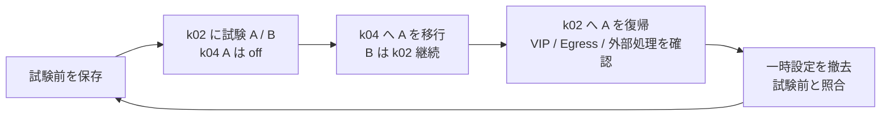

# k02 → k04 移行・k02 復帰・試験前復元の実施手順

2026-09-25 作成。対象は既存 k02／k04、ADC BGR 2 台、既存 Fabric 試験端末。
初回の [実施結果・測定上の制約](../results/multisite/2026-09-25/upgrade-rehearsal.md)も先に確認する。
[アプリ設計](../design/clustermesh-upgrade-test-applications.md)を小規模に実装した反復試験である。
**アプリの k02 復帰と、試験用設定の撤去を別の段階として確認する。**
同じ namespace・IP を同時に二つの試験から使わず、前回の復元を確認して新しい保存先で再実行する。

## 1. 今回の範囲と復元の意味

- VIP 単独、別 Egress IP、同一 Egress IP の順に、k04 への移行と k02 への復帰を行う。
- 同一 E は旧処理を停止して単独移管する。共通 NAT、対向クラスタの Gateway は使わない。
- k03 は Mesh 接続・既存設定を維持し、DR 昇格は行わない。
- Stateful DB／PVC のコピー、Node／サイト障害、長時間接続は別試験。今回の短い HTTP 成功で受入済みにしない。
- 試験前に k02 の業務アプリはないため、k02 への通信復帰を実証後、一時アプリも撤去する。
- Kubernetes の resourceVersion、Pod UID、rollout 時刻、Helm revision、BGP uptime、image cache まで巻き戻すことはしない。
  復元対象は Helm values／Cilium ConfigMap、既存 API resource の仕様、Node アドレス・経路、BGR 設定と既存通信である。
- Nexus の startup-config は試験中に保存しない。終了時に開始前との一致を確認する。



## 2. 実装・アドレス

スクリプトは [upgrade-rehearsal](../../../scripts/cilium-lab/upgrade-rehearsal/)、
一時 Nexus 設定は [Config](../../../nxos_multisite/configs/changes/cilium-upgrade-rehearsal/) を使う。
全アプリは独立 namespace `cilium-upgrade-rehearsal` に置く。

| 用途 | IPv4 | IPv6 |
|---|---|---|
| A の VIP P | `172.16.14.20` | `fd21:0:0:14:0:0:1:100` |
| B の VIP Q | `172.16.14.21` | `fd21:0:0:14:0:0:1:101` |
| E-A 旧 E2 | `172.16.24.101` | `fd21:0:0:24::101` |
| E-A 新 E4 | `172.16.24.104` | `fd21:0:0:24::104` |
| E-B 固定 E | `172.16.24.100` | `fd21:0:0:24::100` |
| 外部 mock | `172.16.0.1:18088` | `[fd21:0:0:1::101]:18088` |

E は各クラスタの `worker` の専用 dummy `uregress0` に付与する。既存の `egress0` は操作しない。
IPv6 の文字列表記の圧縮差は正規化して比較する。これらの値は、再実行時にも所有・Pool・RIB を照合する。
k02 は既存 `k02-app` Pool を利用し、重複する新 Pool を作らない。k04 は P だけの Pool を追加する。
B は k02 の既存 LB 集約で広告し、A だけを exact route と独自 community で切り替える。

## 3. 環境・退避・開始条件

リポジトリの root で、Docker を操作できる実行ユーザーから実施する。
例の shell は `bash`。すべて同じ shell で実行し、出力を都度確認する。

```bash
source nxos_fabric/scripts/cilium-lab/upgrade-rehearsal/env.sh
set -euo pipefail
umask 077
export OP="$LAB_ROOT/operations/upgrade-rehearsal-$(date +%Y%m%d-%H%M%S)"
mkdir -m 700 "$OP"
step() { python3 "$UREH_DIR/lab.py" --op "$OP" "$@"; }
check() { python3 "$UREH_DIR/check.py" --op "$OP" "$@"; }
step snapshot
```

再接続時は `OP` を既存の保存先に設定する。復旧中に別の開始前 snapshot を上書きしない。
`step snapshot` は raw config を private な保存先だけに書き、認証情報を標準出力へ出さない。
`lab.py` はこの lab の Docker inventory にある認証情報で HTTPS NX-API を使う。
lab 固有の自己署名証明書の扱いであり、他環境向けの接続ツールではない。

開始前に次を確認する。

1. 全 9 Node Ready、各クラスタ BGP `8/8`、3 クラスタ Mesh 接続。
2. 試験 namespace、`upgrade-rehearsal*`／`ureh-egress*` の resource、`UREH_*` の Nexus 設定、
   `uregress0`、`urehearsal-mock`／`urehearsal-monitor` が既存用途で使われていない。
3. P／Q／E が全 Service・Pool・Node・BGR の記録で競合しない。
4. BGR の k02 inbound map が `CILIUM_K02_IN_V4/V6`、k04 が `K04UP_BASE_V4/V6`。
   保存した running-config と Config 案を比較する。別の差分があればそのまま上書きしない。
5. startup-config と既存設定、通常の Cilium values が保存されている。
6. メモリ・CPU の余裕と、操作前の継続測定が同じ timeout 条件で安定すること。

```bash
for c in adc-k02 bdc-k03 adc-k04; do
  kubectl --context "kind-$c" get nodes
  cilium status --context "kind-$c"
  cilium clustermesh status --context "kind-$c"
  cilium bgp peers --context "kind-$c"
done
```

## 4. アプリと一時経路を準備する

Python image は実装で digest 固定。worker に image がなければ取得する。
`kind` CLI がないこの lab では containerd へ直接 import できる。

```bash
docker pull python:3.13-alpine@sha256:79e7a9b9ff1cbceff819f856fb374477792a5967759d94df266de7b7b4120e6f
docker tag python:3.13-alpine@sha256:79e7a9b9ff1cbceff819f856fb374477792a5967759d94df266de7b7b4120e6f python:3.13-alpine
docker save -o "$OP/python-image.tar" python:3.13-alpine
for n in adc-k02-worker adc-k02-worker2 adc-k04-worker adc-k04-worker2; do
  docker exec -i "$n" ctr --namespace k8s.io images import - < "$OP/python-image.tar"
done
step render
for c in adc-k02 adc-k04; do
  kubectl --context "kind-$c" create namespace cilium-upgrade-rehearsal
  kubectl --context "kind-$c" annotate namespace cilium-upgrade-rehearsal clustermesh.cilium.io/global=false
  kubectl --context "kind-$c" apply --dry-run=server -f "$OP/$c-workload.json"
  step apply --cluster "$c"
  kubectl --context "kind-$c" -n cilium-upgrade-rehearsal rollout status deploy/app-a --timeout=180s
done
step nexus-apply
step routes --tag prepared
```

`nexus-apply` は両 BGR に P の rank → LP と新側 E の exact permit を追加する。
BGW、Leaf の既存接続、全 neighbor shutdown、startup 保存は操作しない。
k02 P の LP `200`、k04 P は広告なし、Q と Mesh API の既存到達性を確認する。

```bash
NP=$(kubectl --context kind-adc-k04 -n cilium-upgrade-rehearsal get svc app-a -o jsonpath='{.spec.ports[0].nodePort}')
check --tag old-ready --cluster adc-k02
check --tag new-nodeport --cluster adc-k04 --nodeport "$NP"
```

## 5. 継続測定を開始する

外部 mock は、既存 ADC 試験端末の network namespace を共有する一時コンテナである。
Fabric 端末自体へ package を追加せず、host の sudo も使わない。

```bash
mkdir -p "$OP/mock"
printf '%s\n' '[]' > "$OP/mock/allow.json"
step state --value '{"phase":"echo-baseline","mode":"echo","expected_cluster":"adc-k02"}'
python3 "$UREH_DIR/observers.py" --op "$OP" start
```

`adc-probes.jsonl` は A の IPv4／IPv6 を各 2 秒周期、比較用 B を各 10 秒周期で測定する。
各 flow は未完了要求を積み上げず、socket 操作の timeout は `5 秒`、自動再試行なし。
Python の `urlopen(timeout=5)` は要求全体の 5 秒制限ではないため、接続・受信を合わせた実時間は
`duration` に別記し、5 秒を超える成功も保持する。個別確認の `check.py` は curl の接続 3 秒・全体 5 秒制限であり、条件を区別する。
BDC は `check.py` による各段階の独立した疎通確認。BDC の連続断時間を測ったとは扱わない。

開始前／各切替後は `60 秒以上` 観測する。以下の集計で HTTP 失敗と期待 cluster／送信元の不一致を分ける。
操作開始前の基準で失敗がある場合は原因を確認し、切替時間の合格判定を進めない。

```bash
python3 "$UREH_DIR/summarize.py" --op "$OP"
```

## 6. VIP 単独の移行と rollback

```bash
step rank --cluster adc-k04 --value candidate
step routes --tag echo-candidate
# 両 BGR が旧 200 を選択し、新 100 が候補であることを確認する。
step state --value '{"phase":"echo-forward","mode":"echo","expected_cluster":"adc-k04"}'
step rank --cluster adc-k04 --value preferred
step routes --tag echo-forward
check --tag echo-forward --cluster adc-k04
# 60 秒以上観測し、新応答と B の継続を確認する。
step state --value '{"phase":"echo-rollback","mode":"echo","expected_cluster":"adc-k02"}'
step rank --cluster adc-k04 --value off
step routes --tag echo-rollback
check --tag echo-rollback --cluster adc-k02
# 60 秒以上観測して旧へ復帰したことを確認する。
```

## 7. Egress 有効化・別 IP の準備

Cilium Egress／Mesh は公式非互換扱いの lab 実験。通常 profile へ組み込まない。
基盤変更中の通信はアプリ切替時間から分けて記録し、変更完了後に新しい基準を取る。

```bash
step state --value '{"phase":"egress-setup","mode":"echo","expected_cluster":"adc-k02"}'
CHART="$LAB_ROOT/k8s_kind/client/runtime/charts/cilium-1.20.1.tgz"
OVERLAY="$LAB_ROOT/k8s_kind/k02/cilium/values/30-experimental-egress-clustermesh.yaml"
for c in adc-k02 adc-k04; do
  helm --kube-context "kind-$c" upgrade cilium "$CHART" -n kube-system \
    --reset-values -f "$OP/$c-before-values.json" -f "$OVERLAY" --wait --timeout 10m
  kubectl --context "kind-$c" -n kube-system rollout restart ds/cilium deploy/cilium-operator
  kubectl --context "kind-$c" -n kube-system rollout status ds/cilium --timeout=300s
  kubectl --context "kind-$c" -n kube-system rollout status deploy/cilium-operator --timeout=180s
  cilium clustermesh status --context "kind-$c"
done
for c in adc-k02 adc-k04; do
  step interface --cluster "$c" --value separate
  step policy --cluster "$c" --value separate
done
printf '%s\n' '["172.16.24.101","172.16.24.104","fd21:0:0:24::101","fd21:0:0:24::104"]' > "$OP/mock/allow.json"
step routes --tag ea-prepared --value separate
check --tag ea-old-ready --cluster adc-k02 --mode separate
check --tag ea-new-nodeport --cluster adc-k04 --nodeport "$NP" --mode separate
```

この前後に Cilium Egress map を全 worker で採取し、送信元 Pod・local Gateway・E を照合する。
外部 mock のログでも E2／E4 を確認する。Policy の存在や BGP のみで合格にしない。

## 8. 別 Egress IP の統合切替・復帰

```bash
step state --value '{"phase":"ea-baseline","mode":"report","expected_cluster":"adc-k02","expected_source":{"4":"172.16.24.101","6":"fd21:0:0:24::101"}}'
# 60 秒以上の基準を確認する。
step rank --cluster adc-k04 --value candidate
step state --value '{"phase":"ea-forward","mode":"report","expected_cluster":"adc-k04","expected_source":{"4":"172.16.24.104","6":"fd21:0:0:24::104"}}'
step rank --cluster adc-k04 --value preferred
step routes --tag ea-forward --value separate
check --tag ea-forward --cluster adc-k04 --mode separate
# 60 秒以上観測する。旧 E2 の所有と許可は残す。
step state --value '{"phase":"ea-rollback","mode":"report","expected_cluster":"adc-k02","expected_source":{"4":"172.16.24.101","6":"fd21:0:0:24::101"}}'
step rank --cluster adc-k04 --value off
step routes --tag ea-rollback --value separate
check --tag ea-rollback --cluster adc-k02 --mode separate
# 60 秒以上観測する。
```

## 9. 同一 Egress IP の準備・移管・逆移管

別 IP 試験を完了してから準備する。今回のアプリは自発ジョブを持たず、`gate off` が新規業務を拒否する。
`gate status` の全 Pod が `enabled=false`／`active=0` になったことを確認する。処理中なら IP を外さない。
旧・新の gate を閉じ、両 Policy と専用 interface を撤去してから、旧だけに固定 E を付与する。
外部許可も E だけに変更する。E-A → E-B の準備時間は移行時間と区別する。

```bash
step state --value '{"phase":"eb-setup","mode":"echo","expected_cluster":"adc-k02"}'
for c in adc-k02 adc-k04; do
  step gate --cluster "$c" --value off
  step gate --cluster "$c" --value status
  step policy --cluster "$c" --value remove
  step interface --cluster "$c" --value remove
done
step interface --cluster adc-k02 --value same
step policy --cluster adc-k02 --value same
printf '%s\n' '["172.16.24.100","fd21:0:0:24::100"]' > "$OP/mock/allow.json"
step gate --cluster adc-k02 --value on
check --tag eb-old-ready --cluster adc-k02 --mode same
step state --value '{"phase":"eb-baseline","mode":"report","expected_cluster":"adc-k02","expected_source":{"4":"172.16.24.100","6":"fd21:0:0:24::100"}}'
# 60 秒以上観測する。
```

移管中も monitor は停止しない。業務全体の停止時間を記録する。

```bash
step state --value '{"phase":"eb-forward-stop","mode":"report","expected_cluster":"adc-k04","expected_source":{"4":"172.16.24.100","6":"fd21:0:0:24::100"}}'
step gate --cluster adc-k02 --value off
step gate --cluster adc-k02 --value status
step rank --cluster adc-k02 --value off
step policy --cluster adc-k02 --value remove
step interface --cluster adc-k02 --value remove
# 旧 E が消えたこと、旧の再付与処理がないことを確認する。
step interface --cluster adc-k04 --value same
step policy --cluster adc-k04 --value same
step routes --tag eb-new-owner --value same
# 新の業務を開ける前に、Pod から副作用のない外部 /health probe を行う（10 節）。
step gate --cluster adc-k04 --value on
check --tag eb-new-nodeport --cluster adc-k04 --nodeport "$NP" --mode same
step state --value '{"phase":"eb-forward-vip","mode":"report","expected_cluster":"adc-k04","expected_source":{"4":"172.16.24.100","6":"fd21:0:0:24::100"}}'
step rank --cluster adc-k04 --value preferred
check --tag eb-forward --cluster adc-k04 --mode same
# 60 秒以上観測する。
```

逆移管も同じ停止手順を使う。新を止め、E を外してから旧へ戻す。

```bash
step state --value '{"phase":"eb-rollback-stop","mode":"report","expected_cluster":"adc-k02","expected_source":{"4":"172.16.24.100","6":"fd21:0:0:24::100"}}'
step gate --cluster adc-k04 --value off
step gate --cluster adc-k04 --value status
step rank --cluster adc-k04 --value off
step policy --cluster adc-k04 --value remove
step interface --cluster adc-k04 --value remove
step interface --cluster adc-k02 --value same
step policy --cluster adc-k02 --value same
step routes --tag eb-old-owner --value same
# 旧 Pod の外部 /health probe を確認してから開ける。
step gate --cluster adc-k02 --value on
step state --value '{"phase":"eb-rollback-vip","mode":"report","expected_cluster":"adc-k02","expected_source":{"4":"172.16.24.100","6":"fd21:0:0:24::100"}}'
step rank --cluster adc-k02 --value current
check --tag eb-rollback --cluster adc-k02 --mode same
# 60 秒以上観測し、旧アプリ復帰を確定する。
```

`interface --value same` は全 Kind Node の所有を確認し、別 Node に同じ E があれば拒否する。
ただし snapshot・実経路・自動再付与の確認も省略しない。Node の Fabric NIC は down にしない。

## 10. 個別の確認方法

gate を開ける前の Egress probe は業務登録をせず、全 A Pod から外部 `/health` を呼ぶ。
例えば新側へ同一 E を付与した直後は次を使う。

```bash
python3 "$UREH_DIR/egress-check.py" --op "$OP" --cluster adc-k04 --mode same --tag eb-new-probe
# 別 IP なら --mode separate、旧側なら --cluster adc-k02。
for c in adc-k02 adc-k04; do
  for pod in $(kubectl --context "kind-$c" -n kube-system get pod -l k8s-app=cilium -o name); do
    kubectl --context "kind-$c" -n kube-system exec "$pod" -- cilium-dbg bpf egress list
  done
  docker exec "$c-worker" ip -j address show dev uregress0
done
```

存在しない側の `uregress0` でエラーになるのは E-B の待機状態では期待どおり。
両側に同じ E が存在してはならない。BPF map に remote cluster の Pod が選択されていないことを確認する。
`$OP/mock/requests.jsonl` で時刻・実送信元・HTTP status・要求 ID を照合する。

両 BGR の CLI では、次のコマンドを手動確認できる。

```text
show bgp ipv4 unicast 172.16.14.20/32 vrf tenant1-vpc1
show bgp ipv6 unicast fd21:0:0:14:0:0:1:100/128 vrf tenant1-vpc1
show ip route 172.16.14.20 vrf tenant1-vpc1
show ipv6 route fd21:0:0:14:0:0:1:100 vrf tenant1-vpc1
show bgp ipv4 unicast 172.16.24.100/32 vrf tenant1-vpc1
show bgp ipv6 unicast fd21:0:0:24::100/128 vrf tenant1-vpc1
```

P は現用 cluster、E は単独所有 worker を next-hop とする。RIB 表示と外部 HTTP の両方を確認する。
`routes` の保存ファイルだけでは hardware FIB の全動作を証明しない。FIB の既知課題は別途管理する。

## 11. 試験前へ復元する

最初に k02 への業務復帰が成功したことを記録する。その後、試験を終えて一時資源を撤去する。

```bash
step state --value '{"phase":"cleanup","mode":"echo","expected_cluster":"adc-k02"}'
python3 "$UREH_DIR/summarize.py" --op "$OP"
python3 "$UREH_DIR/observers.py" --op "$OP" stop
for c in adc-k02 adc-k04; do
  step gate --cluster "$c" --value off
  step gate --cluster "$c" --value status
  step rank --cluster "$c" --value off
  step policy --cluster "$c" --value remove
  step interface --cluster "$c" --value remove
  step cleanup --cluster "$c"
done
step nexus-restore
for c in adc-k02 adc-k04; do
  helm --kube-context "kind-$c" upgrade cilium "$CHART" -n kube-system \
    --reset-values -f "$OP/$c-before-values.json" --wait --timeout 10m
  kubectl --context "kind-$c" -n kube-system rollout restart ds/cilium deploy/cilium-operator
  kubectl --context "kind-$c" -n kube-system rollout status ds/cilium --timeout=300s
  kubectl --context "kind-$c" -n kube-system rollout status deploy/cilium-operator --timeout=180s
done
```

k04 の Egress CRD が開始前に存在せず試験で新設された場合は、Policy が 0 件で、feature 無効への
復帰を確認してからその CRD だけを撤去する。開始前からある k02 の CRD は残す。
CRD 一括削除、Helm uninstall、namespace の広い削除、Node 再作成はしない。

```bash
for c in adc-k02 adc-k04; do
  step restore-crd --cluster "$c"
done
step verify
python3 "$UREH_DIR/health.py" --op "$OP"
```

`verify` が失敗した場合は raw 差分を非公開領域で確認し、未復元の項目を個別に戻す。
`health.py` の既存 k04 NodePort 確認は、基盤導入時に合わせた接続 10 秒／全体 30 秒の到達性確認。
アップグレード試験の 5 秒条件や性能の受入とは分ける。
health の途中結果・古い再起動中の失敗は合格にせず、20 秒間隔で最大 10 分／クラスタを待つ。
期限までに収束しなければ未復旧として結果を保持する。

復元判定は次をすべて確認する。

| 対象 | 復元条件 |
|---|---|
| Helm／Cilium | 開始前 user values と意味的に一致。ConfigMap の `data` 一致。Egress／BPF masquerade は元の値 |
| BGR | running-config の設定行が開始前と一致。startup-config も開始前と一致 |
| Node | 全 Node Ready。開始前アドレス・静的経路を保持。`uregress0` なし |
| 一時資源 | namespace、専用 Pool／Advertisement／Policy、observer コンテナ、`UREH_*` 設定なし |
| k03／Mesh | k03 の values／resource に意図しない変更なし。3 クラスタ Mesh が接続 |
| 既存通信 | BGP 各 `8/8`、Cilium health、既存 k04 preflight の両 AF NodePort が成功 |

試験前と一致しない場合は、その差分を解消するまで「復元完了」「次回実行可能」としない。
失敗した試験も raw 証跡を残し、再試験の成功で上書きしない。

## 12. 通信断時間の読み方と反復条件

`summary.json` は次を分ける。

- 操作イベントから最初の期待 cluster／送信元の応答完了まで。
- 同じ条件の連続 3 成功を確認するまで。
- HTTP エラー数と、HTTP 成功だが切替前の cluster 等だった回数。
- 同一 E の受付停止イベントから、E の移管・probe・VIP 操作を経て業務成功するまで。

2 秒周期には検出分解能があり、観測した失敗 0 は厳密な通信断 `0 秒` を意味しない。
操作イベントは直前に記録するため、shell／API の操作時間も含む。
E-B の業務停止時間には手動の経路確認・probe を含み、NAT や BGP の純粋な収束時間ではない。
既存アプリ設計の提案目標は、VIP 操作から連続 3 成功の確認まで `5 秒以内`。
判定には `three_success_confirm_s` を使い、初回応答だけが 5 秒以内でも合格へ置き換えない。
初回応答時間も併記し、2 秒周期の測定が連続成功の確認時刻に与える影響を明記する。E-B の停止全体には事前合意した上限がないため、実測値を提示する。

同じ保存先への記録上書きや、前回の mock 台帳の使い回しはしない。
**rollback 後の疎通と、cleanup 後の復元照合まで通れば、同じ手順を新しい `OP` で繰り返せる。**
実業務データや新側の書込みを持つアプリの場合は、データ逆同期もこの条件に加わる。
