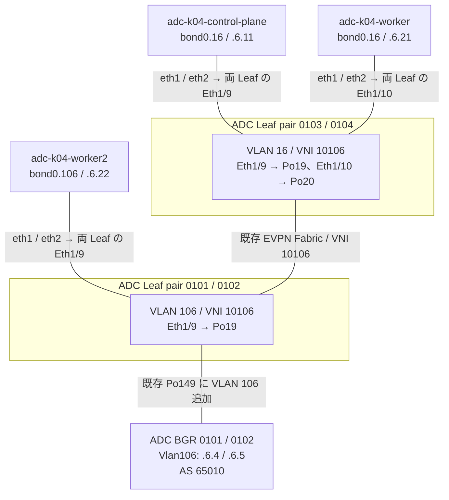

# k04 追加・同一 VIP 引継ぎ用 Nexus Config 案

作成日：2026-09-24。2026-09-25 に **10-connectivity の適用を実施**。
それ以外のアプリ移行／任意 DCI Config は未適用。受入状況は
[k04 追加実施記録](../../../../docs/cilium-lab/results/multisite/2026-09-25/k04-addition.md)を参照する。

[クラスタ更新設計](../../../../docs/cilium-lab/design/clustermesh-cluster-upgrade-design.md)を具体化する
機器別の追加 Config である。**標準案は Leaf 4 台と BGR 2 台の変更で、BGW は変更しない。**
ADC／BDC BGW 各 2 台の Config は、DCI の公開経路を制限する場合だけの任意案として残す。
既存の startup-config を置換する完全設定ではなく、前提確認後に使用する差分である。
10-connectivity は k04 追加時に使用し、Leaf の再作成と BGR の running 設定追加を実施した。
BGR の追加分も 2026-09-25 の後続作業で startup-config へ保存・照合済み。Leaf は起動処理で保存済み。その他の Config はレビュー用のままとする。

対応する [k04 構築準備](../../../k8s_kind/k04/cilium/README.md)と
[追加版 topology](../../../nxos-fabric-multisite-no-cdc-k04.clab.yaml)を 2026-09-25 に作成した。
本 Config の VLAN／VNI／Node IP／peer／Mesh VIP と一致させている。Cilium の基盤マニフェストも適用済み。アプリ移行用は未適用。

## 1. 保存構成との対応

- 基準は [`configs/as-changes/cisco_n9kv`](../../as-changes/cisco_n9kv/) と
  [`nxos-fabric-multisite-no-cdc.clab.yaml`](../../../nxos-fabric-multisite-no-cdc.clab.yaml)。
- startup-config の header は `10.5(4)`、現在の topology の指定は `10.6.4.M.lite`。
  今回の追加では対象機器の running／startup を取得し、稼働 running と追加差分を統合した。
  公開の保存設定をそのまま現在の稼働設定とは扱わない。
- Leaf `0101／0102` は k02 用 VLAN `104`、Leaf `0103／0104` は VLAN `14` を使い、同じ VNI `10104` に接続している。
  k04 もこの方式を踏襲し、新しい VLAN／VNI を割り当てる。
- BGR と Leaf `0101／0102` の接続は既存 `port-channel149` と `Ethernet1/49–50` を使う。
  許可 VLAN に `106` を **add** し、既存の `103,104` は保持する。設定は Port-channel149 に行い、
  所属済み Ethernet1/49–50 に同じ VLAN 変更を直接重ねない。実機 NX-API で拒否されたため当該行を除去した。
  経路交換用の `port-channel151` は変更しない。
- 保存された BGW 設定には DCI の `CILIUM_DCI_*` route-map は見当たらない。
  [既存 DCI 設計](../../../../docs/cilium-lab/design/bgp-config-change-proposal.md#71-dci-hybrid-filter-の採用案)は候補段階のため、
  保存構成の DCI EVPN neighbor には route-map bind がなく、tenant VRF の共通 RT `65000:19001` がある。
  この既存伝播を維持する標準案では BGW の変更は不要である。
  `K04UP_DCI_*` は既存伝播を制限する任意案であり、k04 を到達可能にするための追加許可ではない。
  任意案を採用するときも、実機に別の policy があれば `40-dci-attach` で上書きせず差分を統合する。

## 2. 今回の仮割当

値は本 Config 案のために具体化した候補であり、稼働確認済み・本番予約済みという意味ではない。
保存ファイル上で Node セグメント、VLAN／VNI、追加ポートの競合がないことを確認した。

| 項目 | k04 候補 |
|---|---|
| Cluster Name／ID | `adc-k04`／`4` |
| Cilium ASN／BGR ASN | `65012`／`65010`。k02 と k04 は同一 ASN |
| VRF／L3 VNI | 既存 `tenant1-vpc1`／`19001` |
| Node IPv4／IPv6 | `172.16.6.0/24`／`fd21:0:0:6::/64` |
| Leaf anycast gateway | `172.16.6.1`／`fd21:0:0:6::1` |
| BGR `0101` | `172.16.6.4`／`fd21:0:0:6::4` |
| BGR `0102` | `172.16.6.5`／`fd21:0:0:6::5` |
| control-plane | `172.16.6.11`／`fd21:0:0:6::1:1` |
| worker | `172.16.6.21`／`fd21:0:0:6::2:1` |
| worker2 | `172.16.6.22`／`fd21:0:0:6::2:2` |
| Leaf `0101／0102` と BGR の VLAN | `106` |
| Leaf `0103／0104` の VLAN | `16` |
| ADC 内の共通 L2 VNI | `10106`。DCI へ新しい L2 VNI は延伸しない |
| Mesh API VIP | `172.16.34.10/32`／`fd21:0:0:34:0:0:1:10/128` |
| Mesh API community | `65012:514` |
| 移行例アプリ A の P | `172.16.14.20/32`／`fd21:0:0:14:0:0:1:100/128` |
| P の優先度 community | `65010:100`／`65010:200`／`65010:300` |
| Nexus／Node MTU | `9216`／`9150` |

P は設計書の例示値で、対象 Service への実割当は未確認である。実施前に対象を決め、必要なら
`20-handover-policy` 両ファイルの `K04UP_APP_V4/V6` を同時に修正する。
k04 の `.34` は Mesh API 専用として exact route のみ許可し、LB 集約や Egress 用の広い受信許可は作らない。

## 3. 収容と接続

| 将来追加する topology link | Leaf 側 port-channel／vPC | Node VLAN |
|---|---|---|
| `adc-lfsw0103:Ethernet1/9` ↔ `adc-k04-control-plane:eth1` | `19` | `16` |
| `adc-lfsw0104:Ethernet1/9` ↔ `adc-k04-control-plane:eth2` | `19` | `16` |
| `adc-lfsw0103:Ethernet1/10` ↔ `adc-k04-worker:eth1` | `20` | `16` |
| `adc-lfsw0104:Ethernet1/10` ↔ `adc-k04-worker:eth2` | `20` | `16` |
| `adc-lfsw0101:Ethernet1/9` ↔ `adc-k04-worker2:eth1` | `19` | `106` |
| `adc-lfsw0102:Ethernet1/9` ↔ `adc-k04-worker2:eth2` | `19` | `106` |

`port-channel19` が両 Leaf pair に存在しても、異なる vPC domain なので共有した bundle にはならない。
新規ポートだけを変更し、既存 k01／k02 の収容を維持する。保存構成では対象物理ポートは `shutdown` のみで、
対応する topology link はない。実機に利用があれば別の空きポートを再選定する。

## 4. Config 一覧と適用段階

**標準案では `10-connectivity` と `20-handover-policy` の 8 ファイルだけを対象とする。**
`30-dci-policy`／`40-dci-attach` の 8 ファイルは任意案で、通常の k04 追加には適用しない。
番号は機能区分であり、一括投入用のディレクトリではない。任意の `40` は、`30` の定義と既存経路棚卸し・parser 確認が前提になる。

| 段階 | Config | 内容 |
|---|---|---|
| 10 | [adc-lfsw0101](10-connectivity/adc-lfsw0101.cfg)／[0102](10-connectivity/adc-lfsw0102.cfg) | VLAN 106、SVI、VNI 10106、worker2、BGR trunk |
| 10 | [adc-lfsw0103](10-connectivity/adc-lfsw0103.cfg)／[0104](10-connectivity/adc-lfsw0104.cfg) | VLAN 16、SVI、VNI 10106、control-plane／worker |
| 10 | [adc-bgrt0101](10-connectivity/adc-bgrt0101.cfg)／[0102](10-connectivity/adc-bgrt0102.cfg) | Vlan106、k04 worker への BGP、Mesh API だけを受信 |
| 20 | [adc-bgrt0101](20-handover-policy/adc-bgrt0101.cfg)／[0102](20-handover-policy/adc-bgrt0102.cfg) | k02／k04 の P に community → LP を適用 |
| 任意 30 | [adc-bgw0101](30-dci-policy/adc-bgw0101.cfg)／[0102](30-dci-policy/adc-bgw0102.cfg) | ADC の DCI policy 定義のみ |
| 任意 30 | [bdc-bgw0101](30-dci-policy/bdc-bgw0101.cfg)／[0102](30-dci-policy/bdc-bgw0102.cfg) | BDC の DCI policy 定義のみ |
| 任意 40 | [adc-bgw0101](40-dci-attach/adc-bgw0101.cfg)／[0102](40-dci-attach/adc-bgw0102.cfg) | ADC の DCI neighbor 4 本へ bind |
| 任意 40 | [bdc-bgw0101](40-dci-attach/bdc-bgw0101.cfg)／[0102](40-dci-attach/bdc-bgw0102.cfg) | BDC の DCI neighbor 4 本へ bind |

10 と k04 の Node／Cilium 構築後、既存の DCI 伝播で k04 と DR の到達性を確認し、アプリ側の事前準備を行って 20 へ進む。
BGW で API／Node prefix の追加許可や移行用 community の LP 変換を行う必要はない。P の新旧選択は ADC BGR で行う。
20 の Config を作成したこと自体でアプリが切り替わるわけではなく、切替は設計書の Service label 操作で行う。

### 4.1 接続基盤

Leaf の既存 anycast MAC、vPC、NVE source、underlay、RR、L3 VNI を利用する。
VNI `10106` の L2 RT は ADC 内の auto RT を使い、新しい site 共通 L2 RT は追加しない。
各 Leaf の既存 `redistribute direct/static` と tenant VRF の EVPN で Node セグメントを伝える。
BGR は k04 worker 2 台を IPv4／IPv6 の **個別 neighbor** として定義し、control-plane と Node セグメント全体は許可しない。
BGP timer は既存と同じ `10/30` 秒、受信上限は AF／neighbor ごとに `64`、BFD は追加しない。

Spine／RR、BDC Leaf、WAN PE の追加差分はこの収容案では不要と判断する。既存の tenant L3 RT、
standard community の伝播、k04 Node セグメントの通過が成立することを実施時に確認する。
`as-override`、`allowas-in`、ASN 変更、Node 保守用 `planned-shut` の操作は含めない。

### 4.2 P の community と受信 policy

20 は新規 route-map をすべて定義した後、最後に neighbor の inbound map を変更する。
k02 の既存 map 本体を途中状態のまま編集せず、既存の集約／LB／Egress prefix-list を参照して従来の許可を維持する。
実機で既存 map に追加規則があれば、本案にも反映してから置き換える。

| sequence | 条件 | 結果 |
|---|---|---|
| 1 | P、standard community が `65010:100` だけ | LP 100 |
| 2 | P、standard community が `65010:200` だけ | LP 200 |
| 3 | P、standard community が `65010:300` だけ | LP 300 |
| 4 | 上記に一致しなかった P | 拒否。後続の広い LB permit へ通さない |
| 10～30：k02 | 既存の集約／LB／Egress 許可 | 現行 prefix-list の範囲を維持 |
| 10：k04 | k04 Mesh API exact route と `65012:514` | 許可 |
| 1000 | その他 | 拒否 |

`match community ... exact-match` を使うため、P は **優先度用 standard community 1 個のみ**とする。
複数 rank、未知の rank、rank なしに加え、別用途の standard community の混在も拒否する。
EVPN route-target の extended community とは別の比較である。追加用途が必要になれば照合を別途設計する。

20 の前に、k02 の P が exact route と `65010:200` を持ち、通常集約用／保守用 selector の重複がなく、
k04 の P が `off` であることを確認する。両 BGR の LP 200 と Fabric の経路を確認した後に、k04 を
`candidate`／100、次に `preferred`／300 へ進める。別アプリを移行するときは、その VIP を
両 BGR の `K04UP_APP_V4/V6` へ追加する。k04 に k02 の LB 集約全体を広告させない。

### 4.3 DCI の扱い

標準案は既存伝播を維持する。k04 は既存 `tenant1-vpc1`／L3 VNI `19001` を使うため、
Node と Mesh API の経路を既存 EVPN に取り込めれば、BGW で prefix ごとの追加設定は不要である。
新しい L2 VNI `10106` は ADC 内だけで使用し、サイト間の Node 通信は既存 L3 接続を使う。
BGR で受け入れた P も既存の DCI 伝播対象になり得る。DR の k03 が P を広告しないことと、
Site-A の P が Site-B へ伝播することは別であり、前者の制御に BGW のフィルタは必要ない。

**以下は `30`／`40` を任意に採用した場合の制限で、現状を説明する表ではない。**

| 方向 | 許可する Mesh API |
|---|---|
| ADC outbound／BDC inbound | k02 `.14.10` と k04 `.34.10`、各 IPv6、各用途 community |
| BDC outbound／ADC inbound | k03 `.15.10`、対応 IPv6、用途 community |

API 例外の後で、3 クラスタの LB 範囲 `.14.0/24`、`.15.0/24`、`.34.0/24` と対応 IPv6 `/64` の
全 more-specific を拒否する。P は `.14` 内なので DCI に通さない。既存 DCI 設計の LB list より拒否範囲を
segment 全体へ広げているため、その範囲に Cilium 以外の既存利用がないことを事前に確認する。
BDC の BGP endpoint も拒否し、最後の `permit 1000` で Node セグメントやその他既存 EVPN route を維持する。
これはすべての tenant route の allowlist ではなく、Egress 範囲全体を新たに規制する policy でもない。

40 は AS や DCI の `local-as` を変更せず、既存 EVPN neighbor `10.255.0.101/102/111/112` のみを対象とする。
稼働中の route-map bind がある場合は上書きしない。EVPN Type-5 の IPv4／IPv6 prefix と community の照合、
Type-2／3 の継続を採用版で確認する。DR の一般 application VIP 昇格は本ファイルの対象外であり、
この任意フィルタを採用した場合だけ、データ・Egress を含む DR 実施手順を確定してから P の限定公開を別差分にする。

## 5. Config 以外に必要な準備

本 Config だけでは k04 は作成されない。次の作業は未実装である。

1. kind／containerlab の k04 定義と 6 本の link、API SAN、Node 初期化、資源確認。
2. Node の bond と VLAN、上記 IP、MTU、`172.16.0.0/16` と `fd21:0:0::/48` の Fabric 向け経路。
3. k04 の Cilium／IPAM／Mesh、`65012:514` 付き API exact route、worker BGP peer、P の固定割当と状態 selector。
4. k02 の移行対象 P の exact route 化・集約 selector 除外。k04 の P 広告は準備完了まで `off`。
5. アプリ・データ・Egress・DR の試験。Ingress の community だけで Egress IP を引き継がない。

Egress は別 IP の E-A と同一 IP の E-B を両方用意し、
[統合手順](../../../../docs/cilium-lab/design/clustermesh-cluster-upgrade-design.md#egress-upgrade-steps)でアプリごとに選択する。
同一 IP の E-B は共通 NAT を使わず、旧専用 Gateway から新専用 Gateway へ E 自体を移す。
Gateway／API mock、試験網、外部 API 宛経路と E の返信経路、E exact prefix の追加受信許可は本 Config に含まない。
現在の k04 inbound policy は E を拒否するため、Cilium worker が E を広告する実験では BGR の別差分が必要になる。
専用 Linux Gateway を使う場合はその接続先に許可を追加する。Cilium Egress Gateway と Mesh の併用は公式非互換の実験条件として扱う。
[アプリ例と構成](../../../../docs/cilium-lab/design/clustermesh-cluster-upgrade-design.md#egress-app-examples)を具体化する際に別途作成する。
E-A は Egress の準備・probe 合格後に Ingress を切り替える。E-B は入口・旧送信停止、旧 E 解除、新 E 設定と経路収束、probe 合格の順で進めてから Ingress を切り替える。BGW の標準変更不要という方針は維持する。

## 6. 確認項目と戻し方

実施時に確認する項目は、保存値との一致、SVI／vPC／LACP、Node 間 dual-stack／MTU、
worker 2 台 × BGR 2 台 × AF 2 の計 8 session、Mesh API exact route、community、EVPN／FIB である。

| 試験入力 | 期待結果 |
|---|---|
| k04 API、正しい用途 community | local Fabric と DR へ通過 |
| k04 API、用途 community なし | BGR で拒否 |
| k04 から k02 の `/26`／`/112`、PodCIDR、任意 VIP | BGR で拒否 |
| P ＋候補／現用／優先の各 community | 100／200／300 に変換 |
| P ＋rank なし／未知／複数／別用途の追加 tag | 後続 LB permit に漏れず拒否 |
| k02 の対象外 LB、既存 Mesh API | 既存の許可範囲を維持 |
| DCI の P、各 LB 集約 | 標準案は既存伝播を維持。任意 30／40 採用時だけ拒否 |
| DCI の用途 tag なし API | 標準案は BGW で用途照合しない。任意 30／40 採用時は拒否 |
| DCI の Node セグメント、既存 Type-2／3 | 従来どおり維持 |
| k02：200、k04：100 → 300 → 100 | P の応答が k02 → k04 → k02 |

アプリの復帰は設計書の順序で行い、Nexus Config の撤去とは分ける。
20 を戻す場合は k04 の P を停止し、k02 の復帰と両 AF の経路確認後、k02 neighbor の map を
`CILIUM_K02_IN_V4/V6`、k04 neighbor の map を `K04UP_BASE_V4/V6` へ戻す。
既存 map に差分があった場合は、実施前に記録した bind を復元する。

任意案の 40 を適用した後の単純な unbind は、それまで拒否していたアプリ経路を DCI へ通す可能性がある。
必要な広告を停止・制限してから記録した元の policy／bind へ戻し、DCI 公開範囲も確認する。
全撤去はアプリ・Mesh の依存解消、BGP 経路撤回、Node 切断後に行い、専用 VLAN／VNI／ポートと
Po149 の追加 VLAN だけを外す。既存 Po149 や共用 VRF の削除は行わない。
元設定の差分が未確定なので、包括的な自動 rollback ファイルは作らない。

## 7. 検証範囲と将来の保存設定への反映

ローカルでは候補値・port 使用状況・参照先・prefix／community の整合とサニタイズを確認した。
16 ファイルを対象に、保存構成との資源競合、policy の参照、prefix／community の許可・拒否を
オフラインの条件評価で確認し、566 件の assertion が成功した。これは NX-OS の動作再現ではない。
文書の内部リンク 43 件と空白検査も成功した。
NX-OS parser、vPC consistency、EVPN の match、実際の経路選択・疎通は未検証である。
`show` や route refresh も今回は実行していない。

本案は `configs/changes/` に分離し、既存 `as-equals`／`as-changes` を編集していない。
採用後に startup-config へ反映する場合は `as-equals` を正本として差分を取り込み、正規の
[`generate_as_changes.py`](../../../scripts/generate_as_changes.py)で再生成し、公開前サニタイズを再実行する。
このスクリプトが本ディレクトリの差分を自動で取り込むわけではない。

CLI の根拠は [Cisco NX-OS 10.6 Route Policy Manager](https://www.cisco.com/c/en/us/td/docs/dcn/nx-os/nexus9000/106x/configuration/unicast-routing-configuration/cisco-nexus-9000-series-nx-os-unicast-routing-configuration-guide/m_configuring_route_policy_manager.html)。
`match community ... exact-match` と `set local-preference` を使い、値と適用対象は本 lab 用に定義している。
