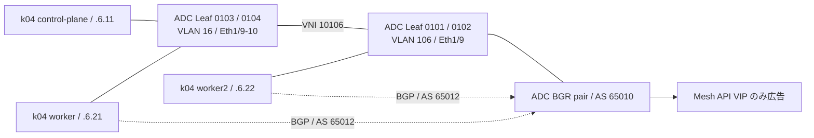

# k04 の構築準備：Mesh API のみを広告する初期構成

2026-09-25 作成・導入済み。**k04 は Kubernetes 1.36.4、Cilium 1.20.1、Tetragon 1.7.0 で稼働し、3 クラスタ Mesh の接続を確認済み**。
[containerlab 追加記録](../../../../docs/cilium-lab/results/multisite/2026-09-25/k04-addition.md)と
[Cilium／Mesh 導入・疎通記録](../../../../docs/cilium-lab/results/multisite/2026-09-25/k04-clustermesh.md)を参照する。
両 AF の Pod／NodePort HTTP は並列 2 の再試験で各 48/48 成功。初回の短い timeout 条件での遅延は残課題。
BGR 2 台の追加設定も startup-config へ保存・照合済み。アプリ VIP／Egress IP の移管は未実施。
既存の k02／k03 は Kubernetes `1.35.5` を維持し、k04 は初回から `1.36.4` の移行先として作成する。
Cilium `1.20.1`／Tetragon `1.7.0` は既存と揃え、まず Kubernetes の minor 差を含む移行を確認する。
本書の適用コマンドは、対象・操作を指定して実施する段階の手順としてまとめた。

## 1. ファイルと初期状態

| ファイル | 用途 |
|---|---|
| [containerlab 追加版](../../../nxos-fabric-multisite-no-cdc-k04.clab.yaml) | CDC 除外版に k04 の定義 4 個と Leaf 接続 6 本を追加 |
| [Kind 定義](../k04.kind.yaml) | control-plane 1 台＋worker 2 台、dual-stack、API SAN |
| [基本 values](values/00-base.yaml)／[観測 values](values/10-observability.yaml)／[Mesh values](values/20-multisite-clustermesh.yaml) | Cilium／Hubble／Mesh、k04 固有の ID・IP |
| [基盤 resources](resources/kustomization.yaml) | Mesh API 専用 IP pool、exact BGP 広告、peer、固定 VIP Service |
| [既存クラスタ用の追加 values](values/90-clustermesh-three-clusters.yaml) | k02／k03 の保存 values に最後に重ねる接続先 3 クラスタの一覧 |
| [Tetragon values](../tetragon/values/00-observe-only.yaml) | 既存と同じ observe-only 構成 |
| [NodePort 検証アプリ](manifests/validation/preflight/kustomization.yaml) | VIP を広告せずに k04 の応答と両 AF を確認 |
| [アプリ A の引継ぎ例](manifests/handover/app-a/kustomization.yaml) | 後続試験専用。同一 VIP の pool と rank 広告、初期状態 `off` |
| [Nexus 追加 Config](../../../configs/changes/cilium-k04-upgrade/README.md) | `10-connectivity` が基盤、`20-handover-policy` が後続のアプリ移行用 |

基盤 resources は Mesh API だけを広告する。アプリ用の通常 pool／集約広告、Egress Gateway、
Egress IP／Interface 広告、Node 保守用 `planned-shut` の profile は初期構成に含めない。
アプリ例と検証アプリは基盤 Kustomization から参照せず、明示的に選んだ場合だけ導入する。
共有 helper の `converge-cilium-lab.sh --profile multisite-final` は従来どおり k02／k03 用であり、
k04 の導入には本書のコマンドを使う。`multisite-k04-prep` は offline renderer 用の profile である。

| 項目 | k04 の値 |
|---|---|
| Kubernetes／Cilium／Tetragon | `1.36.4`／`1.20.1`／`1.7.0`。k04 の Node image は個別指定、chart lock は既存を継承 |
| Cluster Name／ID／ASN | `adc-k04`／`4`／`65012` |
| PodCIDR | `10.204.0.0/16`、`fd00:10:204::/56` |
| ServiceCIDR | `10.104.0.0/16`、`fd00:10:104::/112` |
| Node セグメント | `172.16.6.0/24`、`fd21:0:0:6::/64` |
| CP／worker／worker2 | `.11`／`.21`／`.22`、IPv6 `::1:1`／`::2:1`／`::2:2` |
| VLAN／L2 VNI | CP・worker は `16`、worker2 は `106`、VNI `10106` |
| BGR peer | `172.16.6.4`／`.5`、`fd21:0:0:6::4`／`::5`、AS `65010` |
| Mesh API VIP | `172.16.34.10/32`、`fd21:0:0:34:0:0:1:10/128` |
| Mesh API community | `65012:514` |
| MTU | Nexus `9216`、Node `9150`、Cilium `9050` |



## 2. containerlab 追加版の扱い

### 2.1 初回から Kubernetes 1.36 系を指定する

`topology.nodes.adc-k04.image` に次の image を指定する。共通の `kinds.k8s-kind.image` は `1.35.5` のままとし、
k01／k02／k03 へ波及させない。k04 の control-plane／worker 2 台はこの指定を共用する。
`ext-container` や `k04.kind.yaml` の各 Node に image を重複指定しない。

```yaml
image: kindest/node:v1.36.4@sha256:099e049362a1526b2db71494e1947aae99bd16290d7c895f2b7ea312e3cbfaed
```

出典：[Kind 0.33.0 の公開 image](https://github.com/kubernetes-sigs/kind/releases/tag/v0.33.0)。
[Cilium 1.20.1 の互換表](https://github.com/cilium/cilium/blob/v1.20.1/Documentation/network/kubernetes/compatibility.rst) に Kubernetes `1.36` が含まれる。
preflight は `--cluster adc-k04` でこの digest を期待し、offline Helm template も `--kube-version 1.36.4` で生成する。

ホストの containerlab は `0.78.2`、実行バイナリに含まれる Kind は `0.31.0` と確認した。
内蔵 Kind は kubeadm `v1beta3` を生成するため、Kind 定義は同じ SAN／CIDR mask を指定する `v1beta3` と `v1beta4` の patch を用意した。
Kind `0.32+` は Kubernetes `1.36` で `v1beta4` を使う。生成される API version に一致する patch を使用する。
異なる Kind release の image の完全互換性は保証されないが、**この環境の初回作成は成功し、3 Node の `v1.36.4` と API 接続を確認した**。
`kind load` は新しい containerd に対応した Kind `0.32+` が必要になる。
単体の `kind` CLI を更新しても containerlab に組み込まれたライブラリは変わらない。
作成互換性の問題が出た場合は、Kubernetes を一度 `1.35` で作ってから上げるのではなく、
対応する Kind を内蔵した containerlab の採用を先に確認してから `1.36.4` で作成する。
参照：[Kind 0.32.0 の変更](https://github.com/kubernetes-sigs/kind/releases/tag/v0.32.0)、
[内蔵 Kind の kubeadm 生成実装](https://github.com/kubernetes-sigs/kind/blob/v0.31.0/pkg/cluster/internal/kubeadm/config.go)、
[containerlab の Kind 呼出し](https://github.com/srl-labs/containerlab/blob/v0.78.2/nodes/k8s_kind/k8s_kind.go)。

### 2.2 今回の追加起動と Nexus の再作成

元の `nxos-fabric-multisite-no-cdc.clab.yaml` と同じ lab 名を維持する完全版であり、独立した並行 lab ではない。
既存 Node 定義と既存リンクは維持し、k04 のみを追加した。ネットワーク機器の管理 IP は同じなので、
機器台帳は [hosts-no-cdc.txt](../../../hosts-no-cdc.txt) を共用する。k04 の管理用 kubeconfig は Kind／containerlab が生成する。

**現在の直結案は、標準の差分 deploy でも Leaf 4 台の再作成を伴う設計として扱う。全 lab の再作成とは区別する。**
2026-09-25 に Docker から対象 Leaf 4 台の稼働と `CONNECTION_MODE=tc` を読み取り確認した。
image は `vrnetlab/cisco_n9kv:10.6.4.M.lite`、Boxen vendor label はなく、topology に `link-apply-mode` の上書きもない。
`containerlab 0.78.2` の `VRNode.LinkApplyMode()` は既定で `recreate` を返す。
追加リンクの既存側 endpoint に対してこの処理が選ばれるため、今回の変更だけでも下表の Leaf が対象となる。

| 対象 | 追加する接続 | 標準処理での見込み |
|---|---|---|
| k04 | control-plane 1 台、worker 2 台 | Kubernetes `1.36.4` で新規作成 |
| ADC Leaf 0103／0104 | `Ethernet1/9` → CP、`Ethernet1/10` → worker | 2 台の再作成 |
| ADC Leaf 0101／0102 | `Ethernet1/9` → worker2 | 2 台の再作成 |
| 他の Nexus／k02／k03 | 既存定義・リンクを保持 | この追加差分自体による再作成は想定しない。ただし共有 Leaf 停止で k01／k02 などの通信に影響 |

初回の `sudo -n` はパスワード要求で停止したが、その後ホストの SUID 付き containerlab を直接実行し、dry-run と追加適用を実施できた。
**完全版 topology では既存の `adc-k01`／`adc-k02`／`bdc-k03` まで新規作成と判定されたため、そのまま適用しない。**
追加作業ではこれら 3 個の作成用定義だけを除外し、既存の `ext-container` と全リンクを残した非公開の作業用 topology を使用した。
最終 dry-run は新規 k04 の 4 定義、再作成 Leaf 4 台、削除なし。追加・張り直し対象は新規 6 本＋既存 40 本だった。
以下は **完全版の差分確認のみ**のコマンドであり、そのまま `--dry-run` を外して適用する手順ではない。

```bash
cd /home/suzuyu/my-containerlab/nxos_fabric/nxos_multisite
env CLAB_VERSION_CHECK=disable containerlab deploy \
  -t nxos-fabric-multisite-no-cdc-k04.clab.yaml --dry-run --format json
```

`added/deleted/recreated/restarted nodes` とリンクの計画を確認する。`--dry-run` を外す操作はまだ実施しない。
**この版は稼働 lab の reconciliation と `--node-filter` の組合せを明示的に拒否する。**
k04 だけを指定する方法では解決しない。全体の `--reconfigure` も使用しない。
`link-apply-mode: live` の強制指定は VM 内の接続成立を保証せず、今回の回避策には採用しない。
参照：[reconciliation 実装](https://github.com/srl-labs/containerlab/blob/v0.78.2/core/topology_reconcile.go)、
[VRNode の既定動作](https://github.com/srl-labs/containerlab/blob/v0.78.2/nodes/vr_node.go)、
[node-filter の制約](https://github.com/srl-labs/containerlab/blob/v0.78.2/core/deploy.go)、
[deploy の説明](https://containerlab.dev/cmd/deploy/)。

再作成時は VM 内に保存した startup-config だけを復旧元とせず、現在の running／startup 設定と必要な差分を
ホスト側の非公開領域へ確保し、再投入・復旧手順を準備する。公開 startup-config が稼働状態と一致するとは限らない。
Leaf 4 台は k02 と共有しているため、移行試験前の基盤変更として停止影響と k02／k03 の再受入を別枠で扱う。
k02 は lab 用であり、k04 追加時の k02 への通信影響はユーザー許容済みとする。
実追加では Leaf 4 台を再作成した。稼働 running／startup 設定は Git 対象外の `operations/k04-add-20260925-113255/` に退避した。
作業用 `.k04-add.runtime.clab.yaml` は既存 Leaf の running 設定＋k04 差分を起動設定に指定している。
これは既存状態に依存する一回の追加用ファイルであり、次の deploy／destroy／全体再構築に無条件で流用しない。

リンク再作成後は、既存 Linux／Kind Node の bond 所属・固定 IP・経路、および対向 Spine／BGR の
`ethX`–`tapX` の tc redirect を復旧する必要があった。containerlab の終了コード 0 だけを通信受入としない。
BGR／Leaf の既存 Port-channel149 に VLAN 106 を追加する際は、所属済み物理ポートへ同じ変更を重ねて投入しない。

### 2.3 Nexus を維持してクラスタを繰り返し作る場合

| 案 | 今回の評価 |
|---|---|
| 今回の直結 topology のまま追加 | 準備済みの標準案。全体再作成は不要だが、上記 Leaf 4 台の再作成を見込む |
| 既存リンクを保持した VLAN trunk／Linux bridge へ k04 を収容 | Nexus の接続を固定してクラスタ側だけ増減させる候補。NIC、bridge、LACP、VLAN、MTU と障害試験の再設計が必要。今回の直結ファイルには混在させない |
| 将来の更新用に Leaf–中継 bridge 間を常設 | 次回以降に Kubernetes Node だけ再作成しやすい。常設接続を最初に追加する段階では Leaf 側への影響が残る |

将来の k04 → k02 再利用も「同じポートなら Nexus を必ず維持できる」とはしない。
Kind のライフサイクルと Fabric のリンク所有権を分離した手順を用意し、別途検証する。

新規構築・停止を伴う再構築のための topology としても使えるが、既存 startup-config に k04 の Nexus 差分は埋め込んでいない。
Leaf／BGR の `10-connectivity` を別途適用してから k04 の Fabric／BGP 疎通を受け入れる。
BGW の任意制限案、アプリ移行用 `20-handover-policy` は基盤追加には不要である。

## 3. 作業環境と offline 検査

以下の環境設定はリポジトリ内から行う。runtime のファイルと CA は Git 管理しない。

```bash
export REPO_ROOT="$(git rev-parse --show-toplevel)"
export LAB_ROOT="${REPO_ROOT}/nxos_fabric/nxos_multisite"
export PATH="${LAB_ROOT}/k8s_kind/client/runtime/bin:${PATH}"
export KUBE_CONTEXT_K02=kind-adc-k02
export KUBE_CONTEXT_K03=kind-bdc-k03
export KUBE_CONTEXT_K04=kind-adc-k04
export KUBECONFIG_K02="${LAB_ROOT}/clab-nxos-fabric-multisite/adc-k02/k8s_kind/k02/kubeconfig-k02"
export KUBECONFIG_K03="${LAB_ROOT}/clab-nxos-fabric-multisite/bdc-k03/k8s_kind/k03/kubeconfig-k03"
export KUBECONFIG_K04="${LAB_ROOT}/k8s_kind/k04/kubeconfig-k04"
export KUBECONFIG="${KUBECONFIG_K02}:${KUBECONFIG_K03}:${KUBECONFIG_K04}"
cd "${LAB_ROOT}"

../scripts/k8s-client/prepare-tools.sh --profile k8s_kind/client --check
../scripts/cilium-lab/prepare-helm-charts.sh --profile k8s_kind/client --check
containerlab validate -t nxos-fabric-multisite-no-cdc-k04.clab.yaml
../scripts/cilium-lab/render-cilium-lab.sh \
  --profile multisite-k04-prep --output-dir /tmp/cilium-k04-prep-render
python3 ../scripts/cilium-lab/validate-k04-preparation.py \
  --render-dir /tmp/cilium-k04-prep-render
```

k04 の上記 kubeconfig は今回ユーザー所有で書き出したコピーで、server は証明書 SAN に含まれる Docker 側 IP の `6443` を使用する。
初回コピーの context 名は `kubernetes-admin@adc-k04` だったため、導入時に `kind-adc-k04` へ正規化した。
個別ファイルでは接続できても、`--context kind-adc-k04` が未登録なら後続手順は動かない。
再生成した kubeconfig を使う場合は、環境変数設定後に次で名前を揃える。

```bash
k04_current_context="$(kubectl --kubeconfig "$KUBECONFIG_K04" config current-context)"
if [[ "$k04_current_context" != "$KUBE_CONTEXT_K04" ]]; then
  kubectl --kubeconfig "$KUBECONFIG_K04" config rename-context \
    "$k04_current_context" "$KUBE_CONTEXT_K04"
fi
kubectl --context "$KUBE_CONTEXT_K04" get nodes
```

初回の API 証明書には `127.0.0.1` がなく、localhost の公開 port では TLS 検証に失敗した。
以後の新規作成向け Kind 定義には `localhost`／`127.0.0.1` の SAN も追加した。既存 k04 の証明書は再発行していない。

`containerlab validate` は deploy しないが、使用版では Docker runtime の初期化・照会が必要。
renderer はクラスタに接続せず、k04 基盤と任意アプリ、k02／k03 の 3 クラスタ化案を出力する。
出力ディレクトリ全体を `kubectl apply -f` しない。render 内の API host は文書用の仮値で、適用には使わない。

## 4. Node 作成・Fabric 設定後の準備

本節以降は、k04 の作成と対象クラスタへの適用を実施する段階のコマンドである。
2026-09-25 に以下の導入を実施した。再構築・再適用時は現在の状態と差分を確認して使用する。

Node の `exec` は、LACP／VLAN／MTU／Fabric 向け経路を設定してから kubelet の Node IP を設定する。
k04 は `sh -euc` を使い、前段失敗時に後段を継続しない。IPv6 DAD、LACP、静的経路と Node InternalIP を確認する。
この初回設定は `TI-009` の link 復帰後の自動再設定を解決するものではない。

```bash
set -euo pipefail
umask 077
mkdir -p k8s_kind/k04/cilium/runtime
test -r "$KUBECONFIG_K04"
kubectl --context "$KUBE_CONTEXT_K04" get nodes -o wide
for node in adc-k04-control-plane adc-k04-worker adc-k04-worker2; do
  docker exec "$node" ip -br address
  docker exec "$node" cat /proc/net/bonding/bond0
  docker exec "$node" ip route show
  docker exec "$node" ip -6 route show
  docker exec "$node" cat /var/lib/kubelet/kubeadm-flags.env
done
../scripts/cilium-lab/configure-cilium-node-labels.sh \
  --context "$KUBE_CONTEXT_K04" --apply
../scripts/cilium-lab/preflight-host-and-kind.sh \
  --cluster adc-k04 --kube-context "$KUBE_CONTEXT_K04"
../scripts/cilium-lab/render-k8s-api-values.sh \
  --cluster adc-k04 --output k8s_kind/k04/cilium/runtime/10-k8s-api.yaml

# k04 初回インストールより先に実行。異なる既存 CA は置き換えない。
../scripts/cilium-lab/prepare-clustermesh-shared-ca.sh \
  --source-context "$KUBE_CONTEXT_K02" --target-context "$KUBE_CONTEXT_K03"
../scripts/cilium-lab/prepare-clustermesh-shared-ca.sh \
  --source-context "$KUBE_CONTEXT_K02" --target-context "$KUBE_CONTEXT_K04" --apply
```

k04 は固有の Name／ID／API SAN と共通 CA を使用する。k02／k03 の leaf 証明書や remote-cluster Secret を丸ごと複製しない。

## 5. k04 の Cilium・基盤 resources・Tetragon

```bash
helm template cilium k8s_kind/client/runtime/charts/cilium-1.20.1.tgz \
  --kube-version 1.36.4 \
  -n kube-system \
  -f k8s_kind/k04/cilium/values/00-base.yaml \
  -f k8s_kind/k04/cilium/values/10-observability.yaml \
  -f k8s_kind/k04/cilium/values/20-multisite-clustermesh.yaml \
  -f k8s_kind/k04/cilium/runtime/10-k8s-api.yaml \
  > k8s_kind/k04/cilium/runtime/cilium-rendered.yaml
helm upgrade --install cilium k8s_kind/client/runtime/charts/cilium-1.20.1.tgz \
  -n kube-system --kube-context "$KUBE_CONTEXT_K04" \
  -f k8s_kind/k04/cilium/values/00-base.yaml \
  -f k8s_kind/k04/cilium/values/10-observability.yaml \
  -f k8s_kind/k04/cilium/values/20-multisite-clustermesh.yaml \
  -f k8s_kind/k04/cilium/runtime/10-k8s-api.yaml --wait --timeout 10m
for resource in daemonset/cilium deployment/cilium-operator deployment/clustermesh-apiserver; do
  kubectl --context "$KUBE_CONTEXT_K04" -n kube-system rollout status "$resource" --timeout=5m
done
kubectl --context "$KUBE_CONTEXT_K04" apply -k k8s_kind/k04/cilium/resources
../scripts/cilium-lab/configure-coredns-upstream.sh \
  --context "$KUBE_CONTEXT_K04" \
  --record k8s_kind/k04/cilium/runtime/20-coredns-upstream.env --apply
helm upgrade --install tetragon k8s_kind/client/runtime/charts/tetragon-1.7.0.tgz \
  -n kube-system --kube-context "$KUBE_CONTEXT_K04" \
  -f k8s_kind/k04/tetragon/values/00-observe-only.yaml --wait --timeout 10m
kubectl --context "$KUBE_CONTEXT_K04" -n kube-system rollout status daemonset/tetragon --timeout=5m
kubectl --context "$KUBE_CONTEXT_K04" -n kube-system get svc clustermesh-apiserver -o wide
cilium bgp peers --context "$KUBE_CONTEXT_K04"
cilium bgp routes advertised ipv4 unicast --context "$KUBE_CONTEXT_K04"
cilium bgp routes advertised ipv6 unicast --context "$KUBE_CONTEXT_K04"
```

CoreDNS upstream を自動選定できない場合は、Pod から到達できる resolver を `--upstream` で指定する。
checksum 回避策は新規 k04 で必要性を測定してから対応し、他クラスタの state／timer を流用しない。
ここでは集約を広告しないため、k02 用の aggregate blackhole helper を k04 に実行しない。

Mesh API の固定 VIP が割り当てられ、全 worker の BGP が計 8 session Established となり、
両 AF とも API の exact route だけが広告されることを確認する。k02／k03 から API への経路も確認する。
接続先の追加前は k02／k03 が k04 を認識しないので、この段階の remote error を基盤導入の待機条件にしない。

<a id="k04-three-cluster-values"></a>

## 6. k02／k03 に k04 を追加して full mesh を確認

以下は既存の k02／k03 の Helm release も変更する段階である。
k04 接続中はこの 3 クラスタ用 overlay を維持する。従来の `multisite-final` だけを再適用すると、接続先一覧が 2 クラスタへ戻る。
現在の chart が `1.20.1` であることと、保存 values の実験用設定が通常状態であることを確認する。
保存ディレクトリは毎回新規作成し、既存バックアップを上書きしない。

```bash
export K04_MESH_BACKUP="$(mktemp -d "${LAB_ROOT}/k8s_kind/k04/cilium/runtime/mesh-before.XXXXXX")"
for ctx in "$KUBE_CONTEXT_K02" "$KUBE_CONTEXT_K03"; do
  helm list -n kube-system --kube-context "$ctx" --filter '^cilium$'
  helm get values cilium -n kube-system --kube-context "$ctx" -o json \
    > "$K04_MESH_BACKUP/$ctx-values.json"
done
# 保存 values と差分を確認してから、1 クラスタずつ追加する。
for ctx in "$KUBE_CONTEXT_K02" "$KUBE_CONTEXT_K03"; do
  helm upgrade cilium k8s_kind/client/runtime/charts/cilium-1.20.1.tgz \
    -n kube-system --kube-context "$ctx" \
    -f "$K04_MESH_BACKUP/$ctx-values.json" \
    -f k8s_kind/k04/cilium/values/90-clustermesh-three-clusters.yaml \
    --wait --timeout 10m
  kubectl --context "$ctx" -n kube-system rollout status daemonset/cilium --timeout=5m
  kubectl --context "$ctx" -n kube-system rollout status deployment/clustermesh-apiserver --timeout=5m
done
for ctx in "$KUBE_CONTEXT_K02" "$KUBE_CONTEXT_K03" "$KUBE_CONTEXT_K04"; do
  cilium status --context "$ctx" --wait
  cilium clustermesh status --context "$ctx" --wait --wait-duration 180s
  cilium bgp peers --context "$ctx"
done
```

各クラスタから remote 2 クラスタを確認する。接続失敗時は CA・API VIP・経路・DNS alias・証明書名を切り分ける。
管理対象は Helm values なので、`cilium clustermesh connect` による別方式の書込みを重ねない。
初期接続先は 3 クラスタの完全なリストであり、k02／k03 の接続関係を落とさず k04 を追加する。

必要な場合の k02／k03 の接続先復元は次のとおり。k04 を利用したアプリ移行開始後の rollback とは区別する。

```bash
for ctx in "$KUBE_CONTEXT_K02" "$KUBE_CONTEXT_K03"; do
  test -s "$K04_MESH_BACKUP/$ctx-values.json"
  helm upgrade cilium k8s_kind/client/runtime/charts/cilium-1.20.1.tgz \
    -n kube-system --kube-context "$ctx" \
    -f "$K04_MESH_BACKUP/$ctx-values.json" --wait --timeout 10m
done
```

## 7. VIP を切り替えない確認

```bash
kubectl --context "$KUBE_CONTEXT_K04" apply -k k8s_kind/k04/cilium/manifests/validation/preflight
kubectl --context "$KUBE_CONTEXT_K04" -n cilium-k04-preflight \
  rollout status deployment/k04-preflight --timeout=3m
kubectl --context "$KUBE_CONTEXT_K04" -n cilium-k04-preflight get pods,svc -o wide
export K04_NODEPORT="$(kubectl --context "$KUBE_CONTEXT_K04" -n cilium-k04-preflight \
  get svc k04-preflight -o jsonpath='{.spec.ports[0].nodePort}')"
printf 'IPv4: http://172.16.6.21:%s/\nIPv6: http://[fd21:0:0:6::2:1]:%s/\n' "$K04_NODEPORT" "$K04_NODEPORT"
```

NodePort は自動割当であり、試験端末から上記両 URL と worker2 の両 IP へアクセスして `cluster=adc-k04` を確認する。
Pod の IPv4／IPv6 へ k02／k03 の試験 client から直接アクセスする確認、k04 client から既存 Pod への確認を別途行う。
専用 namespace の endpoint は Mesh 共有対象だが、この Service は Global Service として共有しない。
今回の準備は試験端末だけをアクセス制御する ACL を追加するものではない。

## 8. 後続の同一 VIP 引継ぎ例

`manifests/handover/app-a` は基盤構築後の別試験用で、本書の初期導入コマンドには含めない。
例の `172.16.14.20`／`fd21:0:0:14:0:0:1:100` は予約・利用状況を実機確認してから使う。
既存アプリの Deployment／データ移行を代行するものではなく、k04 と応答するサンプルである。

| Service の `handover-state` | 広告する community | Nexus 受信側の設計 |
|---|---|---|
| `off`（初期値） | 広告に一致しない | k04 から対象 VIP の広告なし |
| `candidate` | `65010:100` | LP `100` |
| `current` | `65010:200` | LP `200` |
| `preferred` | `65010:300` | LP `300` |

各 Advertisement は exact route のみで、pool は対象 VIP 2 個だけを Service 名／namespace／label で限定する。
初期 Service は `off` であり、適用しただけでは BGP 広告しない。`off` は他経路経由の通信禁止を意味しない。
切替には k02 側の exact route と rank、両 BGR の `20-handover-policy`、アプリ・Egress の受入が必要。
rank label の変更は [アップグレード設計](../../../../docs/cilium-lab/design/clustermesh-cluster-upgrade-design.md) の段階で行う。

同一 Egress IP の移管前は新 VIP を `candidate` にせず `off` を維持する。
Egress の初期化・移管マニフェストは `TI-009` 等の前提を満たしてから別途作成する。

## 9. 検査範囲

作成時の検査は containerlab の構文、既存 topology の保持、ポート／アドレスの整合、Helm template、
Kustomize build、初期広告が Mesh API に限定されること、アプリ例が `off` であることを対象にする。
準備時点では Kubernetes API の server dry-run、Nexus parser／稼働差分、空き資源、実通信は未確認だった。
後続の追加作業で確認した範囲と残項目は、追加実施記録に分けて記載する。
追加版・従来版の offline render と既存 driver の 11 試験が成功した。整合検査では、
初期アプリ広告の誤有効化と ASN 不一致を意図的に与え、検出できることも確認した。
Kubernetes `1.36.4` への個別指定後も containerlab validate（49 定義・88 リンク）、
各クラスタの Kubernetes version を指定した Helm template／Kustomize build、整合検査、既存 11 試験が成功した。
preflight の k02／k03／k04 別 image 選択と明示 override も確認した。
上記はファイル準備時の静的検査である。その後の実起動・dry-run・復旧結果は冒頭の追加実施記録を参照する。
公開 Config のサニタイズは 140 ファイルが合格。変更はなく、既存の使い捨て lab 用管理設定 530 件を維持した。
